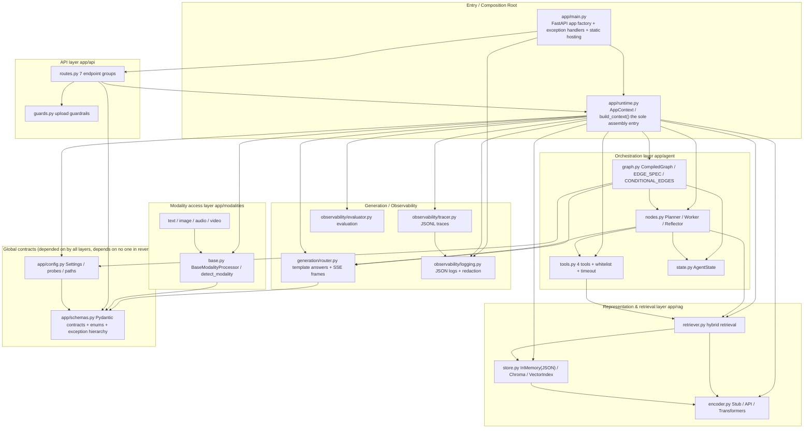
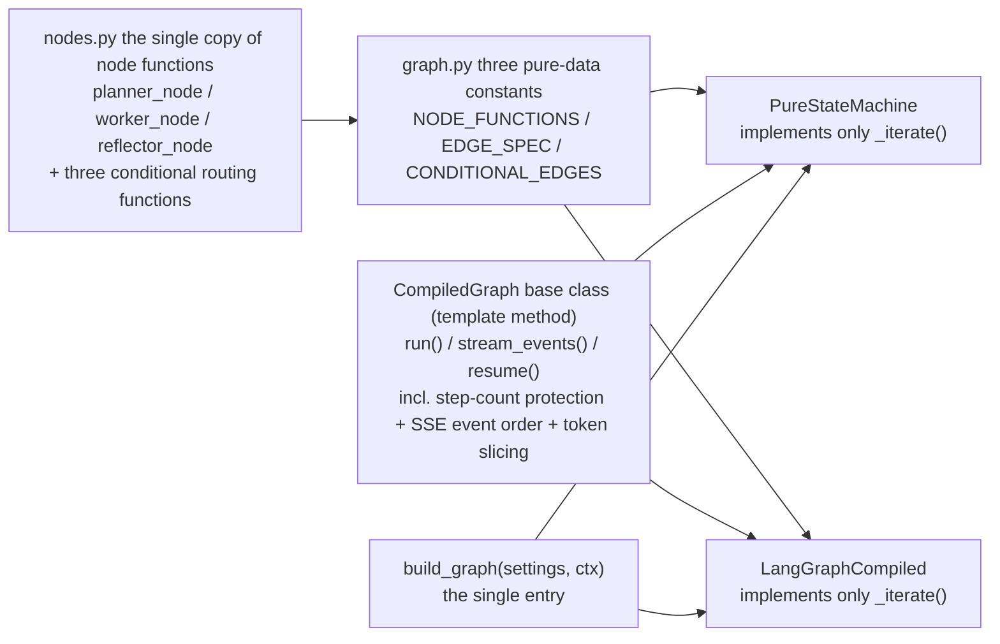
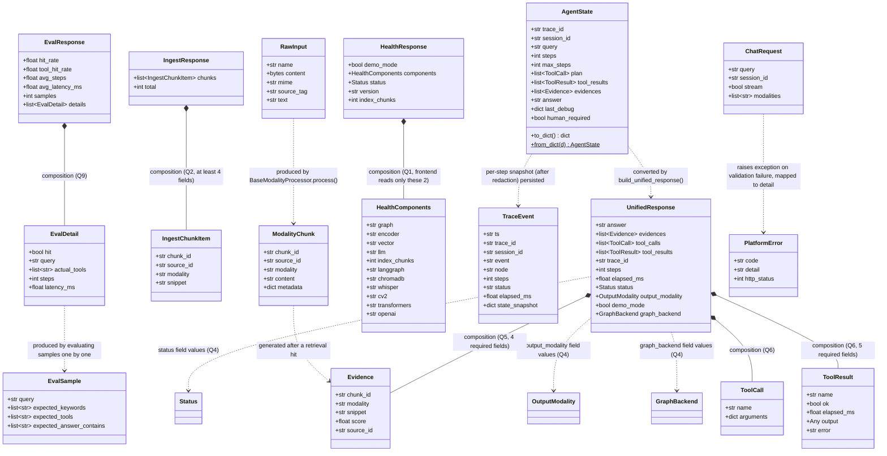
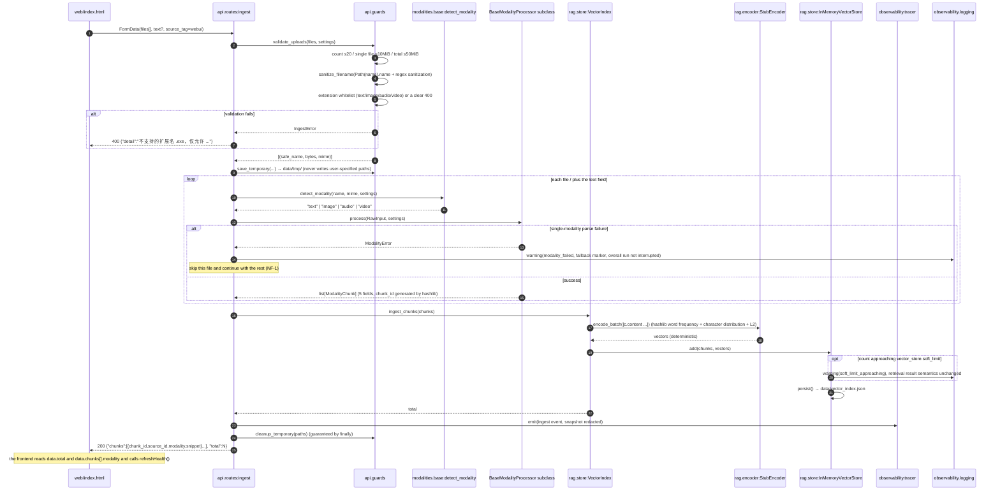

# 多模态通用智能体开发平台 (Multimodal General Agent Development Platform) · System Architecture Design (ARCHITECTURE)

> English translation of [ARCHITECTURE.md](ARCHITECTURE.md). The Chinese version remains the authoritative source. / 中文版为准。

| Item | Value |
| --- | --- |
| Document type | System architecture design + implementation specification (the sole implementation basis for downstream work) |
| Version | v1.0 |
| Author | Architect 高见远 (Gao) |
| Language | English (translated from the Simplified Chinese original) |
| Upstream inputs | `docs/PRD.md` (§1.2 red lines, §4 contracts, §5 non-functional, §7 Q1–Q15), `docs/reference/platform-spec-README.md` (primary contract), `docs/reference/design-project10.md` (secondary), `requirements.txt`, `samples/knowledge.txt`, `web/index.html` |
| Basis of rulings | The lead's (主理人) final decisions on §7 Q1–Q15 + 8 additional hard constraints (fully merged into this document; no further questions asked) |
| Implementation baseline | **Python 3.13 (local machine)** + FastAPI + Pydantic v2 + Uvicorn + vanilla JS (no build tooling); core dependencies restricted to `requirements.txt`, zero new mandatory dependencies |
| Delivery boundary | Full source implemented from scratch on the local machine; **no remote push**; `web/index.html` / `requirements.txt` / `samples/knowledge.txt` zero changes |
| Downstream readers | Engineers (implement in one batch per `docs/TASKS.md`), QA (regression per the §7 quality guard checklist) |

> Relationship between this document and `docs/TASKS.md`: this document answers "what the system looks like, why it is designed this way, and interfaces precise down to the field"; TASKS.md answers "which files to write in what order and how to verify each file after writing". On conflict, **PRD §4 contract red lines** take the highest priority, followed by this document.

---

## 0. Reading Guide and Red-Line Restatement

### 0.1 The seven red lines of "Documentation as Contract" (PRD §1.2, none may be broken)

| # | Red line | Protective measures in this design |
| --- | --- | --- |
| 1 | Path/method/request-field/response-field sets of the 7 REST endpoint groups | §3.6 endpoint contract quick-reference table locks every field; response models only allow "adding optional fields" — deleting, modifying, or renaming is not allowed |
| 2 | Ingest → hybrid retrieval Q&A → SSE → trace replay → automated evaluation sequence and frontend interactions | §4 four sequence diagrams + §5.7 SSE frame specification |
| 3 | `UnifiedResponse` 11 fields, `ModalityChunk` 5 fields, SSE frame format and event order, JSONL trace format | §3.1 Pydantic models + §5.7 + §5.2 |
| 4 | DEMO template answer structure, stub determinism characteristics, hybrid retrieval fallback strategy, evaluation metric definitions | §1.6 / §5.8 / §3.3 |
| 5 | `DEMO_MODE` priority, §4.6 existing configuration key names and values, `.env` override rules | §3.5 full configuration key set + §5.1 three-layer merge |
| 6 | Interfaces called by `web/index.html` and the data formats it consumes remain unchanged character by character | §0.3 frontend fact contract checklist; `web/index.html` zero changes |
| 7 | No auth / no session persistence / no concurrent-write lock must be disclosed as-is; they must not be quietly filled in | §6 assumptions and boundaries + README + startup logs |

**Scope of allowed changes**: fill in missing deliverables; add exception handling, structured logging with redaction, layered configuration validation, tests, performance guardrails, upload safety guardrails, comments and documentation at the internal implementation layer; internal module division and refactoring (§6 — the externally visible parts of the directory stay unchanged).

### 0.2 Landing index of the lead's (主理人) Q1–Q15 rulings (engineers check item by item)

| Ruling | Conclusion summary | Landed in files | Acceptance item |
| --- | --- | --- | --- |
| Q1 | `/health` requires `demo_mode` + `components`; may additionally carry `status`/`version`/`index_chunks` (top level same value as `components.index_chunks`); additional fields do not affect the frontend | `app/api/routes.py`, `app/schemas.py` | §7-A3 |
| Q2 | `/v1/ingest` → `{chunks, total}`; `chunks[]` at least `chunk_id`/`source_id`/`modality`/`snippet`; errors unified as `{"detail":"..."}` | `app/api/routes.py`, `app/schemas.py` | §7-A4 |
| Q3 | Upload guardrails: extension whitelist, single file ≤10 MiB, per-request total ≤50 MiB, ≤20 files, `Path(name).name` + regex sanitization, temporary files in `data/tmp/` + `finally` cleanup, never writing user-specified paths; do not break the frontend `FormData` | `app/api/guards.py`, `config/settings.yaml` | §7-D2 |
| Q4 | `status`∈{ok,degraded,error}; `output_modality`∈{text,image,audio,video,mixed}; `graph_backend`∈{pure,langgraph}; `modalities` default ≡ empty array (= no filtering); `session_id` only passed through to traces | `app/schemas.py`, `app/agent/state.py`, `app/api/routes.py` | §7-A5 |
| Q5 | `evidences[]` requires `chunk_id`/`modality`/`snippet`/`score`; `source_id`/`content` optional additions | `app/schemas.py`, `app/rag/retriever.py` | §7-A6 |
| Q6 | `tool_results[]` requires `name`/`ok`/`elapsed_ms`/`output`/`error` (when there is no error, `error` must still exist, taking `null`/`""`); `tool_calls[]` at least `name`/`arguments` | `app/schemas.py`, `app/agent/tools.py` | §7-A7 |
| Q7 | `/v1/trace/{trace_id}` not found → **HTTP 200** `{"events":[],"count":0}` + warning log; stated in README | `app/api/routes.py`, `app/observability/tracer.py`, `README.md` | §7-A8 |
| Q8 | `/v1/tools` keeps `tools[]` (`name`/`description`/`parameters`), additionally carries `whitelist`/`max_steps`/`tool_timeout_seconds` | `app/api/routes.py`, `app/agent/tools.py` | §7-A9 |
| Q9 | Request `samples`=array, response `samples`=count number (same name, different meanings, preserved); `eval.jsonl` per-line schema fixed; hit determination = all expected keywords appear in the answer **and** `expected_tools ⊆ actual_tools`; all 6 frontend fields present | `app/observability/evaluator.py`, `samples/eval.jsonl`, `app/schemas.py` | §7-A10 |
| Q10 | `human_required` after the `step` requiring human confirmation and before `done`; **no new** REST resume endpoint in this iteration; `resume(state,"approved")` is graph-layer API only, disclosed in README | `app/agent/graph.py`, `app/generation/router.py`, `README.md` | §7-A11 |
| Q11 | Default `agent.max_steps=8`, `agent.tool_timeout_seconds=3.0`, `vector_store.soft_limit=10000` (warning when approaching + `last_debug` annotation, without changing retrieval semantics) | `config/settings.yaml`, `app/rag/store.py`, `app/agent/graph.py`, `app/agent/tools.py` | §7-H5 |
| Q12 | Standard library `logging` + self-written JSON Formatter → stdout; fields `ts`/`level`/`event`/`component`/`trace_id`/`message`; mandatory redaction list; structured exception feedback; stack traces/secrets must never go straight to HTTP; logs not written to third-party services | `app/observability/logging.py`, `app/main.py`, `README.md` | §7-D4 |
| Q13 | `/docs` keeps FastAPI default-on, not listed among the 7 red-line endpoint groups | `app/main.py` | §7-A1 |
| Q14 | `config/settings.yaml` completes the full key set + `config_version: 1`; all keys support environment-variable overrides (**long format uniformly carries the `MAP_` project prefix**: `MAP_<SECTION>__<KEY>`, to avoid misreading host-injected `SERVER__HOST`/`SERVER__PORT`; the spec §4.6 historical short aliases carry no prefix and keep their priority); `DEMO_MODE=1` unconditionally locks `llm_backend=template`/`encoder_backend=stub`/`vector_backend=memory` | `app/config.py`, `config/settings.yaml`, `.env.example` | §7-B1 |
| Q15 | Keep the single-machine demo assumption, no concurrent-write lock, README discloses as-is | `README.md`, `app/rag/store.py` | §7-E3 |

**Landing index of the 8 additional hard constraints**: documentation as contract → whole document; zero new dependencies → §1.2 / §5.2; no redundant graph implementation → §1.5; determinism → §1.6; no insecure configuration → §5.4; frontend zero changes → §0.3; directory structure → §2; `make` unavailable but Makefile still provided → TASKS.md §4.

### 0.3 Frontend fact contract checklist (extracted line by line from `web/index.html`, **must not be changed**)

| Endpoint | Fields the frontend actually reads/sends (established facts) |
| --- | --- |
| `GET /health` | `data.demo_mode`(bool); `data.components.{graph, encoder, vector, llm, index_chunks, langgraph, chromadb, whisper, cv2, transformers, openai}` |
| `POST /v1/ingest` | Sends `FormData`: `files`(multiple allowed), `text`(**append only when non-empty**), `source_tag`(default `webui`); reads `data.total`, `data.chunks[].modality`; reads `data.detail` on error |
| `POST /v1/chat` | Sends `{query, session_id, stream, modalities}` (`stream` default `true`, `modalities` is `[]` or a single-element array); non-streaming calls `renderResult(data)` |
| Non-streaming response | `renderMeta`: `trace_id`/`steps`/`elapsed_ms`/`status`/`output_modality`/`graph_backend`; `renderResult`: `answer`, `evidences[].{modality,score,snippet,chunk_id}`, `tool_results[].{name,ok,elapsed_ms,output,error}` |
| SSE | `parseFrame()` splits frames on `\n\n`, reads `event:` / `data:` line by line and `JSON.parse`s; `meta`→`trace_id`,`backend`; `step`→`steps`,`node`,`next_node`,`status`,`last_observation`; `token`→`delta`; `human_required`→`prompt`; `done`→ the complete `UnifiedResponse` passed directly to `renderResult()` |
| `GET /v1/trace/{id}` | `data.events[].{event,node,steps,status}`, `data.count` |
| `GET /v1/tools` | `data.tools[].{name,description,parameters}` |
| `POST /v1/eval` | Sends `{}`; reads `hit_rate`/`tool_hit_rate`/`avg_steps`/`avg_latency_ms`/`samples`/`details[].{hit,query,actual_tools,steps,latency_ms}`, where `actual_tools.join(",")` **must be an array** |
| Static hosting | `GET /` and `GET /ui/index.html` return `web/index.html` (`text/html`) |

> ⚠️ `data:` lines must be **single-line JSON**. The frontend `parseFrame` accumulates `data:` line contents line by line and then `JSON.parse`s; if indented multi-line JSON or `indent=` is used, the `JSON.parse` failure is swallowed by `catch` into `data={}`, leaving the panel silently blank with no error whatsoever. See §5.7 for details.

---

## 1. Implementation Plan and Framework Selection

### 1.1 Core difficulties and countermeasures

| # | Difficulty | Countermeasure | Landed in |
| --- | --- | --- | --- |
| D1 | **Zero-dependency end-to-end runnability**: no model weights/API keys/GPU/network may be used, yet four modalities + RAG + Agent + SSE + evaluation must all run | The unified abstraction layer `ModalityChunk` converts image/audio/video into **descriptive text** (color grid / perceptual fingerprint / WAV metadata / frame-extraction description), sharing the same `StubEncoder` + `InMemoryVectorStore` as text; all optional backends degrade via `importlib.util.find_spec` + `try/except ImportError` | `app/modalities/*`, `app/rag/encoder.py`, `app/config.py` |
| D2 | **Deterministic reproducibility**: retrieval results, tool choices, and evaluation hit rates must be identical across repeated runs of the same input | Python's built-in `hash()` is disabled (PYTHONHASHSEED randomization); `StubEncoder` uses `hashlib.sha256` word-frequency bucketing + character distribution + L2 normalization; `chunk_id` uses a `hashlib` content hash; degraded video frames use `hashlib.sha256(content)[:8]` as the `numpy.random.default_rng(seed)` seed | §1.6 |
| D3 | **Zero-redundancy graph orchestration**: `PureStateMachine` and `LangGraphCompiled` must not contain two sets of business logic | Three **pure-data** constants `EDGE_SPEC` / `CONDITIONAL_EDGES` / `NODE_FUNCTIONS` + the single copy of node functions in `nodes.py`; the `CompiledGraph` base class unifies `run()` / `stream_events()` / `resume()` (including SSE event order) via the **template method**; subclasses implement only the single difference point `_iterate()` | §1.5, `app/agent/graph.py` |
| D4 | **Zero contract drift**: frontend zero changes, all 11 fields present, SSE frame format byte-for-byte compatible | Pydantic models centrally defined in `app/schemas.py`; `UnifiedResponse` uses explicit fields (no `extra="allow"` for free-form additions/deletions beyond the structure); non-streaming and SSE `done` are **produced by the same `build_unified_response()`**, naturally with identical field sets | `app/schemas.py`, `app/generation/router.py` |
| D5 | **Enterprise cross-cutting concerns without touching the contract**: exceptions / log redaction / upload guardrails / layered configuration / performance guardrails are all internal increments | Exception handlers and middleware attach at the FastAPI application layer; redaction funnels uniformly through three exits: "log Formatter + before trace persistence + HTTP response construction"; upload guardrails validate up front in `guards.py` without changing `FormData` fields | Whole of §5 |
| D6 | **Optional dependency detection ≠ enablement**: `components.langgraph` reporting `native` does not mean langgraph is enabled | Detection results (`native`/`fallback`) and the "effective backend" (`pure`/`langgraph`) are two independent data flows; under DEMO, even with langgraph installed, `pure` is forced | §1.7, `app/runtime.py` |
| D7 | **Agent runaway protection**: max steps / tool whitelist / per-tool timeout / human breakpoint | Step-count protection in the `CompiledGraph` base class (forces convergence into Reflector when exceeded); `ToolRegistry` whitelist + `ThreadPoolExecutor` + `future.result(timeout=...)`; the `HUMAN_IN_LOOP` breakpoint is resumable only at the graph layer | `app/agent/graph.py`, `app/agent/tools.py` |

### 1.2 Technology selection and the "must not introduce" list

**Core tech stack (locked, must not change)**

| Layer | Selection | Rationale |
| --- | --- | --- |
| Web framework | FastAPI ≥0.110 + Uvicorn ≥0.27 | Specified by contract; native `StreamingResponse` supports SSE, `UploadFile` + `Form` support multipart, `/docs` on by default (Q13) |
| Data validation | Pydantic v2 | Specified by contract; centrally carries the contract models such as `UnifiedResponse` (11 items) |
| Numerics | numpy ≥1.24 | `StubEncoder` vectors, cosine similarity, color grid, degraded synthetic frames |
| Image | Pillow ≥10.0 (+ numpy) | Image normalization and color grid / perceptual fingerprint; no model inference in DEMO |
| Video | opencv-python-headless ≥4.8 (cv2) | Core dependency, frame extraction; falls back to deterministic synthetic frames when undecodable |
| Audio | standard library `wave` | Only parses PCM WAV metadata; no decoding library introduced |
| Configuration | PyYAML ≥6.0 + standard library `os` | `config/settings.yaml` + environment variables / `.env` |
| HTTP client | httpx ≥0.27 | Production mode connects directly to OpenAI-compatible endpoints (**does not depend on the `openai` SDK**); in DEMO **no requests of any kind may be issued** |
| Frontend | vanilla JS single page (`web/index.html`) | Specified by contract, no build tooling, same-origin hosting |
| Testing | pytest ≥8.0 + `fastapi.testclient.TestClient` | Specified by contract; `make demo` uses `TestClient` to smoke-test all endpoints |
| Logging | standard library `logging` + self-written `JsonFormatter` | Q12; not written to third-party services |

> **🚫 Libraries absolutely forbidden in `import` statements** (not in `requirements.txt`; importing one is a contract breach):
> `python-dotenv` (`.env` uses a self-written minimal parser, see §5.1), `jsonschema` (tool argument validation is self-written, see §3.3), top-level hard imports of `langchain`/`langgraph` (only `find_spec` + a local `try/except ImportError` allowed), top-level hard imports of `chromadb`/`whisper`/`transformers`/`torch`/`openai` (same as above), and any use of `eval`/`exec` in the calculator.
> **The only legal usage pattern for optional dependencies**:
> ```python
> spec = importlib.util.find_spec("langgraph")
> if spec is not None:
>     try:
>         from langgraph.graph import StateGraph   # local import, must be inside try
>         ...
>     except ImportError:
>         ...  # mark fallback, never re-raise upward
> ```

### 1.3 Layered architecture and dependency direction



**Dependency direction iron rules (preventing circular imports)**

1. `app/config.py` and `app/schemas.py` are the lowest layer and **must not import any `app.*` business modules**.
2. The five business sub-packages allow **one-way dependencies only**: `rag → {config, schemas}` (**`rag` does not import `modalities`**; the `TextProcessor` needed to bootstrap an empty index is injected at runtime by the composition root via `ensure_bootstrap(text_processor)`), `agent → rag` (through the `HybridRetriever` abstraction), `generation → schemas`; `observability` depends only on `config`/`schemas` and state-dict snapshots (use `TYPE_CHECKING` or `Protocol`; no hard imports of concrete classes). Therefore **`app/modalities/` (T02) and `app/rag/`+`app/agent/`+`app/generation/` (T03) do not import each other at the code level and can be written in parallel; both hard-depend only on T01**.
3. `app/api/routes.py` **must not import `app.main`**; endpoints obtain the composition root via `request.app.state.ctx` (avoiding cycles).
4. When `nodes.py` needs the composition root, annotate parameter types with `TYPE_CHECKING` + string annotations or `Protocol`; **do not import `app.runtime` at runtime**.
5. The only module allowed to "know everyone" is `app/runtime.py`; the only modules allowed to "be imported by everyone" are `app/config.py` / `app/schemas.py`.

### 1.4 Architecture patterns

| Pattern | Applied at | Notes |
| --- | --- | --- |
| **Composition Root** | `app/runtime.py::build_context()` | The single assembly point of the whole process; `app/main.py`, `scripts/demo.py`, `tests/conftest.py` reuse the same assembly logic instead of each newing its own dependencies |
| **Abstract Factory / Strategy** | `build_encoder()`, `build_store()`, `build_graph()` | Switching backends changes only configuration, not the orchestration/generation layers |
| **Template Method** | `CompiledGraph` (base class implements `run`/`stream_events`/`resume`; subclasses implement only `_iterate`) | Guarantees zero business-logic duplication across the two graph backends |
| **Adapter** | `LangGraphCompiled`, `ChromaVectorStore`, `APIEncoder` | Adapts external libraries to the platform's single interface |
| **DTO / contract models** | `app/schemas.py` | The single cross-layer data contract; `ModalityChunk` is the only cross-modality carrier |
| **Layered exception handling** | `PlatformError` subclass tree + FastAPI `exception_handler` | Domain exceptions → unified `{"detail": ...}`; stack traces go only to logs |

### 1.5 No-redundancy design: single composition root + single graph interface (implementation of hard constraint 3)



**Mandatory conventions**

- `NODE_FUNCTIONS: dict[str, Callable[[AgentState, AppContext], AgentState]]`, `EDGE_SPEC: dict[str, str]`, `CONDITIONAL_EDGES: dict[str, tuple[Callable, dict[str, str]]]` must be **module-level pure-data constants**; both graph backends read from these three constants and must not hardcode node order or edges themselves.
- The three node functions in `nodes.py` are **pure functions** (`state in → state out`); they hold no state and do not directly write logs/traces/SSE; side effects are uniformly handled by the `CompiledGraph` base class and the external `AgentTracer`, so that both backends behave identically.
- The difference between `PureStateMachine._iterate()` and `LangGraphCompiled._iterate()` **may only** be "how to drive nodes according to `EDGE_SPEC`/`CONDITIONAL_EDGES`"; both produce streams of `AgentState` snapshots; **forbidden** in subclasses: generating SSE events, assembling answers, executing tools, or writing traces.
- `build_graph()` is the **single entry** for creating graph instances, and `CompiledGraph` is the **single interface** exposed externally; no module may directly instantiate `PureStateMachine(...)` or `LangGraphCompiled(...)`.
- If the `LangGraphCompiled` constructor throws any exception (version incompatibility, StateGraph API changes, etc.), `build_graph()` must catch it → log a warning → fall back to `PureStateMachine` → mark `fallback` in `fallback_flags` and `/health.components.langgraph`, **never crash**.

### 1.6 Determinism design (hard constraint 4)

| Scenario | Provision |
| --- | --- |
| All DEMO branches | **Python's built-in `hash()` is disabled**; always `hashlib.sha256` / `sha1`; when globally searching `hash(`, only `hashlib`-related calls may appear |
| `chunk_id` | `"chk_" + hashlib.sha256(f"{source_id}|{modality}|{index}|{content}".encode("utf-8")).hexdigest()[:16]` |
| `StubEncoder` | Tokenization (Chinese per character + English per word, regex `[\u4e00-\u9fff]|[a-zA-Z0-9]+`) → `int(sha256(token)[:8],16) % dim` accumulates word frequency → append character-distribution buckets → `numpy.linalg.norm` L2 normalization; fixed `dim=256`; zero vectors return all zeros rather than NaN |
| Degraded video frames | `seed = int.from_bytes(hashlib.sha256(raw_content).digest()[:8], "big")`; `rng = numpy.random.default_rng(seed)`; the synthetic frame then goes through the same pipeline as `ImageProcessor` |
| Retrieval ordering | When scores tie, `chunk_id` lexicographic order serves as the stable secondary sort key; `dict` iteration order never influences results |
| Sets / dedup | Use ordered `list` + `set` as an aid; final output is sorted by a fixed key; using `set` to directly decide output order is forbidden |
| `current_time` tool | The only non-deterministic source, but its **output does not participate in hit determination**; the determinism scope is limited to "retrieval results, tool choices, template structure, evaluation hit rate / average steps"; time strings and `elapsed_ms`/`ts` are observational metadata and do not enter these scopes (see §6-U2) |
| `trace_id` | `"tr_" + hashlib.sha256(f"{monotonic_ns}|{query}|{session_id}").hexdigest()[:16]` or `uuid4`; **not required to be identical run to run**, but globally unique within one request and threading through logs/traces/responses |

### 1.7 DEMO_MODE lock matrix (Q14 + PRD §4.5)

| Configuration item | `DEMO_MODE=1` | `DEMO_MODE=0` |
| --- | --- | --- |
| `llm.backend` | **Unconditionally locked to `template`** | `api` \| `template` (auto `template` without a key) |
| `encoder.backend` | **Unconditionally locked to `stub`** | `api` \| `transformers` \| `stub` |
| `vector_store.backend` | **Unconditionally locked to `memory`** | `chroma` \| `memory` |
| `graph` effective backend | **Forced to `pure`** (PRD §4.5-8 "graph orchestration PureStateMachine") | `langgraph` if available, otherwise `pure` |
| `/health.components.langgraph` and 5 others | Still truthfully report `native`/`fallback` (= detection result, **does not mean enabled**) | Same as left |
| httpx external requests | **0 times**, even if `LLM_API_KEY`/`LLM_BASE_URL`/`LLM_MODEL` are configured | Allowed only in production mode with explicit `backend=api` |
| Model weights | No `torch`/`transformers` loading, no CUDA calls | `transformers` loads only from the local directory `encoder.local_model_path` with `local_files_only=True` |
| Optional dependencies | Only `find_spec` probing + `try/except ImportError` degradation, never crash | Same as left |

> Implementation-order requirement: `get_settings()` must first merge YAML → `.env` → `os.environ`, and only as the **last step** apply the DEMO lock (overwriting the three fields), ensuring that "even if `.env` contains `LLM_API_KEY`/`LLM_BACKEND=api`, the effective backends remain `template`/`stub`/`memory`" (P0-10 acceptance). The lock happens at the configuration layer, not in each backend individually.

---

## 2. Complete File List

> Status: 🆕 newly created in this iteration (**45 files**)｜🔒 already exists and **zero changes** (5)｜📄 design documents of this round (2, not source code)
> The "Task" column corresponds to T01–T05 in `docs/TASKS.md`.

### 2.1 Project root and configuration (10 🆕 + 3 🔒)

| Relative path | Responsibility | Task | Status |
| --- | --- | --- | --- |
| `requirements.txt` | Core dependency baseline; verify only, **must not be changed** (contains the "Python 3.11 sandbox" historical comment, see §6-U1) | T01 | 🔒 |
| `Makefile` | The four targets `demo` / `test` / `run` / `eval`, commands verbatim identical to spec §2 | T01 | 🆕 |
| `.env.example` | **Placeholders only** (empty values such as `LLM_API_KEY=`, `LLM_BASE_URL=` + comments); no real credentials of any kind may appear | T01 | 🆕 |
| `.gitignore` | Covers `.env`, `data/`, `__pycache__/`, `*.py[cod]`, `.pytest_cache/`, `*.egg-info/` | T01 | 🆕 |
| `config/settings.yaml` | Main configuration with the complete key set + `config_version: 1` (§3.5) | T01 | 🆕 |
| `README.md` | Quick start, architecture, known limitations, no-auth disclosure, HOST override risk, Q7/Q10/Q15 disclosures | T05 | 🆕 |
| `samples/knowledge.txt` | Built-in retrieval knowledge, auto-bootstrapped on empty-index startup; **zero changes** | T02 | 🔒 |
| `samples/eval.jsonl` | Self-built 8 evaluation samples, each line strictly following the §3.5-A schema | T04 | 🆕 |
| `web/index.html` | Vanilla JS single-page console; **zero changes** (source of the frontend fact contract) | — | 🔒 |
| `data/.gitkeep` | Runtime directory placeholder; `data/` is auto-created by `resolve_paths()` | T05 | 🆕 |
| `data/tmp/.gitkeep` | Upload temp directory placeholder, cleaned in `finally` | T05 | 🆕 |

### 2.2 `app/` root (5 🆕)

| Relative path | Responsibility | Task | Status |
| --- | --- | --- | --- |
| `app/__init__.py` | `__version__ = "1.0.0"` (for `/health.version`) | T01 | 🆕 |
| `app/config.py` | `Settings` model, three-layer configuration merge, DEMO lock, self-written `.env` parsing, optional dependency probing, `resolve_paths()`, startup validation | T01 | 🆕 |
| `app/schemas.py` | All Pydantic contract models, three enums, unified exception hierarchy, `SSEFrame` utilities | T01 | 🆕 |
| `app/main.py` | `create_app()` FastAPI app factory (exception handlers / static hosting / lifespan / router registration / `/docs` default-on), `app = create_app()`, `__main__` branch supporting `HOST`/`PORT` | T01 | 🆕 |
| `app/runtime.py` | **Composition root**: `AppContext` dataclass + `build_context()` as the sole assembly entry (no FastAPI side effects) | T04 | 🆕 |

### 2.3 `app/modalities/` (6 🆕)

| Relative path | Responsibility | Task |
| --- | --- | --- |
| `app/modalities/__init__.py` | Exports the `PROCESSORS` mapping (`modality → processor class`) | T02 |
| `app/modalities/base.py` | `RawInput`, `BaseModalityProcessor`(ABC), `detect_modality()`, `MODALITY_BY_EXT`, `make_chunk_id()` (hashlib), `build_chunk()` | T02 |
| `app/modalities/text.py` | `TextProcessor`: cleaning + fixed-length overlapping slicing (`chunk_size`/`chunk_overlap`) | T02 |
| `app/modalities/image.py` | `ImageProcessor`: Pillow normalization to 32×32 → numpy 4×4 color grid + perceptual fingerprint → descriptive-text `content` | T02 |
| `app/modalities/audio.py` | `AudioProcessor`: `wave` parses PCM WAV metadata + `hashlib` deterministic placeholder ASR; optional whisper fallback | T02 |
| `app/modalities/video.py` | `VideoProcessor`: cv2 evenly-spaced frame extraction (≤3 frames) reusing `ImageProcessor`; when undecodable, content hash → `default_rng(seed)` synthetic frames; metadata with timestamps | T02 |

### 2.4 `app/rag/` (4 🆕)

| Relative path | Responsibility | Task |
| --- | --- | --- |
| `app/rag/__init__.py` | Exports `build_encoder` / `build_store` / `HybridRetriever` | T03 |
| `app/rag/encoder.py` | `BaseEncoder`(ABC), `StubEncoder`, `APIEncoder`(httpx), `TransformersEncoder`(local `local_files_only=True`), `build_encoder()` factory with degradation | T03 |
| `app/rag/store.py` | `VectorStore`(ABC), `InMemoryVectorStore`(numpy brute-force cosine + JSON persistence + corruption recovery), `ChromaVectorStore`(optional), `VectorIndex`(encode+store+soft-limit warning+empty-index bootstrap) | T03 |
| `app/rag/retriever.py` | `HybridRetriever`: dense cosine + simplified BM25 + weighted fusion + reranking (substring-hit boost / same-source dedup) + pure-keyword fallback on all-zero/no results; produces `Evidence[]` and `last_debug` | T03 |

### 2.5 `app/agent/` (5 🆕) + `app/generation/` (2 🆕)

| Relative path | Responsibility | Task |
| --- | --- | --- |
| `app/agent/__init__.py` | Exports `build_graph` / `CompiledGraph` | T03 |
| `app/agent/state.py` | `AgentState` dataclass + `to_dict()` / `from_dict()` (serializable snapshot, redacted before tracer persistence) | T03 |
| `app/agent/tools.py` | `BaseTool`(ABC), 4 built-in tools, `ToolRegistry` (whitelist / JSON Schema / self-written argument validation / `ThreadPoolExecutor` timeout), `calculator` with restricted AST | T03 |
| `app/agent/nodes.py` | **The single copy of** `planner_node` / `worker_node` / `reflector_node` + the `route_after_planner/worker/reflector` conditional functions (pure functions) | T03 |
| `app/agent/graph.py` | The three constants `NODE_FUNCTIONS` / `EDGE_SPEC` / `CONDITIONAL_EDGES`, the `CompiledGraph` base class template method, `PureStateMachine`, `LangGraphCompiled`, `build_graph()` as the single entry | T03 |
| `app/generation/__init__.py` | Exports `synthesize_answer` / `build_unified_response` / `format_sse` | T03 |
| `app/generation/router.py` | `route_output()`, `synthesize_answer()` (four-part template / production LLM fallback), `build_unified_response()` (**the single exit for the 11 fields**), `format_sse()`, `slice_tokens()`, `LAST_DEBUG` aggregation | T03 |

### 2.6 `app/observability/` (4 🆕) + `app/api/` (3 🆕)

| Relative path | Responsibility | Task |
| --- | --- | --- |
| `app/observability/__init__.py` | Package initialization | T01 |
| `app/observability/logging.py` | `JsonFormatter`, `RedactFilter`, `configure_logging()`, `get_logger()`, `TraceLoggerAdapter`, the public redaction functions `redact_text()` / `redact_snapshot()` | T01 |
| `app/observability/tracer.py` | `AgentTracer.emit()` appends to `data/traces.jsonl`, `replay(trace_id)`, snapshot redaction; **returns an empty list when not found**, converted to 200 by the routes layer | T04 |
| `app/observability/evaluator.py` | `Evaluator.load_samples()` / `evaluate()` / `evaluate_one()`; `python3 -m app.observability.evaluator` prints the report and persists `data/eval_report.json` | T04 |
| `app/api/__init__.py` | Exports `router` | T04 |
| `app/api/guards.py` | `sanitize_filename()`, `validate_uploads()`, `save_temporary()` / `cleanup_temporary()`; extension/MIME whitelist, size/count limits, path-traversal protection | T04 |
| `app/api/routes.py` | 7 REST endpoint groups (§3.6) + `/health` component report + SSE `StreamingResponse` (`try/finally` release) + trace-not-found 200 empty set | T04 |

### 2.7 `scripts/` (2 🆕) + `tests/` (6 🆕)

| Relative path | Responsibility | Task |
| --- | --- | --- |
| `scripts/__init__.py` | Package initialization | T04 |
| `scripts/demo.py` | `make demo` entry: **does not start a server**, calls `build_context()` to self-generate the four sample resources + ingest four modalities + Agent run + `TestClient` smoke-test of all API endpoints | T04 |
| `tests/__init__.py` | Package initialization | T05 |
| `tests/conftest.py` | `DEMO_MODE=1` fixed fixture, `build_context()` isolated fixture (temporary `data/`), `TestClient` fixture, four-modality sample resource generator | T05 |
| `tests/test_modalities.py` | Four-modality access / determinism / single-modality failure isolation / unknown extensions | T05 |
| `tests/test_rag.py` | StubEncoder determinism, hybrid retrieval hits, all-zero fallback, JSON persistence and corruption recovery, soft limit | T05 |
| `tests/test_agent.py` | Three nodes, 4 tools success and failure, restricted AST, whitelist, timeout, max_steps, behavioral equivalence of both graph backends, `resume()` | T05 |
| `tests/test_api.py` | 7 endpoint group contracts, SSE frame sequence and `done` field completeness, trace-not-found 200, eval field completeness, DEMO lock, redaction, upload guardrails | T05 |

### 2.8 Design documents (2 📄, produced this round, not source code)

| Relative path | Responsibility |
| --- | --- |
| `docs/ARCHITECTURE.md` | This document |
| `docs/TASKS.md` | Ordered task list, dependency graph, acceptance criteria |

> **Statistics**: 45 new files of source code/configuration/documentation to implement; 3 already-existing source-related files with zero changes (`requirements.txt`, `samples/knowledge.txt`, `web/index.html`) + 2 reference documents; 2 design documents added this round. The project source tree totals **50 files**.
> **Directory structure**: strictly keep the spec §6 layout of `app/{modalities,rag,agent,generation,observability,api}`, `tests`, `scripts`, `config`, `samples`, `web`, `data`; under `app/` only `runtime.py` is added as a single **internal assembly module** (the "internal module division and refactoring" allowed by PRD §1.2 — the six externally visible sub-packages and the top-level directories have zero additions/deletions/renames); rationale in §1.3–1.4: the composition root must be reusable side-effect-free by `scripts/demo.py` / `tests/conftest.py`, whereas `app/main.py` carries FastAPI side effects and is unsuitable for that role.

---

## 3. Core Data Structures and Interfaces

### 3.1 Pydantic contract models (`app/schemas.py`)

> All response models declare fields explicitly; the fields marked "contract" in the table below **must not be deleted, modified, or renamed**. Optional additional fields are only allowed as "new additions" and must not alter the frontend's existing consumption paths.

| Model | Fields (types) | Notes / Source |
| --- | --- | --- |
| `ModalityType`(str Enum) | `TEXT="text"`, `IMAGE="image"`, `AUDIO="audio"`, `VIDEO="video"` | Contract; values of `ModalityChunk.modality` |
| `Status`(str Enum) | `OK="ok"`, `DEGRADED="degraded"`, `ERROR="error"` | **Q4**; also used for `/health.status` |
| `OutputModality`(str Enum) | `TEXT`, `IMAGE`, `AUDIO`, `VIDEO`, `MIXED` | **Q4** |
| `GraphBackend`(str Enum) | `PURE="pure"`, `LANGGRAPH="langgraph"` | **Q4** |
| `ModalityChunk` | `chunk_id:str`, `source_id:str`, `modality:str`, `content:str`, `metadata:dict[str,Any]` | **Contract, 5 fields** (PRD §1.2-3), not one character changed |
| `RawInput` | `name:str`, `content:bytes`, `mime:str`, `source_tag:str`, `text:str\|None=None` | Modality-access layer internal input |
| `IngestChunkItem` | `chunk_id:str`, `source_id:str`, `modality:str`, `snippet:str` | **Q2**; `snippet` = first `retrieval.snippet_chars` characters of `content` |
| `IngestResponse` | `chunks:list[IngestChunkItem]`, `total:int` | **Q2**; top level carries only these two fields |
| `ChatRequest` | `query:str`, `session_id:str="default"`, `stream:bool=True`, `modalities:list[str]=Field(default_factory=list)` | **Q4**: default and `[]` are equivalent; `query` length cap validated at the route layer via `agent.max_query_chars` |
| `Evidence` | `chunk_id:str`, `modality:str`, `snippet:str`, `score:float` **required**; `source_id:str\|None=None` optional | **Q5**; this design only adds `source_id`, not `content` (smaller response body, not consumed by the frontend) |
| `ToolCall` | `name:str`, `arguments:dict[str,Any]` **required**; `id:str\|None=None` optional | **Q6** |
| `ToolResult` | `name:str`, `ok:bool`, `elapsed_ms:float`, `output:Any`, `error:str\|None=None` | **Q6**: the `error` field **always exists**, `null` on success; frontend `r.ok ? JSON.stringify(r.output) : r.error` |
| `UnifiedResponse` | `answer:str`, `evidences:list[Evidence]`, `tool_calls:list[ToolCall]`, `tool_results:list[ToolResult]`, `trace_id:str`, `steps:int`, `elapsed_ms:float`, `status:Status`, `output_modality:OutputModality`, `demo_mode:bool`, `graph_backend:GraphBackend` | **Contract, 11 fields**; produced solely by `build_unified_response()`, shared by non-streaming and SSE `done` |
| `MetaEventData` | `trace_id:str`, `backend:str` | SSE `meta` |
| `StepEventData` | `steps:int`, `node:str`, `next_node:str`, `status:str`, `last_observation:str` | SSE `step`; on the final node `next_node` is filled with `"done"` / `""` |
| `TokenEventData` | `delta:str` | SSE `token` |
| `HumanRequiredEventData` | `prompt:str` | SSE `human_required` (Q10) |
| `HealthComponents` | `graph:str`, `encoder:str`, `vector:str`, `llm:str`, `index_chunks:int`, `langgraph:str`, `chromadb:str`, `whisper:str`, `cv2:str`, `transformers:str`, `openai:str` | The frontend reads each of the 11 items; not one may be missing |
| `HealthResponse` | `demo_mode:bool`, `components:HealthComponents` **required**; `status:Status`, `version:str`, `index_chunks:int` additional; `configured_backends:dict[str,str] \| None` (**production mode only**) | **Q1**; top-level `index_chunks` same value as `components.index_chunks`; in DEMO `configured_backends=None` is dropped by `exclude_none=True`, so **the key does not even exist in the response**; open-source badges/version/license/repo info must never be written into `/health` (documentation-consistency note, not a contract change) |
| `ToolsResponse` | `tools:list[ToolDescriptor]`, `whitelist:list[str]`, `max_steps:int`, `tool_timeout_seconds:float` | **Q8**; `ToolDescriptor{name,description,parameters:dict}` |
| `TraceEvent` | `ts:str`, `trace_id:str`, `session_id:str`, `event:str`, `node:str`, `steps:int`, `status:str`, `elapsed_ms:float`, `state_snapshot:dict` (after redaction) | The frontend consumes `event`/`node`/`steps`/`status`; one JSON object per JSONL line |
| `TraceResponse` | `events:list[dict]`, `count:int` | **Q7**; not found → `{"events":[],"count":0}` |
| `EvalSample` | `query:str`, `expected_keywords:list[str]`, `expected_tools:list[str]`, `expected_answer_contains:list[str]` | **Q9** per-line schema of `samples/eval.jsonl` |
| `EvalRequest` | `samples:list[EvalSample]\|None=None` | **Q9**: request `samples` is an array; the frontend sends `{}` |
| `EvalDetail` | `hit:bool`, `query:str`, `actual_tools:list[str]`, `steps:int`, `latency_ms:float` | **Q9**: `actual_tools` **must be an array** (frontend `.join(",")`) |
| `EvalResponse` | `hit_rate:float`, `tool_hit_rate:float`, `avg_steps:float`, `avg_latency_ms:float`, `samples:int`, `details:list[EvalDetail]` | **Q9**: response `samples` is a **count number** |

**Unified exception hierarchy** (also placed in `app/schemas.py` to avoid adding an app-level module)

| Exception | `http_status` | Trigger scenario |
| --- | --- | --- |
| `PlatformError(Exception)` | 500 | Base class, carries `code:str` / `detail:str` / `http_status:int` |
| `ConfigError` | 500 | Invalid configuration key name / value domain / path (at startup) |
| `IngestError` | 400 | Extension not in whitelist, over limit, invalid filename, single-modality parse failure |
| `ModalityError` | 400 | Single-file parse failure (caught by ingest as "skip this file" with degradation) |
| `ToolError` | 200 (business layer) | Unregistered tool / argument validation failure → converted to `ToolResult(ok=False)`, **not raised to the HTTP layer** |
| `ToolTimeoutError` | 200 (business layer) | `future.result` timeout → converted to `ToolResult(ok=False, error="tool timeout")` |
| `IndexCorruptedError` | 200 (internal) | `vector_index.json` corrupted → clear and rebuild + warning log, **not raised to the HTTP layer** |

### 3.2 Service-class interface signatures (engineers implement exactly as written)

```python
# ---- app/config.py ----
class Settings(BaseModel):
    config_version: int
    server: ServerCfg; demo: DemoCfg; llm: LLMCfg; encoder: EncoderCfg
    vector_store: VectorStoreCfg; retrieval: RetrievalCfg; ingest: IngestCfg
    agent: AgentCfg; observability: ObservabilityCfg; eval: EvalCfg

def get_settings() -> Settings: ...                 # three-layer merge + DEMO lock last + validation
def load_dotenv_simple(path: Path) -> dict[str, str]: ...   # self-written, see §5.1
def probe_optional_dependencies() -> dict[str, str]: ...   # -> {"langgraph": "native"|"fallback", ...} 6 items
def resolve_paths() -> Paths: ...                  # PROJECT_ROOT / DATA_DIR / TMP_DIR / WEB_DIR / ... auto mkdir
def env_override(section: str, key: str) -> str | None: ... # MAP_<SECTION>__<KEY> prefixed long format + historical short aliases

# ---- app/runtime.py ----
@dataclass
class AppContext:
    settings: Settings; paths: Paths; probes: dict[str, str]
    encoder: BaseEncoder; store: VectorStore; index: VectorIndex
    retriever: HybridRetriever; tools: ToolRegistry; graph: CompiledGraph
    tracer: AgentTracer; evaluator: Evaluator; generator: AnswerGenerator
    graph_backend: str; fallback_flags: list[str]; started_at: float

def build_context(settings: Settings | None = None) -> AppContext: ...  # the sole assembly entry, no FastAPI side effects

# ---- app/modalities/base.py ----
class BaseModalityProcessor(ABC):
    modality: str
    @abstractmethod
    def process(self, raw: RawInput, settings: Settings) -> list[ModalityChunk]: ...
def detect_modality(name: str, mime: str, settings: Settings) -> str: ...   # extension first, MIME as fallback
def make_chunk_id(source_id: str, modality: str, index: int, content: str) -> str: ...  # hashlib

# ---- app/rag/encoder.py ----
class BaseEncoder(ABC):
    dim: int
    @abstractmethod
    def encode(self, text: str) -> list[float]: ...
    def encode_batch(self, texts: list[str]) -> list[list[float]]: ...
def build_encoder(settings: Settings, ctx_partial) -> BaseEncoder: ...  # factory + fallback marker

# ---- app/rag/store.py ----
class VectorStore(ABC):
    @abstractmethod
    def add(self, chunks: list[ModalityChunk], vectors: list[list[float]]) -> int: ...
    @abstractmethod
    def search(self, vector: list[float], top_k: int, modalities: list[str]) -> list[tuple[ModalityChunk, float]]: ...
    @abstractmethod
    def count(self) -> int: ...
    @abstractmethod
    def persist(self) -> None: ...
    @abstractmethod
    def load(self) -> None: ...
class VectorIndex:
    def __init__(self, encoder: BaseEncoder, store: VectorStore, settings: Settings, paths: Paths): ...
    def ingest_chunks(self, chunks: list[ModalityChunk]) -> int: ...
    def ensure_bootstrap(self, text_processor) -> None: ...  # composition root injects TextProcessor, bootstraps knowledge.txt on empty index
    def count(self) -> int: ...

# ---- app/rag/retriever.py ----
class HybridRetriever:
    def __init__(self, index: VectorIndex, settings: Settings): ...
    def retrieve(self, query: str, modalities: list[str], top_k: int = 5
                 ) -> tuple[list[Evidence], dict[str, Any]]: ...  # (evidences, last_debug)
    # last_debug.strategy ∈ {"hybrid", "keyword_fallback", "empty"}
    # last_debug.soft_limit_warning: bool (True when approaching the soft limit, retrieval semantics unchanged)

# ---- app/agent/state.py ----
@dataclass
class AgentState:
    trace_id: str; session_id: str; query: str; steps: int; max_steps: int
    plan: list[ToolCall]; tool_calls: list[ToolCall]; tool_results: list[ToolResult]
    evidences: list[Evidence]; answer: str; status: str; node: str; next_node: str
    last_observation: str; last_debug: dict[str, Any]; human_required: bool
    pending_step: str | None; fallback_flags: list[str]; elapsed_ms: float
    def to_dict(self) -> dict[str, Any]: ...
    @classmethod
    def from_dict(cls, d: dict[str, Any]) -> "AgentState": ...

# ---- app/agent/tools.py ----
class BaseTool(ABC):
    name: str; description: str; parameters: dict[str, Any]
    @abstractmethod
    def run(self, **kwargs) -> Any: ...
class ToolRegistry:
    def __init__(self, retriever: HybridRetriever, settings: Settings): ...
    def register(self, tool: BaseTool) -> None: ...
    def whitelist(self) -> list[str]: ...
    def describe(self) -> list[ToolDescriptor]: ...
    def invoke(self, name: str, arguments: dict[str, Any]) -> ToolResult: ...  # whitelist+validation+timeout+elapsed_ms
    def shutdown(self) -> None: ...

# ---- app/agent/graph.py ----
NODE_FUNCTIONS: dict[str, Callable[[AgentState, AppContext], AgentState]]
EDGE_SPEC: dict[str, str]
CONDITIONAL_EDGES: dict[str, tuple[Callable[[AgentState], str], dict[str, str]]]
class CompiledGraph(ABC):
    def __init__(self, ctx: AppContext): ...
    @abstractmethod
    def _iterate(self, state: AgentState) -> Iterator[AgentState]: ...   # the sole subclass difference point
    def run(self, state: AgentState) -> AgentState: ...                   # template method
    def stream_events(self, state: AgentState) -> Iterator[SSEFrame]: ... # template method: unified event order
    def resume(self, state: AgentState, decision: str = "approved") -> AgentState: ...  # Q10 graph-layer API only
def build_graph(settings: Settings, ctx: AppContext) -> CompiledGraph: ...  # the single entry

# ---- app/generation/router.py ----
def route_output(state: AgentState) -> OutputModality: ...                 # fixed to text in DEMO
def synthesize_answer(state: AgentState, settings: Settings) -> str: ...   # four-part template / LLM fallback
def build_unified_response(state: AgentState, settings: Settings,
                           trace_id: str, elapsed_ms: float) -> UnifiedResponse: ...  # the single exit for the 11 fields
def format_sse(event: str, data: dict[str, Any]) -> str: ...              # "event: X\ndata: <single-line JSON>\n\n"
def slice_tokens(answer: str, chunk_chars: int) -> list[str]: ...

# ---- app/observability/logging.py ----
class JsonFormatter(logging.Formatter): ...
class RedactFilter(logging.Filter): ...
def configure_logging(settings: Settings) -> None: ...
def get_logger(component: str, trace_id: str | None = None) -> logging.LoggerAdapter: ...
def redact_text(text: str, secrets: set[str]) -> str: ...
def redact_snapshot(snapshot: dict[str, Any], secrets: set[str]) -> dict[str, Any]: ...

# ---- app/observability/tracer.py ----
class AgentTracer:
    def emit(self, event: TraceEvent) -> None: ...        # append-write JSONL, snapshot redacted first
    def replay(self, trace_id: str) -> list[dict[str, Any]]: ...   # returns [] when not found
    def close(self) -> None: ...

# ---- app/observability/evaluator.py ----
class Evaluator:
    def __init__(self, ctx: AppContext): ...
    def load_samples(self, override: list[EvalSample] | None = None) -> list[EvalSample]: ...
    def evaluate(self, samples: list[EvalSample] | None = None) -> EvalResponse: ...
    def evaluate_one(self, sample: EvalSample) -> EvalDetail: ...

# ---- app/api/guards.py ----
def sanitize_filename(name: str) -> str: ...
def validate_uploads(files: list[UploadFile], settings: Settings) -> list[tuple[str, bytes, str]]: ...
def save_temporary(content: bytes, name: str, tmp_dir: Path) -> Path: ...
def cleanup_temporary(paths: list[Path]) -> None: ...

# ---- app/main.py ----
def create_app() -> FastAPI: ...
app = create_app()
```

### 3.3 Mermaid class diagram (1): contract data models and relationships



### 3.4 Mermaid class diagram (2): service classes, inheritance, and assembly

```mermaid
classDiagram
    class BaseModalityProcessor {
        <<abstract>>
        +str modality
        +process(raw, settings)* list~ModalityChunk~
    }
    class TextProcessor { +process(raw, settings) list~ModalityChunk~ }
    class ImageProcessor { +process(raw, settings) list~ModalityChunk~ }
    class AudioProcessor { +process(raw, settings) list~ModalityChunk~ }
    class VideoProcessor { +process(raw, settings) list~ModalityChunk~ }
    class BaseEncoder {
        <<abstract>>
        +int dim
        +encode(text)* list~float~
        +encode_batch(texts) list~list~float~~
    }
    class StubEncoder { +encode(text) list~float~ }
    class APIEncoder { +encode(text) list~float~ }
    class TransformersEncoder { +encode(text) list~float~ }
    class VectorStore {
        <<abstract>>
        +add(chunks, vectors)* int
        +search(vec, top_k, mods)* list
        +count()* int
        +persist()* None
        +load()* None
    }
    class InMemoryVectorStore { +persist() None; +load() None }
    class ChromaVectorStore { +persist() None; +load() None }
    class VectorIndex {
        +ingest_chunks(chunks) int
        +ensure_bootstrap() None
        +count() int
    }
    class HybridRetriever {
        +retrieve(query, mods, top_k) tuple
    }
    class BaseTool {
        <<abstract>>
        +str name
        +str description
        +dict parameters
        +run(kwargs)* Any
    }
    class CalculatorTool { +run(expression) float }
    class CurrentTimeTool { +run(tz) dict }
    class KnowledgeSearchTool { +run(query, top_k) list }
    class TextStatsTool { +run(text) dict }
    class ToolRegistry {
        +register(tool) None
        +whitelist() list~str~
        +describe() list
        +invoke(name, args) ToolResult
        +shutdown() None
    }
    class CompiledGraph {
        <<abstract>>
        +run(state) AgentState
        +stream_events(state) Iterator
        +resume(state, decision) AgentState
        +_iterate(state)* Iterator~AgentState~
    }
    class PureStateMachine { +_iterate(state) Iterator~AgentState~ }
    class LangGraphCompiled { +_iterate(state) Iterator~AgentState~ }
    class AnswerGenerator {
        +route_output(state) OutputModality
        +synthesize_answer(state, settings) str
        +build_unified_response(...) UnifiedResponse
        +format_sse(event, data) str
        +slice_tokens(answer, n) list~str~
    }
    class AgentTracer {
        +emit(event) None
        +replay(trace_id) list~dict~
        +close() None
    }
    class Evaluator {
        +load_samples(override) list~EvalSample~
        +evaluate(samples) EvalResponse
        +evaluate_one(sample) EvalDetail
    }
    class AppContext {
        +Settings settings
        +dict probes
        +BaseEncoder encoder
        +VectorIndex index
        +HybridRetriever retriever
        +ToolRegistry tools
        +CompiledGraph graph
        +AgentTracer tracer
        +Evaluator evaluator
        +str graph_backend
        +list fallback_flags
    }
    class JsonFormatter { +format(record) str }
    class RedactFilter { +filter(record) bool }

    BaseModalityProcessor <|-- TextProcessor : inheritance
    BaseModalityProcessor <|-- ImageProcessor : inheritance
    BaseModalityProcessor <|-- AudioProcessor : inheritance
    BaseModalityProcessor <|-- VideoProcessor : inheritance
    VideoProcessor ..> ImageProcessor : reuses the image pipeline (frame extraction / synthetic frames)
    BaseEncoder <|-- StubEncoder : inheritance
    BaseEncoder <|-- APIEncoder : inheritance
    BaseEncoder <|-- TransformersEncoder : inheritance
    VectorStore <|-- InMemoryVectorStore : inheritance
    VectorStore <|-- ChromaVectorStore : inheritance
    BaseTool <|-- CalculatorTool : inheritance
    BaseTool <|-- CurrentTimeTool : inheritance
    BaseTool <|-- KnowledgeSearchTool : inheritance
    BaseTool <|-- TextStatsTool : inheritance
    CompiledGraph <|-- PureStateMachine : inheritance (the only difference is _iterate)
    CompiledGraph <|-- LangGraphCompiled : inheritance (the only difference is _iterate)
    CompiledGraph ..> NODE_FUNCTIONS : reads the same copy of node functions
    CompiledGraph ..> EDGE_SPEC : reads the same copy of edge specs
    CompiledGraph ..> CONDITIONAL_EDGES : reads the same copy of conditional edges
    ToolRegistry o-- BaseTool : aggregation (whitelist has only 4)
    ToolRegistry ..> HybridRetriever : injected for knowledge_search
    HybridRetriever --> VectorIndex : dependency
    VectorIndex *-- BaseEncoder : composition
    VectorIndex *-- VectorStore : composition
    AppContext *-- BaseEncoder : assembled by the composition root
    AppContext *-- VectorIndex : assembled by the composition root
    AppContext *-- HybridRetriever : assembled by the composition root
    AppContext *-- ToolRegistry : assembled by the composition root
    AppContext *-- CompiledGraph : build_graph() is the single entry
    AppContext *-- AgentTracer : assembled by the composition root
    AppContext *-- Evaluator : assembled by the composition root
    AppContext *-- AnswerGenerator : assembled by the composition root
    AnswerGenerator ..> UnifiedResponse : the single producer of the 11 fields
    AgentTracer ..> TraceEvent : persists JSONL
    Evaluator ..> CompiledGraph : reuses run() per sample
    JsonFormatter ..> RedactFilter : log redaction chain
```



### 3.5 `config/settings.yaml` complete key set (Q14)

```yaml
config_version: 1                       # versioned, validated at startup

server:
  host: "0.0.0.0"                       # spec §2 keeps 0.0.0.0; overridable via HOST (§5.4)
  port: 8000                            # overridable via PORT

demo:
  enabled: true                         # DEMO_MODE=1 (highest priority)

llm:
  backend: template                     # api | template          [LLM_BACKEND]
  api_key: ""                           # sensitive, placeholder only           [LLM_API_KEY]
  base_url: ""                          #                         [LLM_BASE_URL]
  model: ""                             #                         [LLM_MODEL]
  vision_model: ""                      # empty reuses model          [LLM_VISION_MODEL]
  timeout_seconds: 10.0
  max_tokens: 512

encoder:
  backend: stub                         # api | transformers | stub [ENCODER_BACKEND]
  dim: 256                              # StubEncoder fixed dimension
  local_model_path: ""                  # transformers local weights directory, local_files_only=True
  timeout_seconds: 10.0

vector_store:
  backend: memory                       # chroma | memory         [VECTOR_BACKEND]
  soft_limit: 10000                     # Q11: warning when approaching + last_debug annotation, retrieval semantics unchanged
  index_path: "data/vector_index.json"
  top_k: 5

retrieval:
  dense_weight: 0.6
  bm25_weight: 0.4
  dense_floor: 1.0e-9                   # threshold for the all-zero dense-score determination
  substring_boost: 0.15                 # reranking: substring-hit boost
  snippet_chars: 160

ingest:
  chunk_size: 320
  chunk_overlap: 64
  allowed_extensions:                   # Q3 whitelist (conservative defaults)
    text:  [".txt", ".md", ".json", ".csv", ".text"]
    image: [".png", ".jpg", ".jpeg", ".webp", ".bmp"]
    audio: [".wav"]
    video: [".mp4", ".avi", ".mov", ".mkv", ".webm"]
  max_file_bytes: 10485760              # 10 MiB
  max_total_bytes: 52428800             # 50 MiB
  max_files: 20
  tmp_dir: "data/tmp"                   # isolated temp directory, cleaned in finally

agent:
  max_steps: 8                          # Q11
  tool_timeout_seconds: 3.0             # Q11
  max_query_chars: 2000
  token_chunk_chars: 24                 # SSE token fixed-length slicing
  human_in_loop: false                  # HUMAN_IN_LOOP=1

observability:
  trace_path: "data/traces.jsonl"
  eval_report_path: "data/eval_report.json"
  log_level: "INFO"
  log_json: true
  redact_keys: ["LLM_API_KEY", "Authorization", "Bearer", "token", "password", "secret", "api_key", ".env"]

eval:
  samples_path: "samples/eval.jsonl"
  default_samples: 8
```

**A. `samples/eval.jsonl` schema (Q9, one JSON object per line, 8 lines in total)**

```json
{"query": "请检索多模态平台的混合检索说明，并计算 12*8 的结果", "expected_keywords": ["混合检索", "96"], "expected_tools": ["knowledge_search", "calculator"], "expected_answer_contains": []}
```

- All four keys **must exist**; `expected_answer_contains` may be `[]`.
- ⚠️ `expected_answer_contains` is a field mandated by the Q9 schema, but it **does not participate in hit determination** (determination scope in §5.8); it is retained only as sample metadata. Engineers must not add it to the `hit` computation on their own, otherwise the evaluation scope changes (PRD §1.2-4).

**B. Environment-variable override rules table (Q14 "all keys support overrides")**

| settings path | Historical short alias (**priority**, no prefix) | Project-prefixed long format (`MAP_<SECTION>__<KEY>`) |
| --- | --- | --- |
| `demo.enabled` | `DEMO_MODE` (`1`/`0`/`true`/`false`) | `MAP_DEMO__ENABLED` |
| `server.host` | `HOST` | `MAP_SERVER__HOST` |
| `server.port` | `PORT` | `MAP_SERVER__PORT` |
| `llm.backend` | `LLM_BACKEND` | `MAP_LLM__BACKEND` |
| `llm.api_key` | `LLM_API_KEY` | `MAP_LLM__API_KEY` |
| `llm.base_url` | `LLM_BASE_URL` | `MAP_LLM__BASE_URL` |
| `llm.model` | `LLM_MODEL` | `MAP_LLM__MODEL` |
| `llm.vision_model` | `LLM_VISION_MODEL` | `MAP_LLM__VISION_MODEL` |
| `encoder.backend` | `ENCODER_BACKEND` | `MAP_ENCODER__BACKEND` |
| `encoder.local_model_path` | `ENCODER_LOCAL_MODEL_PATH` | `MAP_ENCODER__LOCAL_MODEL_PATH` |
| `vector_store.backend` | `VECTOR_BACKEND` | `MAP_VECTOR_STORE__BACKEND` |
| `vector_store.soft_limit` | `VECTOR_STORE_SOFT_LIMIT` | `MAP_VECTOR_STORE__SOFT_LIMIT` |
| `agent.max_steps` | `AGENT_MAX_STEPS` | `MAP_AGENT__MAX_STEPS` |
| `agent.tool_timeout_seconds` | `AGENT_TOOL_TIMEOUT_SECONDS` | `MAP_AGENT__TOOL_TIMEOUT_SECONDS` |
| `agent.human_in_loop` | `HUMAN_IN_LOOP` (`1`/`0`) | `MAP_AGENT__HUMAN_IN_LOOP` |
| `ingest.*` | `INGEST_MAX_FILE_BYTES` etc. | `MAP_INGEST__<KEY>` |
| **All remaining keys** | — | **`MAP_<SECTION>__<KEY>` all-uppercase double underscore** (e.g. `MAP_RETRIEVAL__DENSE_WEIGHT=0.7`) |

> The project-prefixed long format guarantees "all keys support environment-variable overrides" without enumerating them one by one. **The `MAP_` prefix avoids conflicts with unrelated same-named variables injected into the host environment, such as `SERVER__HOST` / `SERVER__PORT`**: a bare `<SECTION>__<KEY>` would misread them as `server.host` / `server.port`, silently binding `python3 -m app.main` to an unintended address (potentially even conflicting with the host port). The spec §4.6 historical short aliases carry no prefix and keep their behavior and priority unchanged; the double underscore avoids naming conflicts with short aliases such as `LLM_BACKEND`. Types are converted automatically according to the default type of the key in YAML (bool/int/float/str/list); conversion failure raises `ConfigError` (a readable error, no silent failure).

### 3.6 Quick reference for the 7 endpoint group contracts (PRD §4 + Q1–Q10 rulings)

| Endpoint | Request | Response (**required fields**) | Additional fields | Errors |
| --- | --- | --- | --- | --- |
| `GET /health` | none | `demo_mode:bool`, `components:{graph,encoder,vector,llm,index_chunks,langgraph,chromadb,whisper,cv2,transformers,openai}` | top-level `status`, `version`, `index_chunks` (Q1); `configured_backends:dict[str,str] \| None` **added in production mode only**, dropped by `exclude_none=True` in DEMO so the key does not even exist | — |
| `POST /v1/ingest` | multipart `files`(multiple) / `text`(default `""`) / `source_tag`(default `webui`) | `total:int`, `chunks:[{chunk_id,source_id,modality,snippet}]` (Q2) | — | `400 {"detail":"..."}` (Q3 whitelist/limits/filename) |
| `POST /v1/chat` | `{query,session_id,stream,modalities}` | `stream=false` → `UnifiedResponse` 11 fields; `stream=true` → SSE (§5.7) | — | `400/422 {"detail":"..."}`; tool failures do not raise HTTP errors |
| `GET /v1/trace/{trace_id}` | path parameter | `events:[{event,node,steps,status,...}]`, `count:int` | `ts`/`trace_id`/`session_id`/`elapsed_ms`/`state_snapshot` | not found → **200 `{"events":[],"count":0}`** + warning (Q7) |
| `GET /v1/tools` | none | `tools:[{name,description,parameters}]` | `whitelist:list[str]`, `max_steps:int`, `tool_timeout_seconds:float` (Q8) | — |
| `POST /v1/eval` | optional `{"samples":[...]}` (array); the frontend sends `{}` | `hit_rate,tool_hit_rate,avg_steps,avg_latency_ms,samples:int,details:[{hit,query,actual_tools,steps,latency_ms}]` (Q9) | — | `400 {"detail":"..."}` |
| `GET /`, `GET /ui/index.html` | none | `text/html` = `web/index.html` | — | — |
| `GET /docs` | — | FastAPI default-on (Q13) | not part of the 7 red-line groups | — |

**`components` value conventions**

- `graph` = `ctx.graph_backend` (`pure` / `langgraph`); `encoder` / `vector` / `llm` = the **effective** backend values (`stub` / `memory` / `template` under DEMO).
- `index_chunks` = `ctx.index.count()` (refreshed in real time, P1-2).
- `langgraph` / `chromadb` / `whisper` / `cv2` / `transformers` / `openai` = **detection results** `native` / `fallback`; if any runtime degradation occurs, the item in `ctx.fallback_flags` is forcibly marked `fallback`.
- `status` = any `fallback` → `degraded`, a critical component failing → `error`, otherwise `ok`.

---

## 4. Key Call Flows (Mermaid sequence diagrams)

### 4.0 Startup and composition-root assembly

```mermaid
sequenceDiagram
    autonumber
    participant UV as uvicorn / TestClient / demo.py
    participant MAIN as app.main:create_app
    participant CFG as app.config:get_settings
    participant LOG as observability.logging
    participant RT as app.runtime:build_context
    participant PROBE as app.config:probe_optional_dependencies
    participant IDX as rag.store:VectorIndex
    participant GR as agent.graph:build_graph
    participant ROUTES as api.routes:router

    UV->>MAIN: create_app()
    MAIN->>CFG: get_settings()
    CFG->>CFG: read config/settings.yaml (config_version validation)
    CFG->>CFG: load_dotenv_simple(.env) → merge os.environ
    CFG->>CFG: MAP_<SECTION>__<KEY> prefixed long format + historical short alias overrides
    CFG->>CFG: if DEMO_MODE=1 → unconditionally lock template/stub/memory
    CFG->>CFG: resolve_paths() auto-creates data/ and data/tmp/
    CFG-->>MAIN: Settings + Paths
    MAIN->>LOG: configure_logging(settings)
    LOG-->>MAIN: stdout JSON Formatter + RedactFilter ready
    MAIN->>MAIN: register PlatformError / RequestValidationError / Exception handlers
    MAIN->>MAIN: register GET / and GET /ui/index.html → FileResponse(web/index.html)
    MAIN->>ROUTES: app.include_router(router) (/docs stays default-on)
    Note over MAIN: lifespan startup
    MAIN->>RT: build_context(settings)
    RT->>PROBE: probe_optional_dependencies()
    PROBE-->>RT: langgraph / chromadb / whisper / cv2 / transformers / openai each native or fallback
    RT->>RT: build_encoder() / build_store() (ImportError → degrade and record fallback_flags)
    RT->>IDX: VectorIndex(...).load()
    alt vector_index.json corrupted
        IDX->>LOG: warning (IndexCorruptedError, no HTTP raise)
        IDX->>IDX: clear and rebuild
    end
    RT->>IDX: ensure_bootstrap(text_processor): count==0 → bootstrap samples/knowledge.txt
    RT->>RT: construct HybridRetriever / ToolRegistry / AnswerGenerator / AgentTracer / Evaluator
    RT->>GR: build_graph(settings, ctx)
    alt DEMO_MODE=1 or langgraph missing / constructor exception
        GR-->>RT: PureStateMachine (graph_backend=pure)
    else production + langgraph available
        GR-->>RT: LangGraphCompiled (graph_backend=langgraph)
    end
    RT-->>MAIN: AppContext
    MAIN->>MAIN: app.state.ctx = ctx
    MAIN->>LOG: info("startup", disclosing "no auth implemented; local/trusted-intranet single-machine demo only")
    MAIN-->>UV: FastAPI app ready
```

### 4.1 `POST /v1/ingest` (four-modality ingestion)



### 4.2 `POST /v1/chat` non-streaming (`stream=false`)

```mermaid
sequenceDiagram
    autonumber
    participant FE as web/index.html
    participant R as api.routes:chat
    participant RT as AppContext
    participant GR as CompiledGraph.run
    participant N as agent.nodes (the same copy of NODE_FUNCTIONS)
    participant TOOL as ToolRegistry.invoke
    participant RET as HybridRetriever.retrieve
    participant GEN as generation.router
    participant TR as AgentTracer.emit
    participant LOG as JsonFormatter

    FE->>R: {"query":"计算 12*8 的结果","stream":false,"session_id":"default","modalities":[]}
    R->>R: ChatRequest validation (query non-empty / length ≤agent.max_query_chars)
    R->>R: generate trace_id; modalities=[] ⇒ no filtering (Q4)
    R->>RT: ctx (request.app.state.ctx)
    R->>GR: run(AgentState(trace_id, session_id, query, max_steps=8))
    loop driven by EDGE_SPEC / CONDITIONAL_EDGES, steps < max_steps
        GR->>N: planner_node(state, ctx)
        N->>N: rule-based recognition → plan=[calculator{expression:"12*8"}]
        N-->>GR: state(plan, next_node="worker")
        GR->>TR: emit(step snapshot, JSONL written after redact_snapshot)
        GR->>N: worker_node(state, ctx)
        N->>TOOL: invoke("calculator", {"expression":"12*8"})
        TOOL->>TOOL: whitelist check + self-written argument validation + restricted AST (no eval/hash())
        TOOL->>TOOL: ThreadPoolExecutor + future.result(timeout=3.0)
        TOOL-->>N: ToolResult(name=calculator, ok=true, output=96, elapsed_ms, error=null)
        N-->>GR: state(tool_results, last_observation="96")
        GR->>TR: emit(step snapshot)
        GR->>N: reflector_node(state, ctx)
        N->>RET: retrieve(query, modalities=[], top_k=5)
        RET-->>N: (evidences, last_debug{strategy})
        N->>GEN: synthesize_answer(state, settings)
        GEN-->>N: four-part template (conclusion + tool result[96] + cited evidence + reasoning trace)
        N-->>GR: state(answer, evidences, status=ok, next_node="done")
        GR->>TR: emit(step snapshot)
    end
    opt steps reaching max_steps
        GR->>N: force reflector_node convergence (Q11)
    end
    GR-->>R: final AgentState
    R->>GEN: build_unified_response(state, settings, trace_id, elapsed_ms)
    GEN-->>R: UnifiedResponse (the single exit for the 11 fields)
    R->>TR: emit(done event)
    R->>LOG: info(chat_completed, trace_id, elapsed_ms, fallback marker, redacted)
    R-->>FE: 200 application/json UnifiedResponse
    Note over FE: renderMeta() reads 6 fields; renderResult() reads answer / evidences / tool_results
```

### 4.3 `POST /v1/chat` SSE (`stream=true`)

```mermaid
sequenceDiagram
    autonumber
    participant FE as web/index.html (parseFrame)
    participant R as api.routes:chat
    participant SG as StreamingResponse generator
    participant GR as CompiledGraph.stream_events (base-class template method)
    participant N as agent.nodes (the same copy of NODE_FUNCTIONS)
    participant GEN as generation.router
    participant TR as AgentTracer.emit
    participant LOG as observability.logging

    FE->>R: {"query":"介绍一下平台","stream":true,...}
    R->>R: generate trace_id, construct the initial AgentState
    R-->>FE: 200 text/event-stream (headers: no-cache / keep-alive / X-Accel-Buffering:no)
    R->>SG: return the generator
    SG->>GR: stream_events(state)
    GR-->>SG: meta {"trace_id":..., "backend":"pure"}
    SG->>GEN: format_sse("meta", data)
    GEN-->>SG: "event: meta\ndata: {single-line JSON}\n\n"
    SG-->>FE: frame 1 (the frontend records trace_id / backend)
    loop one frame per node (1..n in total)
        GR->>N: execute the node per EDGE_SPEC (the same functions as non-streaming)
        N-->>GR: AgentState snapshot
        GR->>TR: emit(step snapshot written to data/traces.jsonl)
        GR-->>SG: step {steps,node,next_node,status,last_observation}
        SG->>GEN: format_sse("step", data)
        SG-->>FE: step frame (appended to the live trace panel)
    end
    GR->>GEN: build_unified_response(final state) → final_response
    GEN-->>GR: UnifiedResponse (11 fields)
    loop answer sliced into fixed-length pieces per token_chunk_chars
        GR-->>SG: token {"delta": "..."}
        SG-->>FE: token frame (incrementally appended to the answer area)
    end
    opt HUMAN_IN_LOOP=1 and a human confirmation is triggered (Q10)
        GR-->>SG: human_required {"prompt": "..."}
        SG-->>FE: human_required frame (position: after the last step, before done)
        Note over GR,FE: no REST resume endpoint in this iteration; resume(state,"approved") is graph-layer API only, disclosed in README
    end
    GR-->>SG: done = final_response (complete UnifiedResponse, field set identical to non-streaming)
    SG->>GEN: format_sse("done", final_response.model_dump())
    SG-->>FE: done frame → renderResult(data) renders all metadata/evidence/tool results
    GR->>TR: emit(done event)
    SG->>LOG: info(sse_completed, trace_id, elapsed_ms, redacted)
    alt client disconnect (GeneratorExit / CancelledError)
        FE--xSG: connection closed
        SG->>SG: finally: release tracer / stop iteration / never write a half frame
        SG->>LOG: warning(sse_client_disconnected, trace_id)
    end
```

> **Frame-order hard constraint** (PRD §4.4 + Q10): `meta(1) → step(1..n) → token(1..n) → [human_required] → done(1)`. `done` is **always the last frame and always present**; `human_required` does not remove `done`; `token` must be simulated by fixed-length slicing of the final answer, **never hooked onto `LLMClient.chat_stream`** (P2-4).

### 4.4 `POST /v1/eval` and trace replay

```mermaid
sequenceDiagram
    autonumber
    participant FE as web/index.html
    participant R as api.routes:eval / trace
    participant EV as observability.evaluator:Evaluator
    participant S as samples/eval.jsonl
    participant GR as CompiledGraph.run
    participant GEN as generation.router
    participant TR as AgentTracer.replay
    participant LOG as observability.logging

    FE->>R: POST /v1/eval  {} (or {"samples":[...]} array, Q9)
    R->>EV: evaluate(samples=None)
    EV->>S: load_samples() reads the 8 EvalSample lines
    S-->>EV: [{query,expected_keywords,expected_tools,expected_answer_contains} × 8]
    loop sample by sample
        EV->>GR: run(AgentState(query=sample.query)) (direct call via the composition root, no self HTTP requests)
        GR-->>EV: final state (answer / tool_calls / steps / elapsed_ms)
        EV->>EV: actual_tools = [c.name for c in state.tool_calls] (list, frontend .join)
        EV->>EV: hit = all(k in answer for k in expected_keywords) AND set(expected_tools) ⊆ set(actual_tools)
        EV->>EV: tool_hit = set(expected_tools) ⊆ set(actual_tools)
        EV-->>EV: EvalDetail{hit,query,actual_tools,steps,latency_ms}
    end
    EV->>EV: hit_rate / tool_hit_rate / avg_steps / avg_latency_ms / samples=len(details)
    EV->>EV: persist data/eval_report.json (P1-4, response fields unchanged)
    EV-->>R: EvalResponse (all 6 fields present, samples a number)
    R-->>FE: 200 JSON
    Note over FE: the frontend reads the 6 fields; details[].actual_tools.join(",")

    FE->>R: GET /v1/trace/{lastTraceId}
    R->>TR: replay(trace_id)
    alt trace_id not found
        TR-->>R: []
        R->>LOG: warning(trace_not_found, trace_id) (Q7)
        R-->>FE: 200 {"events":[],"count":0}
    else found
        TR-->>R: events in write order (with event/node/steps/status)
        R-->>FE: 200 {"events":[...],"count":N}
    end
    Note over FE: both the frontend data.events||[] and data.count work, no 404 ever appears
```

---

## 5. Cross-Cutting Design

### 5.1 Layered configuration, validation, and `.env` parsing (NF-3 / Q14)

**Three-layer priority (low → high)**

```
config/settings.yaml (defaults, config_version: 1)
        ↓ overrides
.env file (self-written parser) → os.environ real environment variables (the latter takes priority)
        ↓ final lock
DEMO_MODE=1 → unconditionally overrides llm.backend=template / encoder.backend=stub / vector_store.backend=memory
```

- **The `.env` parser must be self-written** (`python-dotenv` is not in `requirements.txt`): `load_dotenv_simple(path)` reads line by line, skips blank lines and `#` comments, splits on the first `=`, strips paired quotes, **performs no variable interpolation, executes no code, and does not `eval`**; if `os.environ` already contains the same key, it is **not overwritten** (real environment variables take priority over `.env`). A missing `.env` is a normal situation, not an error.
- `app/config.py` is the **sole** path-resolution entry: `PROJECT_ROOT` is `Path(__file__).resolve().parents[1]`, and all relative paths are resolved against it (`web/index.html`, `samples/knowledge.txt`, `data/`, `config/settings.yaml`); **relying on the current working directory is forbidden**; `data/` and `data/tmp/` are auto-created via `mkdir(parents=True, exist_ok=True)`; in read-only/non-writable environments a readable `ConfigError` is raised rather than crashing (Q15).
- **Startup validation**: `config_version` must be `1`; enum keys checked against their value domains (`llm.backend` ∈ {api,template}, `encoder.backend` ∈ {api,transformers,stub}, `vector_store.backend` ∈ {chroma,memory}); numeric keys > 0; `chunk_overlap < chunk_size`; whitelist extensions start with `.`; invalid configuration raises `ConfigError` with a readable message, **no silent failure**.
- `get_settings()` is recommended to cache with `functools.lru_cache`, but tests must provide `reset_settings_cache()` or construct `Settings` directly in fixtures to avoid the DEMO/production switch being polluted by the cache.
- **Sensitive values never enter logs/traces/HTTP responses**: keys such as `llm.api_key` use Pydantic `repr=False`; `redact_snapshot()` removes sensitive keys from state dicts.

### 5.2 Structured logging and mandatory redaction (NF-2 / Q12)

**Format**: standard library `logging` + self-written `JsonFormatter` → `StreamHandler(sys.stdout)`, **single-line JSON**, fields:

```json
{"ts":"2026-01-01T12:00:00.123Z","level":"INFO","event":"chat_completed","component":"api.routes","trace_id":"tr_ab12...","message":"chat completed","elapsed_ms":42.7,"fallback":false}
```

- Required fields: `ts` (ISO 8601 UTC), `level`, `event`, `component`, `trace_id`, `message`; optional `elapsed_ms`, `fallback`, `node`, `strategy`.
- `trace_id` is injected into the request context via `TraceLoggerAdapter` (`logging.LoggerAdapter`), threading through "request → Agent nodes → trace → response"; all logs of one request can be correlated by `trace_id`.
- **Logs are not written to third-party services and not to files** (stdout only, satisfying "logs are not written to third-party services"; traces go separately to `data/traces.jsonl`).

**Mandatory redaction list (funneled uniformly through three exits)**

| # | Sensitive item | Handling |
| --- | --- | --- |
| 1 | `LLM_API_KEY` / credentials inside `LLM_BASE_URL` / all values in `.env` | At startup collect a `secrets` set (all non-empty values whose key names contain `key`/`token`/`secret`/`password` + all `.env` values), and substring-replace occurrences in `message` and `args` → `***REDACTED***` |
| 2 | `Authorization` / `Bearer <...>` / `token=` / `password=` / `sk-xxxx` | `RedactFilter` replaces with regex `(?i)(authorization\s*[:=]\s*|bearer\s+|token=|password=|sk-)[^\s,;&}]+` |
| 3 | Uploaded file contents / full prompt originals | Logs record **only the filename, byte count, modality, and first 8 hex of hashlib**, never the `content`; `message` is truncated beyond `N=512` characters; in trace `state_snapshot`, `query`/`answer` keep only length and a 120-character preview |
| 4 | Sensitive originals in trace state snapshots | `tracer.emit()` uniformly calls `redact_snapshot(snapshot, secrets)` before persisting, removing keys such as `api_key`/`raw_content`/`content`/file bytes |
| 5 | HTTP exception responses | The unified exception handler returns only `{"detail": readable short message}`; **emitting `traceback.format_exc()`, secrets, or stack traces directly in the response is forbidden**; stack traces go only into structured logs via `exc_info` (and redacted) |
| 6 | Third-party services | No remote handler is configured; under DEMO `httpx` must not instantiate a client to send requests |

- Any `fallback` must simultaneously: ① write a warning log (with `component` + `fallback:true`); ② enter `ctx.fallback_flags`; ③ be reflected in the corresponding `/health.components` item (NF-1 "degradation must be observable").

### 5.3 Unified exception hierarchy and HTTP mapping (NF-1)

```mermaid
flowchart LR
    A["argument validation failure / single-modality failure / tool timeout / corrupted index / ImportError"] --> B{"exception type"}
    B -->|PlatformError subclass| C["@app.exception_handler(PlatformError)"]
    B -->|RequestValidationError| D["@app.exception_handler(RequestValidationError)"]
    B -->|unexpected Exception| E["@app.exception_handler(Exception)"]
    C --> F["{\"detail\": e.detail} + the corresponding http_status"]
    D --> F
    E --> G["{\"detail\": \"internal error, see server logs\"} + 500"]
    F --> H["structured log (redacted, with trace_id)"]
    G --> H
    H --> I["never crash / never emit stack traces or secrets / the chain can continue"]
```

- **Three classes of internal failures that do not interrupt the chain** (converted into business results rather than HTTP errors): tool timeout/unregistered tool → `ToolResult(ok=False, error=...)`; single-modality parse failure → skip that file + warning; `vector_index.json` corrupted → clear and rebuild + warning.
- All `detail` values are user-readable short messages; upload-guardrail errors must be specific (e.g. "unsupported extension `.exe`, only .txt/.md/... allowed"), never a bare `400 Bad Request`.

### 5.4 Safety guardrails (NF-6 / Q3 / hard constraint 5)

| Guardrail | Implementation provision | Location |
| --- | --- | --- |
| **Extension whitelist** | `text: .txt/.md/.json/.csv/.text`; `image: .png/.jpg/.jpeg/.webp/.bmp`; `audio: .wav`; `video: .mp4/.avi/.mov/.mkv/.webm`. Case-insensitive; unsupported → `400 {"detail":"不支持的扩展名 ..."}` (real HTTP error literal; means "unsupported extension ..."). MIME serves only as a fallback; the whitelist decision is extension-based | `guards.py` + `base.MODALITY_BY_EXT` |
| **Size / count** | Single file ≤ `10 MiB`, per-request total ≤ `50 MiB`, at most `20` files; judged by the actual byte count of `await f.read()`, never trusting `UploadFile.size` | `guards.py` |
| **Filename sanitization** | `Path(name).name` strips path parts → regex `re.sub(r"[^A-Za-z0-9._\-\u4e00-\u9fff]", "_", name)` → reject names containing `..`, empty names, or hidden names starting with `.`; encoded traversals such as `..%2f` are also sanitized | `guards.py` |
| **Write isolation** | Temporary files are written only to `data/tmp/`, filename = `uuid4().hex + "_" + safe_name`; **never writing user-specified paths**; deleted after parsing in `finally: cleanup_temporary(paths)`; no upload bodies are retained | `guards.py` + `routes.ingest` |
| **Do not break the frontend FormData** | `files: list[UploadFile] = File(default=[])`, `text: str = Form("")`, `source_tag: str = Form("webui")` — these three parameters **must have defaults** (the frontend appends `text` only when non-empty; without a default the request would 422) | `routes.ingest` |
| **`calculator` restricted AST** | `ast.parse(expr, mode="eval")` → whitelisted nodes only `Expression` / `BinOp`(`Add,Sub,Mult,Div,FloorDiv,Mod,Pow`) / `UnaryOp`(`UAdd,USub`) / `Constant`(only `int`/`float`, `bool`/`str` forbidden); **rejects** `Call` / `Attribute` / `Name` / `Subscript` / `Import` / `Lambda` / comparisons / bitwise ops; nesting-depth cap and a `Pow` exponent absolute-value cap prevent DoS; division by zero converts to `ToolResult(ok=False)`; **`eval`/`exec` forbidden** | `tools.CalculatorTool` |
| **Tool whitelist** | `ToolRegistry` registers only 4 tools; `invoke()` checks the whitelist first — unregistered → `ToolResult(ok=False, error="tool not in whitelist")`; arguments validated per each tool's `parameters` JSON Schema **with self-written validation** (types / required / unknown keys), no `jsonschema` introduced | `tools.ToolRegistry` |
| **No-auth disclosure** | README "Known limitations" + startup log `warning("未实现鉴权/多租户/会话持久化/并发写入锁，仅限本机或可信内网单机演示，勿暴露公网")` (real Chinese startup-warning string from `app/main.py:40`; meaning: no auth/multi-tenancy/session persistence/concurrent-write lock implemented, local or trusted-intranet single-machine demo only, do not expose to the public internet); **no auth of any kind is added in this iteration** | `README.md` + `main.lifespan` |
| **`HOST` override and exposure risk** | The Makefile `run` target keeps the spec §2 `--host 0.0.0.0 --port 8000` unchanged; `app/main.py` provides a `__main__` branch reading `settings.server.host`, and users may tighten it with `HOST=127.0.0.1 python3 -m app.main`; README explicitly discloses that `0.0.0.0` listens on all network interfaces | `Makefile` + `main.py` + `README.md` |
| **Insecure-configuration protection** | `.env.example` **contains only placeholders** (empty values + comments), no real credentials and no example keys; `.gitignore` covers `.env`, `data/`, `__pycache__/`, `.pytest_cache/` | The three T01 files |

### 5.5 Performance budget and resource release (NF-5 / Q11)

| Mechanism | Provision |
| --- | --- |
| Brute-force scan soft limit | `vector_store.soft_limit=10000`; when `count() >= 0.9 * soft_limit`, write a warning log and set `last_debug.soft_limit_warning=True`; **never truncating the candidate set, never changing retrieval result semantics** |
| Per-tool timeout | `ThreadPoolExecutor(max_workers=4)` + `future.result(timeout=agent.tool_timeout_seconds=3.0)`; on timeout → `ToolResult(ok=False, error="tool timeout after 3.0s")`, the chain continues; `ToolRegistry.shutdown(wait=False, cancel_futures=True)` releases on shutdown |
| Max steps | `agent.max_steps=8`; the `CompiledGraph` base class **forces convergence into the Reflector** when `steps >= max_steps`, no longer taking conditional edges |
| SSE disconnect | the generator's `try/finally` catches `GeneratorExit` / `asyncio.CancelledError`, stops iteration, stops tracer writes, never writes a half frame; `StreamingResponse` sets `X-Accel-Buffering: no` |
| `elapsed_ms` | measured end-to-end with `time.perf_counter()`, reported truthfully (including retrieval + tools + generation); `tool_results[].elapsed_ms` times each tool individually |
| Evaluation | calls `graph.run()` directly through the composition root, **no self HTTP requests** (avoiding port dependencies and extra latency) |
| Index persistence | `persist()` after every `ingest`; `data/vector_index.json` uses compact JSON (`separators=(",", ":")`), no large redundant fields beyond embeddings |

### 5.6 Degradation and observability propagation chain (P0-7 / NF-1)

```
find_spec detects a missing package / try-except ImportError / constructor exception
   → ctx.fallback_flags.append("langgraph" ...)
   → logging.warning(event="fallback", component=..., trace_id=..., fallback=true)
   → /health.components.<name> = "fallback" (detection result)
   → /health.components.<effective backend> reports the actual effective value (pure/stub/memory/template under DEMO)
   → /health.status = "degraded"
   → UnifiedResponse.status takes "degraded" when the chain shows degradation
```

> ⚠️ **Detection result ≠ enablement state**: `/health.components.langgraph` reporting `native` only means the wrapper is installed; under DEMO `components.graph` must be `pure`. These are independent fields; engineers must not use `components.langgraph == "native"` to decide whether to enable LangGraph.

### 5.7 SSE frame format specification (byte-level conventions, the frontend fact contract)

```python
def format_sse(event: str, data: dict) -> str:
    payload = json.dumps(data, ensure_ascii=False, separators=(",", ":"))
    assert "\n" not in payload          # must be single-line; JSON escapes in-string newlines as \n
    return f"event: {event}\ndata: {payload}\n\n"
```

- Each frame = `event: <name>\n` + `data: <single-line JSON>\n` + `\n` (blank line `\n\n` between frames).
- **Forbidden**: `indent=`, multi-line JSON, `:` comment lines, or standalone empty `data:` frames (a frontend `JSON.parse` failure would silently yield `{}`).
- `event` names are only `meta` / `step` / `token` / `human_required` / `done`.
- The `data` of `done` must be the **complete 11 fields** of `UnifiedResponse.model_dump(mode="json")`, produced by the same function as the non-streaming response (P0-4 "identical field sets, no missing fields").
- The `delta` of `token` is produced by `slice_tokens(final_answer, agent.token_chunk_chars)`; concatenating all `token.delta` must equal `done.answer` (for easy QA assertions).
- `human_required` position: after the last `step` frame and before the `done` frame (Q10); `done` is always the last frame.
- Response headers: `Content-Type: text/event-stream`, `Cache-Control: no-cache`, `Connection: keep-alive`, `X-Accel-Buffering: no`.

### 5.8 Evaluation metric definitions (Q9, must not be changed unilaterally)

```
hit        := all(k in answer for k in sample.expected_keywords)
              AND set(sample.expected_tools) ⊆ set(actual_tools)
tool_hit   := set(sample.expected_tools) ⊆ set(actual_tools)
hit_rate        := sum(hit)        / len(samples)
tool_hit_rate   := sum(tool_hit)  / len(samples)
avg_steps       := mean(details[].steps)
avg_latency_ms  := mean(details[].latency_ms)
samples(response) := len(details)               # count number
samples(request) := list[EvalSample] | None     # array; same name, different meanings, preserved
actual_tools    := [call.name for call in state.tool_calls]   # must be a list
```

- `expected_answer_contains` **does not participate** in the `hit` determination (§3.5-A); it is sample metadata only.
- With empty `expected_keywords`, `all([]) == True` (Python semantics); with empty `expected_tools`, the subset check is always true; the sample set should avoid samples where both are empty, which would inflate the metrics.
- Under DEMO, `hit_rate` / `tool_hit_rate` / `avg_steps` are reproducible (identical across repeated runs of the same input); `avg_latency_ms` is an observational metric and may fluctuate.
- The metrics serve only pipeline correctness and regression verification, **not business accuracy** (README states this truthfully).

---

## 6. Anything UNCLEAR: Assumptions, Boundaries, and Explicit Trade-offs

> The following items are not fully covered by the documents / frontend / the lead's (主理人) rulings; this design provides assumptions and landings in the **most conservative, least contract-touching** way. Any change must be reported back to the lead and confirmed by the user.

| # | Item | This design's assumption / disposition |
| --- | --- | --- |
| U1 | **Python version discrepancy**: PRD §0 and the `requirements.txt` comment say "Python 3.11 + Ubuntu 22.04 sandbox"; the lead explicitly stated "local Python 3.13" | Implementation and verification are based on **local Python 3.13**; all code keeps **3.11+ compatible syntax** (no 3.12/3.13-only features such as the PEP 695 `type` statement); the `requirements.txt` comment is a historical description and stays **zero-changed** (zero contract drift). Engineers must not switch to 3.11-only APIs because "the comment says 3.11" |
| U2 | **Determinism vs `current_time`**: the tool returns real time, in tension with "fully deterministic reproducible pipeline" | The determinism scope is limited to "retrieval results, tool choices, template structure, evaluation hit rate / average steps"; the `current_time` output, `ts`, and `elapsed_ms` are observational metadata, **not participating in hit determination and not affecting the above scope**. No fixed clock is faked for the demo, preserving the correct business semantics of `current_time`. If QA needs byte-level equality, a monkeypatched clock may be injected temporarily, not as default behavior |
| U3 | **How SSE finishes after `human_required`** (Q10 provides no REST resume endpoint) | The only self-consistent interpretation: `human_required` is inserted as a prompt frame between `step` and `done`, **`done` remains always present and last**, carrying the `UnifiedResponse` synthesized from the current state (`status="degraded"` while awaiting confirmation); `resume(state, "approved")` is a graph-layer API only, demonstrated by `scripts/demo.py`, with README disclosing "no REST resume channel in this iteration". No new endpoints, no change to the event order |
| U4 | **Does `expected_answer_contains` participate in hit determination** | Q9 explicitly limits the determination to the two rules "all keywords appear + tool subset", so the field **does not participate** and is retained in `eval.jsonl` per the schema only. Engineers must not add it unilaterally, otherwise the evaluation scope changes (PRD §1.2-4) |
| U5 | **`/health` top-level `status` and `UnifiedResponse.status` share a name** | Both use the `Status` enum `{ok,degraded,error}` with consistent semantics (`degraded` when the chain degrades); the frontend does not consume the top-level `status`, so no conflict |
| U6 | **`components.cv2` native/fallback**: cv2 is a core dependency (opencv-python-headless) and should normally be `native` | Still reported per Q1/spec item by item; if `find_spec("cv2")` fails (an extreme dependency-missing environment), report `fallback` and `VideoProcessor` uses deterministic synthetic frames, with the service not crashing |
| U7 | **The `make` command is unavailable** (explicitly stated by the lead) | The Makefile **must still be provided** with the four target commands verbatim identical to spec §2; local verification always uses the equivalent `python3` commands from spec §2 (see TASKS.md §4), never reducing targets on the grounds that "make does not exist" |
| U8 | **`LLMClient.chat_stream`** | `LLMClient.chat_stream` is not implemented in this iteration; the original spec §8 once mentioned this interface, but this repository does not contain the class/method; SSE `token` is always simulated by fixed-length slicing of the final answer at `agent.token_chunk_chars=24`; this capability is not added in this iteration (original PRD P2-4) |
| U9 | **`session_id`** | Only passed through into `AgentState` and `TraceEvent.session_id`, **no session persistence/lookup of any kind**; `modalities` default is equivalent to `[]` (both mean no filtering); `status` and other enums per Q4 |
| U10 | **Read-only / multi-process / concurrent writes** (Q15) | Keep the single-machine demo assumption, no concurrent-write lock; when `data/` is not writable a readable `ConfigError` is raised; README explicitly states "`/v1/chat` streaming and ingestion share the in-process index, suited to single-machine demos" |
| U11 | **`/docs`** | Stays FastAPI default-on (Q13), not listed among the 7 red-line endpoint groups, no additional auth configured |
| U12 | **Is `app/runtime.py` a "new top-level module"** | The six `app/` sub-packages and top-level directories listed in spec §6 have zero additions/deletions; `runtime.py` is an **internal assembly module file** under `app/` (explicitly allowed by PRD §1.2 "internal module division and refactoring"), enabling `scripts/demo.py`/`tests/conftest.py` to reuse the composition root side-effect-free. If the lead requires the file list under `app/` to match the spec verbatim, `build_context()` may be merged into `app/main.py`, but then demo/tests imports would carry the FastAPI app-construction side effects |
| U13 | **The `event` values of trace `events[]`** | The frontend only displays strings, without enumerating; this design uses the node event names `meta`/`step`/`token`/`human_required`/`done`/`ingest`, `node` takes `planner`/`worker`/`reflector`/`ingest`/`done`, `steps` the current round's step count, `status` one of `ok`/`degraded`/`error` |
| U14 | **Production-mode real API behavior** | This iteration only guarantees "usable when dependencies are present; on failure always fall back to `template`/`stub`/`memory` without crashing" (P1-1); no commitment is made about the specific compatibility range of any third-party endpoint; under DEMO the httpx request count must be 0 |

---

## 7. Quality Guard Checklist (shared by engineer self-check / QA regression)

> Checkbox legend: `[ ]` unverified / `[x]` passed. Delivery is prohibited if any single item fails.

### A. Zero contract drift (PRD §4 / §1.2)

- [ ] A1 The paths and methods of the 7 endpoint groups fully consistent; `/docs` default-on and not listed under red-line protection (Q13)
- [ ] A2 `web/index.html` / `requirements.txt` / `samples/knowledge.txt` — these three files are **byte-level zero-change**
- [ ] A3 `GET /health` contains `demo_mode` + `components` (all 11 items) + the additional `status`/`version`/`index_chunks`; top-level `index_chunks` same value as `components.index_chunks` (Q1)
- [ ] A4 `POST /v1/ingest` response `{chunks:[{chunk_id,source_id,modality,snippet}], total}`; errors `{"detail":...}` (Q2)
- [ ] A5 `UnifiedResponse` has **exactly 11 fields** with enum values per Q4; `modalities` default ≡`[]`; `session_id` passed through only (Q4)
- [ ] A6 `evidences[]` has the 4 required fields present; `tool_calls[].{name,arguments}` present (Q5)
- [ ] A7 `tool_results[]` has the 5 required fields present, **`error` still exists on success** (Q6)
- [ ] A8 `/v1/trace/{nonexistent}` returns **HTTP 200** `{"events":[],"count":0}` + a warning log, stated in README (Q7)
- [ ] A9 `/v1/tools` keeps the three items of `tools[]` + the additional `whitelist`/`max_steps`/`tool_timeout_seconds` (Q8)
- [ ] A10 `/v1/eval` has all 6 response fields; request `samples`=array / response `samples`=number; `details[].actual_tools` is a list (Q9)
- [ ] A11 `human_required` after `step` and before `done`; no new REST resume endpoints; README discloses `resume()` (Q10)
- [ ] A12 SSE frames are `event:` + single-line `data:` + `\n\n`; event order `meta→step*→token*→[human_required]→done`; `done` field set identical to non-streaming (§5.7)
- [ ] A13 Non-streaming and SSE `done` are produced by **the same `build_unified_response()`**
- [ ] A14 `GET /` and `GET /ui/index.html` return `web/index.html`; no 404 when started from any cwd (paths based on `PROJECT_ROOT`)

### B. DEMO_MODE / configuration (Q14 / P0-8 / P0-10)

- [ ] B1 `config/settings.yaml` contains the complete key set and `config_version: 1`; all keys support `MAP_<SECTION>__<KEY>` prefixed long-format overrides (bare `SERVER__HOST` and other host variables must not take effect); all §4.6 historical short aliases take effect without prefix (Q14)
- [ ] B2 With `.env` containing `LLM_API_KEY` / `LLM_BACKEND=api` and `DEMO_MODE=1`, the effective backends remain `template`/`stub`/`memory`
- [ ] B3 With network off + no key + no optional dependencies, all four equivalent commands pass; **httpx external request count = 0**
- [ ] B4 Under DEMO `components.graph == "pure"`, even when langgraph is installed (§1.7)
- [ ] B5 Invalid configuration (enum out of range / negative numbers / overlap≥size) yields a readable `ConfigError`, no silent failure
- [ ] B6 `.env.example` contains only placeholders, no real credentials of any kind

### C. Determinism / no redundancy (hard constraints 3, 4)

- [ ] C1 A global search shows DEMO branches **contain no Python built-in `hash(`** calls (only `hashlib.*`)
- [ ] C2 `StubEncoder` encodings of the same text are bit-identical across runs; retrieval result order is stable
- [ ] C3 The RNG seed of degraded video frames comes from `hashlib.sha256(content)`
- [ ] C4 `PureStateMachine` and `LangGraphCompiled` **share** the three constants `NODE_FUNCTIONS` / `EDGE_SPEC` / `CONDITIONAL_EDGES`; no business-logic duplication outside `_iterate()` in either class
- [ ] C5 `build_graph()` is the single entry for creating graphs; no direct instantiation of either concrete graph class anywhere in the code
- [ ] C6 The `CompiledGraph` base class template method uniformly produces the SSE event order; subclasses generate no SSE frames at all
- [ ] C7 `scripts/demo.py` / `tests/conftest.py` / `app/main.py` all reuse the same `build_context()`

### D. Security / logging / exceptions (hard constraint 5, Q3, Q12, NF-1/2/6)

- [ ] D1 `.gitignore` covers `.env`/`data/`/`__pycache__/`, `.pytest_cache/`; startup host stays `0.0.0.0` with a `HOST` override + README risk disclosure
- [ ] D2 Upload guardrails: whitelist/10 MiB/50 MiB/20 files/filename sanitization/`data/tmp/` + `finally` cleanup/never writing user-specified paths; the normal `FormData` flow is not rejected (Q3)
- [ ] D3 The `calculator` restricted AST rejects `Call`/`Attribute`/`Name`/`Import`/`__import__`, **no `eval`/`exec`**; unregistered tools are rejected
- [ ] D4 Logs are single-line JSON containing `ts`/`level`/`event`/`component`/`trace_id`/`message`, stdout only; full-text search of logs, `data/traces.jsonl`, and all HTTP responses shows **no `LLM_API_KEY` plaintext / Bearer / file contents / full prompts**; exception responses carry no stack traces (Q12)
- [ ] D5 Every `fallback` appears simultaneously in logs, `ctx.fallback_flags`, and `/health.components` (P0-7)
- [ ] D6 Under six classes of injection — malformed files / invalid JSON / overlong queries / tool timeouts / corrupted index / missing optional dependencies — the service stays usable and returns readable errors without crashing
- [ ] D7 README + the startup log explicitly state "no auth/multi-tenancy/session persistence/concurrent-write lock implemented; local or trusted-intranet single-machine demo only"

### E. Directory / dependencies / documentation (hard constraints 2, 7, Q15)

- [ ] E1 Directory structure strictly per spec §6; the six `app/` sub-packages and top-level directories have zero additions/deletions/renames
- [ ] E2 Beyond `requirements.txt` there are **no new mandatory dependencies**; a global search shows no imports of `python-dotenv`/`jsonschema` or other banned libraries; optional dependencies use only `find_spec` + a local `try/except ImportError`
- [ ] E3 No concurrent-write lock added; README truthfully discloses the single-machine assumption (Q15)
- [ ] E4 `README.md` covers quick start, architecture, DEMO_MODE, known limitations, no-auth disclosure, HOST risk, Q7/Q10/Q15 disclosures
- [ ] E5 `Makefile` provides the four targets `demo`/`test`/`run`/`eval` with commands identical to spec §2 (local `make` being unavailable does not affect delivery)

### F. Ten DEMO_MODE red lines (PRD §4.5)

- [ ] F1 Zero API keys (configured keys are neither read nor used for requests) F2 Zero GPU (no torch/transformers loading) F3 Zero network (0 httpx requests)
- [ ] F4 Zero weight downloads (`local_files_only=True`) F5 Three backends unconditionally locked F6 Optional dependencies probed only, not hard-depended upon, never crashing
- [ ] F7 Determinism (hashlib) F8 Implementation form locked (rule-based Planner / template generator / PureStateMachine / InMemory+JSON / Pillow+numpy / wave / cv2)
- [ ] F9 `make demo` does not start a server (direct composition-root call + `TestClient` smoke-testing all endpoints), and the four commands `demo/test/run/eval` run independently
- [ ] F10 Business results unchanged (four-part template answers / stub features / hybrid retrieval fallback / evaluation metric definitions)

### G. P0 functional acceptance (PRD §3.1)

- [ ] G1 Each of the four modalities yields ≥1 chunk, `total>0` (P0-1)
- [ ] G2 "Hybrid retrieval" style questions hit the built-in knowledge chunks with non-empty `evidences[]`; in the all-zero scenario `last_debug.strategy="keyword_fallback"` (P0-2)
- [ ] G3 The `answer` of `{"query":"计算 12*8 的结果","stream":false}` contains `96`, `tool_results[]` contains `calculator` with `ok=true`; `/v1/tools` returns 4 tools (P0-3)
- [ ] G4 The frontend SSE displays `step`/`token`/`done` in real time (P0-4)
- [ ] G5 After a chat, replay by `trace_id` with `count ≥ the round's step count` and consistent order (P0-5)
- [ ] G6 `make eval` outputs the 8-sample report; metrics reproducible under DEMO (P0-6)
- [ ] G7 With optional dependencies absent, `/health` reports all `fallback` and the service does not crash (P0-7)
- [ ] G8 P0-8 / P0-9 / P0-10 — see groups B, A, B
- [ ] G9 P0-11～P0-15 — see groups D and H

### H. Testing and performance (NF-4 / NF-5 / Q11)

- [ ] H1 The four pytest groups under `tests/` (modalities / RAG / Agent / API) + `conftest.py` isolated fixtures
- [ ] H2 `DEMO_MODE=1 python3 -m pytest -q tests` exits 0
- [ ] H3 Boundary coverage: empty/overlong queries, unknown extensions and malformed files, invalid JSON, empty and corrupted index, tool timeout, exceeding `max_steps`, nonexistent `trace_id`, SSE disconnect, missing optional dependencies, configured keys still DEMO
- [ ] H4 Soft limit `10000` warns when approached + `last_debug.soft_limit_warning`, **retrieval result semantics unchanged** (Q11)
- [ ] H5 `agent.max_steps=8`, `tool_timeout_seconds=3.0` take effect; exceeding the step cap forces Reflector convergence; tool timeouts return structured failures and the chain continues (Q11)
- [ ] H6 SSE disconnect releases resources; `elapsed_ms` truthfully measured end-to-end

---

> **Document status**: finalized per the lead's (主理人) Q1–Q15 rulings and the 8 hard constraints, handed to the engineers (`docs/TASKS.md`) and QA (§7 quality guard checklist). Any deviation from the PRD §4 contract must be reported back to the lead and confirmed by the user before proceeding.
