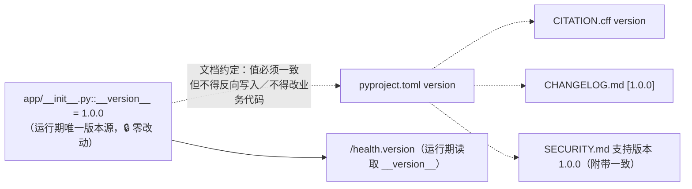
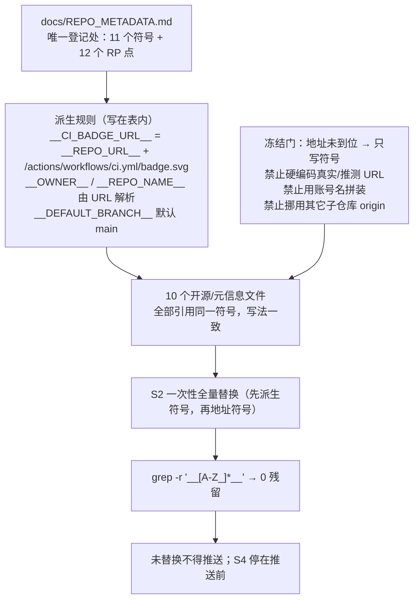
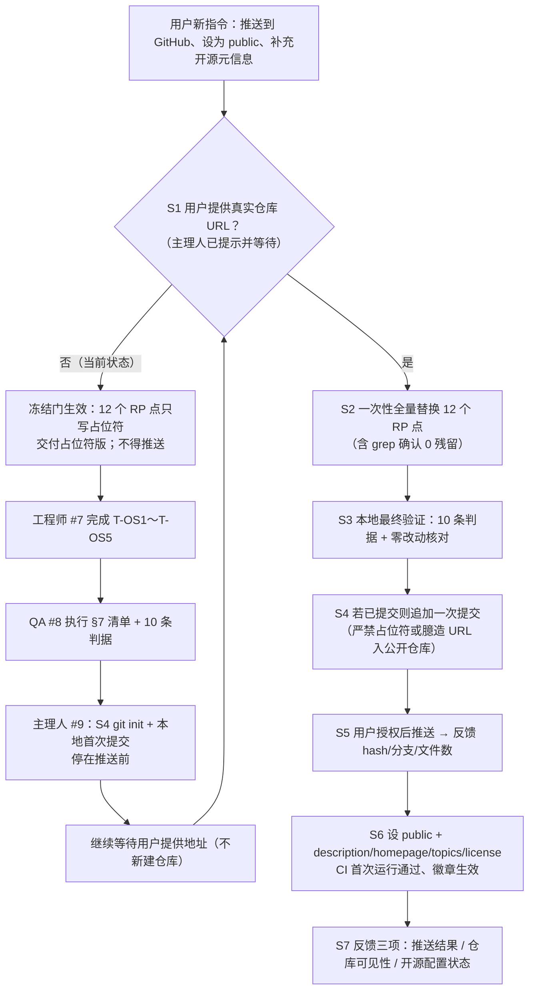
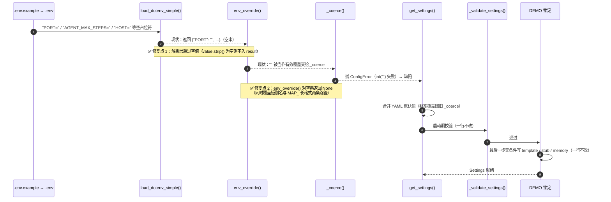

# 多模态通用智能体开发平台 · 开源化增量架构设计（ARCHITECTURE-OPENSOURCE）

| 项 | 值 |
| --- | --- |
| 文档类型 | 增量系统架构设计（开源化 / 企业级补齐） |
| 版本 | **v1.1**（按主理人对 `docs/PRD-OPENSOURCE.md` §6 Q-OS1～Q-OS12 的裁决修订；替代 v1.0） |
| 编写 | 架构师 高见远（Gao） |
| 语言 | 简体中文 |
| 上游依据 | `docs/PRD.md` v1.0（行为契约，最高优先级）、`docs/PRD-OPENSOURCE.md`（增量 PRD）、`docs/ARCHITECTURE.md`、`docs/TASKS.md`、`README.md`、**主理人裁决**、主理人实测现状 |
| 实现现状 | 45 个源码／配置／测试文件 + QA 新增 `tests/test_edge_api.py`；`DEMO_MODE=1 python3 -m pytest -q tests` = **80 passed**；结构化日志脱敏／异常处理／输入校验／上传护栏／配置分层／受限 AST／工具白名单与超时**均已落地** |
| 本轮定位 | **不重构已落地模块**；仅做「10 个开源／元信息文件 + README 开源章节 + 2 个缺陷修复 + 回归用例 + `.gitignore` 补充 + 文档一致性」 |
| 交付边界 | 本文件为设计文档；**不写任何业务代码或开源文件本身，不执行任何 git 操作、不推送** |
| 下游 | 工程师（#7，照 `docs/TASKS-OPENSOURCE.md` 实现）、QA（#8，按 §7 清单 + PRD-OPENSOURCE §3 十条判据回归）、主理人（#9，地址到位后 S1–S7 收尾） |

> 本文是 `docs/ARCHITECTURE.md` 的**增量**，不替代原设计；`docs/ARCHITECTURE.md` §7 质量守卫清单 A–H 与 `docs/TASKS.md` S1–S20 共享约定继续有效。冲突时以 `docs/PRD.md` §4 契约红线为最高优先级，其次 `docs/PRD-OPENSOURCE.md` §1.3 与**主理人裁决**，再次本文。

---

## 0. 阅读指引与裁决索引

### 0.1 v1.1 相对 v1.0 的六处实质变更（工程师务必按本版实现）

| # | 变更 | v1.0（作废） | **v1.1（本版）** |
| --- | --- | --- | --- |
| 1 | 占位符登记位置 | 集中在 `PRD-OPENSOURCE.md` §4.1 | **新建 `docs/REPO_METADATA.md`（第 10 个开源／元信息文件）作为唯一登记处**，本设计给出表结构（§5.1） |
| 2 | 作者／版权身份 | 全部用 `__AUTHOR_NAME__` 等待填占位符 | **用可核实默认值**：`Nephets1010`（gh 实测登录账号、目标仓库所有者）、`2026`（当前年份）、`Nephets1010@users.noreply.github.com`；在 REPO_METADATA.md 登记为「默认取值，用户可替换」 |
| 3 | `pyproject.toml` | 仅 `[project]` + 可选 `[project.scripts]`，未提工具配置 | **不加 `[build-system]`**；补 `[tool.pytest.ini_options]`（`testpaths`，不得破坏 80 用例）、可选 `[tool.coverage.*]` 纯配置；`requirements.txt` 仍是唯一依赖来源 |
| 4 | CI 步骤 | 三步（compileall / pytest / demo.py） | **五步**：compileall / pytest / demo.py / **`python3 -m app.observability.evaluator`** / **契约冒烟**；外加 pip 缓存与失败-fast |
| 5 | README §6 | 仅 §8 新增 + `:154` 修正 | **§6 再增加一句**：`docs/reference/` 是目标态设计基线，实现状态以本 README 与 §6 为准 |
| 6 | BUG2 范围 | 4 处 + 中性措辞保留 | 同 4 处，但明确 `docs/reference/platform-spec-README.md`（原始规格清洗副本）**字节级零改动**，并新增 §6 消解说明 |

### 0.2 主理人裁决落地索引

| 裁决 | 结论 | 落地章节 |
| --- | --- | --- |
| Q-OS1 仓库 URL | 用户未回复地址（无 `.git`/remote、账号下无同名仓库）。开发阶段一律**统一占位符**，集中登记在新建 `docs/REPO_METADATA.md`；禁止多文件散落硬编码不同写法、禁止臆造 owner/repo、**禁止挪用工作区其它 24 个子仓库 origin**；推送前一次性全量替换，未替换不得推送（主理人负责） | §5 全章 |
| Q-OS2 已有／新建 | **不新建仓库**。只写地址到位后的 S1–S7 收尾流程，**不设计任何仓库创建动作** | §5.4 |
| Q-OS3 作者／版权 | 作者／版权 holder = `Nephets1010`；年份 `2026`；邮箱 `Nephets1010@users.noreply.github.com`；REPO_METADATA.md 登记为「默认取值，用户可替换」 | §5.1、§5.5 |
| Q-OS5 build-system | **不加 `[build-system]`**，不引入任何打包期依赖；`pyproject.toml` 只承担「项目元信息 + 工具配置」；`requirements.txt` 一字不改、仍是唯一依赖来源 | §3 |
| Q-OS8 外部 lint | **不允许**。CI 只用标准库五步；不引入 `ruff`/`flake8`/`mypy`/`coverage` 包 | §4 |
| 许可 | **Apache-2.0**（`LICENSE` 完整原文 + `NOTICE`），理由沿用 PM §2.1／§2.4 | §2、§8 |
| BUG2 | 只修 4 处（README:154、PRD:115+263、ARCHITECTURE:1389）；reference 零改动；TASKS.md／`router.py:8` 中性措辞保留；README §6 增加消解说明 | §6.6 |
| 版本号一致性 | `app/__init__.py::__version__="1.0.0"` 与 pyproject / CITATION / CHANGELOG / `/health.version` **五处一致**；不得改业务代码凑入口点；`scripts/demo.py:129 main()` 可作 `[project.scripts]` 入口；evaluator 无 `main()` 保持 `python3 -m ...` | §3.6 |
| CI Python | 本期仅 **3.11**（requirements 注释口径）；本机 3.13 实测全绿；多版本矩阵列 P2，本期不做 | §4 |

---

## 1. 增量范围与不变式清单

### 1.1 三条总不变式

1. **不新建独立项目**：所有改动只在现有 `D:/data/WorkBuddy/程序宇宙/repos/multimodal-agent-platform/` 内，不建同级新目录、不复制／分叉项目、不改 `app/` 六个子包与顶层目录名。
2. **不改变项目定位**：四模态统一接入 → 统一表征与多模态 RAG → Planner／Worker／Reflector → 工具调用 → SSE 流式统一应答 → 轨迹回放与自动评测；面向**求职作品集／实训**的真实可运行项目，不得宣称生产级可用或具备企业级安全能力；`DEMO_MODE=1` 零 API Key／零 GPU／零联网／零权重下载十条红线不变。
3. **不改对外契约**：见 §1.2 逐条复述。

> ⚠️ 禁止以「完善核心功能」为名重构 `app/`、偷偷补齐鉴权／多租户／会话持久化／并发写入锁，或改动零改动文件（§2.4）。

### 1.2 不可变契约逐条复述（最高优先级红线）

#### 1.2.1 7 组 REST 端点（路径／方法／请求字段／响应字段集合）

| 编号 | 方法 | 路径 | 请求 | 响应 |
| --- | --- | --- | --- | --- |
| EP-1 | GET | `/health` | 无 | JSON：`demo_mode` + `components`（DEMO 逐字段冻结，见 §1.2.5） |
| EP-2 | POST | `/v1/ingest` | `multipart/form-data`：`files`（可多传）／`text`／`source_tag` | JSON：`total` + `chunks[]` |
| EP-3 | POST | `/v1/chat` | JSON：`query`／`session_id`／`stream`／`modalities` | JSON（`UnifiedResponse`）或 SSE |
| EP-4 | GET | `/v1/trace/{trace_id}` | 路径参数 | JSON：`events[]` + `count`（不存在 → 200 `{"events":[],"count":0}`） |
| EP-5 | GET | `/v1/tools` | 无 | JSON：`tools[]` + 白名单等 |
| EP-6 | POST | `/v1/eval` | 可选 `{"samples":[...]}`（数组） | JSON 6 字段，响应 `samples` 为**数量数字** |
| EP-7 | GET | `/`、`/ui/index.html` | 无 | `text/html`，同源托管 `web/index.html` |

`GET /docs` 为 FastAPI 自动文档（原 PRD Q13），不列入 7 组红线；所有端点同源、无跨域配置。**本轮不得新增任何端点**（含 REST 恢复端点，Q10）。

#### 1.2.2 `UnifiedResponse` 恰好 11 字段（不得删改／重命名）

`answer` ／ `evidences[]`（含 `chunk_id`／`modality`／`snippet`／`score`）／ `tool_calls[]` ／ `tool_results[]`（前端消费 `name`／`ok`／`elapsed_ms`／`output`／`error`，`error` 恒存在）／ `trace_id` ／ `steps` ／ `elapsed_ms` ／ `status` ／ `output_modality` ／ `demo_mode` ／ `graph_backend`。

枚举（Q4）：`status`∈{ok,degraded,error}、`output_modality`∈{text,image,audio,video,mixed}、`graph_backend`∈{pure,langgraph}。

#### 1.2.3 SSE 帧格式与事件顺序

- 帧格式：`event: <name>\ndata: <单行 JSON>\n\n`，帧间 `\n\n` 分隔；**禁止多行／缩进 JSON**（前端 `parseFrame()` 逐行 `JSON.parse` 会静默吞错）。
- 顺序：`meta`(1) → `step`(每节点 1..n) → `token`(答案分片 1..n，由最终答案按 `agent.token_chunk_chars=24` 定长切片模拟) → `human_required`(仅 `HUMAN_IN_LOOP=1`，插在最后一个 `step` 之后、`done` 之前，**不替代 `done`**) → `done`(1，恒为最后一帧、携带完整 11 字段 `UnifiedResponse`)。
- 事件 `data` 字段：`meta`{`trace_id`,`backend`}／`step`{`steps`,`node`,`next_node`,`status`,`last_observation`}／`token`{`delta`}／`human_required`{`prompt`}／`done`{完整 `UnifiedResponse`}。
- `done` 与非流式响应由同一个 `build_unified_response()` 产出；所有 `token.delta` 拼接后等于 `done.answer`；**本期不新增 REST 恢复端点**，`resume()` 仅图层 API。
- **本期未实现 `LLMClient.chat_stream`**（BUG2 统一口径，§6.6）；不得挂到主应答路径。

#### 1.2.4 配置键兼容性

`DEMO_MODE` 默认 `1`、`0`=生产、优先级最高；`LLM_BACKEND`∈{api,template}；`ENCODER_BACKEND`∈{api,transformers,stub}；`VECTOR_BACKEND`∈{chroma,memory}；`HUMAN_IN_LOOP=1`；`LLM_API_KEY`/`LLM_BASE_URL`/`LLM_MODEL`/`LLM_VISION_MODEL`；历史短别名（`HOST`/`PORT`/`AGENT_MAX_STEPS`/`AGENT_TOOL_TIMEOUT_SECONDS` 等）**不带前缀、优先级不变**；长格式 **`MAP_<SECTION>__<KEY>`**（项目前缀，全部键可覆盖，**裸 `<SECTION>__<KEY>` 不得被读取**）；`config/settings.yaml` 的 `config_version: 1` 与键名／取值域／默认值不得改动；`.env.example` → `.env` 模板仅占位符。所有 LLM／Embedding 调用通过 `httpx` 直连，不依赖 `openai` SDK；未配置 Key 时自动保持 `template`/`stub`/`memory`。

#### 1.2.5 `DEMO_MODE=1` 下 `/health` 响应逐字段冻结（本期特别红线）

实测 `app/api/routes.py:102–110`：

```python
configured = dict(ctx.configured_backends) if not ctx.settings.demo.enabled else None
return HealthResponse(..., configured_backends=configured).model_dump(
    mode="json", exclude_none=True
)
```

- DEMO 下字段集合恒为：`demo_mode`(bool) + `components`(11 项：生效后端 4 项、6 项 `native`/`fallback` 探测结果、实时 `index_chunks`) + 顶层 `status` + `version`(="1.0.0") + `index_chunks` —— **不多不少**。
- `configured_backends` **仅生产模式**附加；DEMO 下为 `None` 且被 `exclude_none=True` 剔除，**响应中连键都不存在**（输出 `null` 亦违约）。
- **冻结 = 不增不删**：「不得把版本／许可／徽章信息塞进 `/health`」约束的是**新增**，不是删除既有 `version`。开源徽章、许可证、repo URL 一律只出现在 README／pyproject／LICENSE／NOTICE 等静态文件。
- `components.graph/encoder/vector/llm` 报**实际生效**后端（`ctx.effective_backends`），不报配置声明值；`configured_backends` 是另一条独立数据流。

### 1.3 零改动清单与允许增量清单

**字节级零改动**：`web/index.html`、`requirements.txt`、`samples/knowledge.txt`、`docs/reference/*`（**原始规格清洗副本**，含 `platform-spec-README.md:648` 的「已提供」措辞）、`Makefile` 四目标命令、`config/settings.yaml` 键名／取值域／默认值、`.env.example` 模板形态、`docs/ARCHITECTURE.md` §7 质量守卫清单、`docs/TASKS.md` S1–S20、`docs/PRD-OPENSOURCE.md`、`app/` 除 `config.py` 外全部源码。

**允许增量（且仅限）**：① 新增 10 个开源／元信息文件 + `tests/test_config_env.py`；② README 增补 §8 与 §6 一句说明（§1–§7 零删减）；③ 修正 2 个缺陷 + 回归用例；④ `.gitignore` 补充构建产物忽略项；⑤ 文档间术语一致性修正（精确清单 §6.6）。不得新增必需依赖、不得改技术栈（Python 3.11+ / FastAPI / Pydantic v2 / Uvicorn / 原生 JS，无前端构建工具）。

### 1.4 前序已核实现状（避免重复劳动）

| 核实项 | 结论 |
| --- | --- |
| `MAP_` 前缀 | Grep 核实 `docs/ARCHITECTURE.md` 与 `docs/TASKS.md` **已由前序全局一致性审查更新为 `MAP_<SECTION>__<KEY>`**，与 `app/config.py::ENV_PREFIX="MAP_"` 一致 → **本轮不再改这两处** |
| `configured_backends` | 实测 `app/schemas.py:223–233`、`app/runtime.py:57–110`、`app/api/routes.py:102–109` 已实现且仅生产模式输出；但原 ARCH §3.1 `HealthResponse` 表与 §3.6 端点表**未记载** → 本轮作文档补注（§6.6） |
| 版本／入口点 | `app/__init__.py:7` = `"1.0.0"` ✓；`scripts/demo.py:129` 有 `main() -> int` ✓；`app/observability/evaluator.py:150` 只有 `if __name__ == "__main__":`、**无 `main()`** ✓ |
| `collect_secrets` | `app/observability/logging.py:67–77` 已用 `if value and len(value) >= 4` 过滤空串 → BUG1 修复**无脱敏衍生风险**，不改 logging 层 |
| 回归隔离 | `tests/conftest.py::_demo_env` 只重定向 `data_dir`/`tmp_dir`，**不重定向 `PROJECT_ROOT`** → BUG1 回归须自建 `.env` 沙箱（§6.5） |
| 不实声明 | `README.md:154`、`docs/PRD.md:115`、`:263`、`docs/ARCHITECTURE.md:1389` 共 4 处；`docs/TASKS.md:256/276/454` 与 `app/generation/router.py:8` 为「不得改挂」中性措辞，**保留** |
| 开源要素 | PM 列出的 9 个文件经 Glob 核实全部缺失；主理人裁决再新增 `docs/REPO_METADATA.md` → 共 **10 个** |

---

## 2. 完整新增／修改文件清单

### 2.1 新增文件（11 个 🆕）

| # | 相对路径 | 职责 | 任务 | 关键约束 |
| --- | --- | --- | --- | --- |
| 1 | `LICENSE` | Apache-2.0 完整原文 | T-OS1 | 条款零改写，含 §3／§6／§7／§8 + APPENDIX |
| 2 | `NOTICE` | 版权行（默认 `2026 Nephets1010`）+ 10 核心／6 可选依赖归属 | T-OS1 | 用 REPO_METADATA.md 符号；不含真实凭据／URL |
| 3 | `pyproject.toml` | 项目元信息 + 工具配置（§3 字段全集） | T-OS1 | **不加 `[build-system]`**；不新增必需依赖 |
| 4 | `docs/REPO_METADATA.md` | **占位符唯一登记处**（§5.1 表结构） | T-OS1 | 所有含 URL／身份的新文件只引用此表符号；禁止散落硬编码 |
| 5 | `CONTRIBUTING.md` | 开发环境／四条命令／代码风格／PR 流程／测试要求／Issue 规范 | T-OS2 | 明确零改动清单；URL 用符号 |
| 6 | `CODE_OF_CONDUCT.md` | 适用范围／行为准则正文／举报渠道 | T-OS2 | 举报渠道用 `__SECURITY_CONTACT__` |
| 7 | `SECURITY.md` | 支持版本／报告渠道／响应预期／**无鉴权属设计边界非漏洞**／`0.0.0.0` 风险 | T-OS2 | 与 README §6 四方一致 |
| 8 | `CHANGELOG.md` | Keep a Changelog；`[1.0.0]` 记录本次补齐 | T-OS2 | 日期用 `__RELEASE_DATE__`；不夸大 |
| 9 | `CITATION.cff` | CFF 1.2.0；PyYAML 可解析 | T-OS2 | 占位符加引号；`version: 1.0.0` |
| 10 | `.github/workflows/ci.yml` | 五步 CI（§4） | T-OS3 | 零联网零 Key；标准库 compileall；pip 缓存 |
| 11 | `tests/test_config_env.py` | BUG1 四条回归用例 | T-OS4 | `tmp_path` 隔离，不污染仓库根 |

> 主理人清单的 10 个开源／元信息文件（1–10）+ BUG1 回归用例（11）。`.github/workflows/` 为新建目录，不新增顶层目录名。

### 2.2 修改文件（6 个 ✏️，严格限定范围）

| # | 相对路径 | 改动范围 | 任务 |
| --- | --- | --- | --- |
| 1 | `.gitignore` | **仅追加** `dist/`、`build/`、`.mypy_cache/`、`.ruff_cache/`、`.coverage`；现有 6 类零删减 | T-OS1 |
| 2 | `README.md` | ① 第 176 行 `---` 之前插入 `## 8. 开源与社区`；② **§6 增加一句 reference 消解说明**；③ 只改 `:154` 一行 | T-OS3 / T-OS5 |
| 3 | `app/config.py` | **唯一业务代码改动**：`load_dotenv_simple()` + `env_override()` 两处空串短路（§6.2） | T-OS4 |
| 4 | `tests/conftest.py` | 新增 `env_sandbox` fixture（`PROJECT_ROOT` 隔离，§6.5） | T-OS4 |
| 5 | `docs/PRD.md` | `:115`、`:263` 不实声明；可加 1 行指向增量 PRD 的交叉链接 | T-OS3 / T-OS5 |
| 6 | `docs/ARCHITECTURE.md` | `:1389`（U8）不实声明；§3.1 `HealthResponse` 表 / §3.6 端点表补 `configured_backends` 说明。**§7 清单零改动** | T-OS5 |

### 2.3 仅核对不改（2 个 🔍）

| 文件 | 核对内容 |
| --- | --- |
| `docs/TASKS.md` | `:256/276/454` 与 S1–S20 的「不得改挂」中性措辞保留，**不改** |
| `app/generation/router.py` | `:8` 中性措辞保留；业务代码零改动 |

### 2.4 零改动清单（🔒，QA 逐条字节级核对）

`web/index.html`、`requirements.txt`、`samples/knowledge.txt`、`docs/reference/*`、`Makefile` 四目标命令、`config/settings.yaml`、`.env.example`、`docs/PRD-OPENSOURCE.md`、`docs/ARCHITECTURE.md` §7、`docs/TASKS.md` S1–S20、`app/` 除 `config.py` 外全部源码。

> **统计**：**11 个新建** + **6 个限定范围修改** + **2 个仅核对**；业务代码仅 `app/config.py` 一个文件的两个函数。

---

## 3. `pyproject.toml` 逐字段设计表

> **定位**：本项目不是要发布到 PyPI 的库，`pyproject.toml` **只承担「项目元信息 + 工具配置」**。**不加 `[build-system]`**、不引入任何打包期依赖；`requirements.txt` 仍是唯一依赖来源，**一字不改**。CI／DEMO 一律 `pip install -r requirements.txt` + 四条 `python3` 命令，**不执行打包安装**。

### 3.1 `[project]` 字段表（11 类，逐字段给出具体取值）

| 字段 | 设计值 | 说明 / 红线 |
| --- | --- | --- |
| `name` | `multimodal-agent-platform` | 与目录名一致 |
| `version` | `1.0.0` | **静态镜像** `app/__init__.py::__version__`，不得反向写业务代码（§3.6 五处一致） |
| `description` | 与 README 首段一致的一句话定位，如「四模态统一接入 → 多模态 RAG → Agent 编排 → SSE 统一应答的可运行教学／作品集项目」 | 不得出现「生产级／企业级安全／90% 准确率」 |
| `readme` | `README.md` | — |
| `license` | `license = { text = "Apache-2.0" }`（PEP 621 table 形式，兼容面最广） | 与 `LICENSE`／`NOTICE`／CFF／README §8.1 完全一致；`classifiers` 同步含 Apache 许可项 |
| `requires-python` | `">=3.11"` | 本机 3.13 实测全绿，代码 3.11+ 兼容；CI 仅 3.11 |
| `authors` | `[{ name = "__AUTHOR_NAME__", email = "__AUTHOR_EMAIL__" }]` | 符号在 `docs/REPO_METADATA.md` 登记，默认 `Nephets1010` / `Nephets1010@users.noreply.github.com`（用户可替换）；`maintainers` 可同值 |
| `keywords` | `["multimodal", "rag", "retrieval-augmented-generation", "agent", "state-machine", "fastapi", "sse", "vector-search", "demo", "portfolio"]` | 与定位一致；不得含「production」「enterprise-security」 |
| `classifiers` | 见下方**具体取值清单** | **Development Status 只能 `3 - Alpha` 或 `4 - Beta`**，禁 `5 - Production/Stable` |
| `[project.urls]` | 5 个子键，全部由占位符派生（§3.2） | 不得硬编码真实／推测 URL |
| `[project.optional-dependencies]` | 与 `requirements.txt` 注释逐项对齐（§3.3） | **不得出现任何新包名、不得设为必需** |
| `[project.scripts]`（可选） | `multimodal-agent-demo = "scripts.demo:main"` | 主理人已确认 `scripts/demo.py:129 main() -> int` 可作入口；**不加 build-system 时仅静态声明、不产生可安装 console script**。`evaluator.py` 无 `main()`，**不得为凑入口点改业务代码**，保持 `python3 -m app.observability.evaluator` |

**`classifiers` 具体取值（建议全集）**：

```toml
classifiers = [
  "Development Status :: 3 - Alpha",
  "Intended Audience :: Developers",
  "Intended Audience :: Education",
  "License :: OSI Approved :: Apache Software License",
  "Operating System :: OS Independent",
  "Programming Language :: Python :: 3",
  "Programming Language :: Python :: 3 :: Only",
  "Programming Language :: Python :: 3.11",
  "Framework :: FastAPI",
  "Topic :: Scientific/Engineering :: Artificial Intelligence",
  "Topic :: Software Development :: Libraries :: Application Frameworks",
]
```

> 不得写 `Development Status :: 5 - Production/Stable`（与「求职作品集／实训、非生产级」定位冲突）。

### 3.2 `[project.urls]` 五子键占位符映射

| 子键 | 值（占位符表达式） | 依赖符号 |
| --- | --- | --- |
| `Homepage` | `"__REPO_URL__"` | `__REPO_URL__` |
| `Repository` | `"__REPO_URL__"` | `__REPO_URL__` |
| `Issues` | `"__REPO_URL__/issues"` | `__REPO_URL__` |
| `Changelog` | `"__REPO_URL__/blob/__DEFAULT_BRANCH__/CHANGELOG.md"` | `__REPO_URL__` + `__DEFAULT_BRANCH__` |
| `Documentation` | `"__REPO_URL__/blob/__DEFAULT_BRANCH__/README.md"` | `__REPO_URL__` + `__DEFAULT_BRANCH__` |

- `__DEFAULT_BRANCH__` 在 `docs/REPO_METADATA.md` 登记，默认 `main`（用户可替换），避免臆造分支。
- S2 替换顺序：先替换 `__DEFAULT_BRANCH__`，再替换 `__REPO_URL__`，最后 grep 确认所有 `__...__` 残留为 0。
- **五个子键不得散落硬编码不同写法**；任何新增引用点必须回填 REPO_METADATA.md 的 RP 表。

### 3.3 `[project.optional-dependencies]` 与 `requirements.txt` 注释对齐表

> `requirements.txt` 注释区逐字列出 6 个可选包，本表**只复制其包名与版本下限**，不新增包名、不设为必需、不写成运行期依赖。

| 分组 | 内容 | `requirements.txt` 注释原文依据 |
| --- | --- | --- |
| `graph` | `["langgraph>=0.2"]` | `# langgraph>=0.2  # 缺失 -> 纯 Python 等价状态机` |
| `vector` | `["chromadb>=0.5"]` | `# chromadb>=0.5  # 缺失 -> InMemoryVectorStore + JSON 持久化` |
| `asr` | `["openai-whisper>=20231117"]` | `# openai-whisper>=20231117  # 缺失 -> WAV 元信息 + 确定性占位转写` |
| `encoder` | `["transformers>=4.40", "torch>=2.0"]` | `# transformers>=4.40` / `# torch>=2.0  # 仅 transformers 本地编码器需要` |
| `llm` | `["openai>=1.0"]` | `# openai>=1.0  # 非必需：LLM/Embedding 用 httpx 直连 OpenAI 兼容端点` |

- 可选：再提供聚合组 `optional = [上述 6 项]`。**不得**把 `fastapi`/`numpy` 等核心依赖写进本表（它们只在 `requirements.txt`）。
- 分组只是元信息声明：**CI 与 DEMO 均不安装任何可选分组**；`DEMO_MODE=1` 下全部走 `importlib.util.find_spec` + `try/except ImportError` 降级。
- 顶部注释建议写明「可选依赖全部缺失时自动降级，`DEMO_MODE=1` 无需安装」。

### 3.4 `[tool.pytest.ini_options]` 与 `[tool.coverage.*]`（纯工具配置）

```toml
[tool.pytest.ini_options]
testpaths = ["tests"]
# addopts 建议不配置；若配置，只允许 "-q" 等不改变收集行为／不改变用例结果的值

# [tool.coverage.run]        # 可选，纯配置；不安装 coverage 包、CI 不执行 coverage
# source = ["app"]
# omit = ["tests/*", "scripts/*"]
```

- **`testpaths = ["tests"]`** 只影响「不带路径参数运行 pytest」时的默认收集路径；本轮所有验证命令均显式带 `tests`，因此不改变现有行为。
- **禁止**配置会改变默认 pytest 行为导致 80 用例失败的选项（如 `addopts = "--import-mode=importlib"`、`--strict-markers`、`-x`、`filterwarnings = ["error"]` 等）。
- **必验**：新增 `pyproject.toml` 后 pytest 会把该文件所在目录识别为 `rootdir`；必须重跑 `DEMO_MODE=1 python3 -m pytest -q tests` 确认仍 **≥80 passed 且退出码 0**。若收集行为发生变化，**移除 `[tool.pytest.ini_options]`**，只保留 `[project]`。
- `[tool.coverage.*]` 是纯静态配置，**不安装 `coverage` 包、CI 不执行 coverage**（Q-OS8 明确不引入 coverage 包）。

### 3.5 不加 `[build-system]` 的代价（明示）

- 无构建后端 → `[project.scripts]` 只是静态声明，**不产生可安装的 console script**，`packages` 不适用；这不影响任何运行路径（项目以 `requirements.txt` + 四条 `python3` 命令运行）。
- 不得为让入口点「真正可用」而补 `[build-system]`／`[tool.setuptools]`（主理人裁决），也不得改 `app/__init__.py` 或 `scripts/demo.py` 来凑入口点。

### 3.6 版本号五处一致性



- 一致性由 **QA 核对**保证，不新增构建脚本或代码联动。
- `/health.version` 由 `app/api/routes.py` 读取 `__version__`，天然一致；**不得**为展示开源信息改动该端点。

---

## 4. CI 工作流设计

### 4.1 job / step 顺序（五步，全部标准库或既有依赖）

| # | Step | 命令 | 预期 |
| --- | --- | --- | --- |
| 0 | 环境 | `actions/checkout@v4` → `actions/setup-python@v5`（`python-version: "3.11"`，`cache: "pip"`，`cache-dependency-path: "requirements.txt"`） | 零联网额外安装 |
| 1 | 安装 | `python3 -m pip install -r requirements.txt`（**唯一安装步骤**） | 仅 10 个核心依赖 |
| 2 | 编译／lint | `python3 -m compileall -q app scripts tests` | 退出码 0，无外部 lint |
| 3 | 测试 | `DEMO_MODE=1 python3 -m pytest -q tests` | ≥ **80 passed**，退出码 0 |
| 4 | demo 冒烟 | `DEMO_MODE=1 python3 scripts/demo.py` | 退出码 0；四模态各 ≥1 切片；`TestClient` 冒烟 7 组端点 |
| 5 | 评测 | `DEMO_MODE=1 python3 -m app.observability.evaluator` | 退出码 0；`samples=8`；6 字段齐备 |
| 6 | 契约冒烟 | 内联 `python3 - <<'PY'`（§4.2） | 11 字段 / `/health` 冻结 / `96` / SSE 序列四项断言通过 |

### 4.2 YAML 骨架（示意，非最终文件内容）

```yaml
name: ci
on: [push, pull_request]

jobs:
  verify:
    runs-on: ubuntu-latest
    timeout-minutes: 15            # 失败-fast 的总闸
    env:
      DEMO_MODE: "1"               # 全局：零 Key / 零联网 / 零可选依赖
    steps:
      - uses: actions/checkout@v4
      - uses: actions/setup-python@v5
        with:
          python-version: "3.11"
          cache: "pip"
          cache-dependency-path: "requirements.txt"
      - name: Install core dependencies only
        run: python3 -m pip install -r requirements.txt
      - name: Compile check (stdlib only)
        run: python3 -m compileall -q app scripts tests
      - name: Pytest
        run: DEMO_MODE=1 python3 -m pytest -q tests
      - name: Demo smoke
        run: DEMO_MODE=1 python3 scripts/demo.py
      - name: Evaluator
        run: DEMO_MODE=1 python3 -m app.observability.evaluator
      - name: Contract smoke
        run: |
          python3 - <<'PY'
          from fastapi.testclient import TestClient
          from app.main import app
          from app.schemas import UnifiedResponse
          c = TestClient(app)
          h = c.get("/health").json()
          assert h["demo_mode"] is True
          assert "configured_backends" not in h          # DEMO 冻结
          r = c.post("/v1/chat", json={"query": "计算 12*8 的结果", "stream": False})
          assert r.status_code == 200 and len(r.json()) == 11 and "96" in r.json()["answer"]
          assert len(UnifiedResponse.model_fields) == 11
          print("contract smoke OK")
          PY
```

> 契约冒烟为**内联 here-doc**，不新增文件、不新增依赖；只用既有 `fastapi.testclient` 与 `app.schemas`。

### 4.3 零联网零 Key 保证

- 全局 `env: DEMO_MODE: "1"` → `get_settings()` 最后一步无条件锁定 `template`/`stub`/`memory`，**httpx 外部请求数为 0**、不加载 torch／transformers 权重、不下载模型。
- **不配置任何 secrets／API Key／Token**；不安装可选依赖分组；不调用任何外部 API；不上传产物到第三方服务；不执行 `git` 写操作。
- `actions/checkout` 与 `actions/setup-python` 是 GitHub 官方 CI 基础设施，**不是 pip 依赖、不是外部 API 调用**；`cache: "pip"` 只缓存 `requirements.txt` 对应的 wheel，不引入表外包。
- CI **不额外真启动端口**：`scripts/demo.py` 已用 `TestClient` 冒烟全部端点（含 `/health`）；真启动由本机 §7-G1（R-1）验证。
- 仅 Python **3.11**；本机 3.13 全绿，多版本矩阵列 P2、本期不做。

### 4.4 缓存策略与失败-fast

| 项 | 设计 |
| --- | --- |
| pip 缓存 | `actions/setup-python@v5` 的 `cache: "pip"` + `cache-dependency-path: "requirements.txt"`；缓存 key 由 requirements.txt 内容哈希决定，文件内容不变则复用。**不缓存／不安装 requirements 之外的包** |
| 失败-fast | ① 每个 step 独立 `run`，任一非 0 退出即终止 job（GitHub Actions 默认）；② **不使用** `continue-on-error`、`|| true`、`retry` 循环；③ `pip install` 作为独立 step，失败即终止，不进入后续测试；④ job 级 `timeout-minutes: 15` 防挂起 |
| 不吞错 | 所有命令不加 `2>/dev/null`、不加 `--fail NEVER`、不把断言包在 `try/except` 里吞掉 |
| 缓存失效 | `requirements.txt` 一字不改（零改动清单），因此缓存键稳定；若未来改动须同步更新 `cache-dependency-path` |

### 4.5 失败判据（任一命中即 job 失败）

| Step | 失败条件 |
| --- | --- |
| 环境／安装 | checkout / setup-python 失败；`pip install -r requirements.txt` 任一依赖安装失败（**零重试、直接 fail**） |
| compileall | 任何 `.py` 语法错误 → 非 0 退出 |
| pytest | 退出码非 0、`< 80 passed`、或新增 `pyproject.toml` 后收集行为变化导致用例减少 |
| demo.py | 退出码非 0、四模态任一为 0 切片、`TestClient` 冒烟任一端点失败 |
| evaluator | 退出码非 0、`samples != 8`、6 个响应字段任一缺失 |
| 契约冒烟 | `len(UnifiedResponse.model_fields) != 11`、非流式响应字段数 ≠11、`/health` 出现 `configured_backends` 或任何新增字段、`answer` 不含 `96` |
| 全局 | 出现 secrets／Key／外部 API／产物上传／可选依赖安装／外部 lint（ruff/flake8/mypy/coverage 包）／git 写操作 → 视为设计违约，即使 step 全绿也须返工 |

---

## 5. 占位符治理设计（Q-OS1 / Q-OS2 / Q-OS3）

### 5.1 `docs/REPO_METADATA.md` 表格结构（本设计给出，工程师实现）

> **唯一登记处**：所有需要真实 URL／身份的位置只引用本表中的**占位符键**，禁止在多个文件里散落硬编码不同写法；新增引用点必须回填 §5.2 的 RP 表。地址未到位时全仓允许 `__...__` 残留，但**不得推送**。

**表头（四列为主，附默认取值与类别）**

| 占位符键 | 类别 | 用途 | 默认取值（用户可替换） | 出现文件（RP 点） | 替换后校验方式 |
| --- | --- | --- | --- | --- | --- |

**完整行（11 个符号）**

| 占位符键 | 类别 | 用途 | 默认取值（用户可替换） | 出现文件（RP 点） | 替换后校验方式 |
| --- | --- | --- | --- | --- | --- |
| `__REPO_URL__` | 地址·待用户提供 | 完整仓库 URL | `<待用户提供；禁止臆造>` | RP-01～04、06、08、10、11 | 全仓 `grep -r "__REPO_URL__"` = 0；所有出现处 URL 完全一致；S6 阶段 `curl -I` 可访问 |
| `__OWNER__` | 地址·派生 | 仓库 owner | 由 `__REPO_URL__` 解析（**不得用账号名反推**） | RP-04、06（如需） | grep 0 残留；与 URL 中 owner 段一致 |
| `__REPO_NAME__` | 地址·派生 | 仓库名（`cd` 目录） | 由 `__REPO_URL__` 解析 | RP-02、08 | grep 0 残留；与 URL 末段一致 |
| `__CI_BADGE_URL__` | 地址·派生 | CI badge 图片 URL | `__REPO_URL__ + /actions/workflows/ci.yml/badge.svg` | RP-01 | grep 0 残留；与派生公式一致 |
| `__DEFAULT_BRANCH__` | 地址·派生 | `blob` 路径分支段 | `main` | RP-04、11 | grep 0 残留；与仓库实际默认分支一致 |
| `__AUTHOR_NAME__` | 身份·**有默认值** | 作者／版权 holder | `Nephets1010`（gh 实测登录账号、目标仓库所有者） | RP-05、07、12 | 值与 gh 账号一致；不臆造真实姓名 |
| `__AUTHOR_EMAIL__` | 身份·**有默认值** | 作者／联系邮箱 | `Nephets1010@users.noreply.github.com`（GitHub 标准 noreply 格式） | RP-05、07、09、10 | 格式为 `<login>@users.noreply.github.com` |
| `__COPYRIGHT_YEAR__` | 身份·**有默认值** | 版权年份 | `2026`（当前日期） | RP-12 | 值为当前年份 |
| `__COPYRIGHT_HOLDER__` | 身份·**有默认值** | 版权持有人 | `Nephets1010` | RP-12 | 与 `__AUTHOR_NAME__` 一致 |
| `__SECURITY_CONTACT__` | 联系·**有默认值** | 安全／行为准则举报渠道 | `Nephets1010@users.noreply.github.com`（用户可替换为私密报告入口） | RP-09、10 | grep 0 残留；非真实私人凭据 |
| `__RELEASE_DATE__` | 元信息·待用户提供 | CHANGELOG／CITATION 发布日期 | `<待用户提供；不得臆造月日>` | RP-11、CHANGELOG、CITATION | grep 0 残留；格式 `YYYY-MM-DD` |

**两条区分铁律**：

1. **身份类有可核实默认值，地址类没有**：`Nephets1010` 是 gh 实测登录账号且为目标仓库所有者，可用于作者／版权；但**仓库名未确认、同名仓库 404**，因此**禁止**用该账号拼装 `https://github.com/Nephets1010/<repo>` 形式的 URL。
2. **禁止挪用**工作区其它 24 个子仓库的 origin（它们属别的项目）。地址来源唯一 = 用户提供的 URL。

### 5.2 12 个 RP 点逐点映射（PRD-OPENSOURCE §4.2，更新出现文件）

| RP | 位置 | 引用符号 | 类别 |
| --- | --- | --- | --- |
| RP-01 | `README.md` §8.1 徽章（CI badge img/href、License、Release/Stars） | `__CI_BADGE_URL__`、`__REPO_URL__` | URL |
| RP-02 | `README.md` §8.2 克隆 | `__REPO_URL__`／`__REPO_NAME__` | URL |
| RP-03 | `README.md` §8.4–8.7 Issues／Discussions／PR／Homepage | `__REPO_URL__` 派生 | URL |
| RP-04 | `pyproject.toml [project.urls]` 5 子键 | `__REPO_URL__` + `__DEFAULT_BRANCH__` + `__OWNER__` | URL |
| RP-05 | `pyproject.toml authors`／`maintainers` | `__AUTHOR_NAME__`／`__AUTHOR_EMAIL__` | 身份 |
| RP-06 | `CITATION.cff url`／`repository-code` | `__REPO_URL__`／`__OWNER__` | URL |
| RP-07 | `CITATION.cff authors` | `__AUTHOR_NAME__`／`__AUTHOR_EMAIL__` | 身份 |
| RP-08 | `CONTRIBUTING.md` 克隆／Issue／PR／CI 链接 | `__REPO_URL__`／`__REPO_NAME__` | URL |
| RP-09 | `CODE_OF_CONDUCT.md` 举报渠道 | `__SECURITY_CONTACT__` | 联系 |
| RP-10 | `SECURITY.md` 报告渠道／公告 | `__REPO_URL__` 或 `__SECURITY_CONTACT__` | URL／联系 |
| RP-11 | `CHANGELOG.md` 底部版本比较链接 | `__REPO_URL__` + `__DEFAULT_BRANCH__` + `__RELEASE_DATE__` | URL／元信息 |
| RP-12 | `NOTICE` 版权行 | `__COPYRIGHT_YEAR__`／`__COPYRIGHT_HOLDER__` | 身份 |

**统计**：12 个依赖点 = **9 个需真实仓库 URL／联系渠道**（RP-01～04、06、08～11，其中 RP-11 含日期）+ **3 个需作者与版权身份**（RP-05、07、12）。所有符号集中在 `docs/REPO_METADATA.md`。

### 5.3 单一来源与禁止散落硬编码



- 新增任何需引用地址的位置，一律复用表内符号并**回填 RP 表**，禁止新增未登记的硬编码位置。
- `README.md`／`pyproject.toml`／`CITATION.cff` 等文件里出现的是符号本身，不是「另一种写法的 URL」。
- 替换顺序建议：`__DEFAULT_BRANCH__` / `__CI_BADGE_URL__` / `__OWNER__` / `__REPO_NAME__` 等派生符号先展开 → 再替换 `__REPO_URL__` → 最后身份／日期符号；避免出现「符号里套符号」的残留。

### 5.4 S1–S7 收尾流程（**不设计仓库创建动作**）



| 步骤 | 动作 | 完成判据 |
| --- | --- | --- |
| S1 | 用户提供真实仓库 URL；主理人确认 owner/repo、目标可见性 public | 地址来源唯一、可核验；**不新建仓库、不使用其它子仓库 origin** |
| **S2** | **一次性全量替换 12 个 RP 点** | 全仓 `grep -r "__[A-Z_]*__" --exclude-dir=data --exclude-dir=__pycache__ .` → **0 残留**；12 处 URL 完全一致；无臆造 owner/repo；无散落硬编码 |
| S3 | 本地最终验证：§7 清单 + PRD-OPENSOURCE §3 十条判据 | 全部通过，退出码 0；零改动文件字节级核对通过 |
| S4 | `git init`（当前无 `.git`）→ 配置 remote（**只用用户提供的地址**）→ 本地首次提交 | 提交含 10 个开源文件、README 增补、两处缺陷修复与回归用例；`.gitignore` 已排除 `.env`/`data/`/缓存；**提交信息不含密钥**；**停在推送前** |
| S5 | 用户授权后推送 | 推送成功；反馈 commit hash、分支、文件数 |
| S6 | 仓库设为 **public**；配置 description／homepage／topics／license | GitHub 自动识别 `LICENSE` 为 Apache-2.0；topics 与 keywords 一致；CI 首次运行通过 |
| S7 | 向用户反馈 | 推送结果（hash／分支／文件数）、仓库可见性（public）、开源配置状态（license／topics／description／homepage／CI） |

> ⚠️ **S4 与推送之间的关键约束**：若 S4 提交时地址仍未到位，提交内容必然含占位符；**推送前必须完成 S2 替换并追加一次提交**，严禁把占位符或臆造 URL 推入公开仓库。**架构师／工程师／QA 均不得执行 S4–S6 中任何 git 操作、不得推送。**

### 5.5 身份默认值与地址占位符的区分（防误用）

| 维度 | 身份／版权类 | 地址／repo 类 |
| --- | --- | --- |
| 是否有可核实默认值 | **有**：`Nephets1010` / `2026` / noreply 邮箱 | **无**：仓库名未确认、同名仓库 404 |
| 是否可用账号 `Nephets1010` | 可以（gh 实测登录账号、目标仓库所有者） | **禁止**用于拼装 URL |
| S2 后是否仍有占位符 | 否（替换成默认值或用户指定值） | 否（但**地址未到位时不得执行 S2、不得推送**） |
| 用户可替换 | 是（REPO_METADATA.md 注明「默认取值，用户可替换」） | 是（由用户提供） |

---

## 6. BUG1 修复设计（含 BUG2 范围）

### 6.1 根因链与修复边界



### 6.2 精确改动点（唯一业务代码改动）

1. `load_dotenv_simple()`：解析出 `value` 后，若 `value.strip() == ""` 则**不写入 `result`**（空串一律视为「未设置」）。
2. `env_override()`：短别名或 `MAP_<SECTION>__<KEY>` 命中后，若 `str(source[key]).strip() == ""` 则返回 `None`。这样同时覆盖 `get_settings()` 主合并循环（第 347–349 行）与 `config_version` 单独覆盖（第 352–356 行）两条路径，**无需改调用点**。

**一行不得改动**：`SHORT_ALIASES` 表、`ENV_PREFIX="MAP_"`、`_coerce()`、`_validate_settings()`、`get_settings()` 合并顺序、`os.environ` 优先级、**DEMO 最后一步三后端无条件锁定**（第 365–369 行）、`app/observability/logging.py`（`collect_secrets` 已过滤空串）、`.env.example` 模板形态、`config/settings.yaml`。

### 6.3 必须保持的行为（逐条）

| # | 行为 | 保持方式 / 断言 |
| --- | --- | --- |
| 1 | **短别名优先级不变** | `DEMO_MODE`/`HOST`/`PORT`/`LLM_BACKEND`/`ENCODER_BACKEND`/`VECTOR_BACKEND`/`HUMAN_IN_LOOP`/`AGENT_MAX_STEPS` 等不带前缀、优先于长格式；`SHORT_ALIASES` 表零改动 |
| 2 | **`MAP_` 长格式不变** | `MAP_<SECTION>__<KEY>` 仍可覆盖全部键；**裸 `<SECTION>__<KEY>` 仍不得被读取**（宿主注入的 `SERVER__HOST`/`SERVER__PORT` 不生效）；`ENV_PREFIX="MAP_"` 零改动 |
| 3 | **DEMO 最后一步三后端锁定** | `LLM_BACKEND=api` + `LLM_API_KEY=...` + `DEMO_MODE=1` 仍得 `template`/`stub`/`memory`；锁定代码一行不改 |
| 4 | **非空覆盖正常生效** | `PORT=8123`、`MAP_RETRIEVAL__DENSE_WEIGHT=0.7`、`HOST=127.0.0.1` 等非空值照旧经 `_coerce()` 生效 |
| 5 | **`server.host` 非空（启动期校验链路不变）** | 空 `HOST=`／`MAP_SERVER__HOST=` 回落到 YAML 默认 `"0.0.0.0"`，**不得把 host 变成空串**导致 `python3 -m app.main` 绑到无效地址；非空 `HOST`/`MAP_SERVER__HOST` 正常传给 `uvicorn.run`。`_validate_settings()` 一行不改，**不得新增 host 非空校验逻辑**（超出本轮允许增量）；由「空串回落默认值」自然保证非空 |
| 6 | 非法非空值仍报错 | `PORT=abc` 等仍抛可读 `ConfigError`（`_coerce()` 不得吞异常） |
| 7 | 脱敏链路不变 | `collect_secrets` 已过滤 `len(value) < 4` 与空串，Key 不进日志／轨迹／响应 |

### 6.4 四条回归用例断言口径（`tests/test_config_env.py`）

| # | 场景 | 断言 |
| --- | --- | --- |
| ① | 含空占位符的 `.env`（`HOST=`/`PORT=`/`AGENT_MAX_STEPS=`/`AGENT_TOOL_TIMEOUT_SECONDS=`/`HUMAN_IN_LOOP=`/`LLM_API_KEY=`/`LLM_BASE_URL=`/`LLM_MODEL=`/`LLM_VISION_MODEL=`/`ENCODER_LOCAL_MODEL_PATH=`） | `get_settings()` **不抛** `ConfigError`；`server.port==8000`、`agent.max_steps==8`、`agent.tool_timeout_seconds==3.0`、`agent.human_in_loop is False`、**`server.host=="0.0.0.0"`（非空）**、`llm.api_key==""` 等取 YAML 默认 |
| ② | 非空覆盖 | `PORT=8123` → `server.port==8123`；`MAP_RETRIEVAL__DENSE_WEIGHT=0.7` → `retrieval.dense_weight==0.7`；`HOST=127.0.0.1` → `server.host=="127.0.0.1"`；且裸 `SERVER__PORT`／`RETRIEVAL__DENSE_WEIGHT` 不生效 |
| ③ | 非法非空值 | `PORT=abc` → 抛 `ConfigError` 且消息含「无法转换」与键名，可读 |
| ④ | DEMO 锁定 + 脱敏 | `LLM_BACKEND=api` + `LLM_API_KEY=sk-should-not-leak` + `DEMO_MODE=1` → `llm.backend=="template"`、`encoder.backend=="stub"`、`vector_store.backend=="memory"`；且 Key 明文不出现在异常消息与日志中 |

每条用例前后调用 `config.reset_settings_cache()`（`@functools.lru_cache` 会缓存 Settings）。

### 6.5 回归测试的 `.env` 隔离（关键）

现有 `tests/conftest.py::_demo_env` 只重定向 `data_dir`/`tmp_dir`，**不重定向 `PROJECT_ROOT`**；而 `get_settings()` 读的是 `PROJECT_ROOT / ".env"`。新增 `env_sandbox` fixture：

1. `monkeypatch.setattr(config, "PROJECT_ROOT", tmp_path)`；
2. 复制真实 `config/settings.yaml` 到 `tmp_path/config/settings.yaml`；
3. 把含空占位符的 `.env` 内容写到 `tmp_path/.env`（内容取自 `.env.example`，不新建仓库根文件）；
4. `config.reset_settings_cache()`；退出时恢复并再次清缓存。

**绝不在仓库根生成真实 `.env`**；M-3 的 `cp .env.example .env` 是**独立的手动验证步骤**，验证后必须删除。

### 6.6 BUG2 修复范围与 README §6 消解说明

**统一口径（逐字采用）**

> 本期未实现 `LLMClient.chat_stream`；原始规格 §8 曾提及该接口，本仓库未包含该类／方法；SSE `token` 恒由最终答案按 `agent.token_chunk_chars=24` 定长切片模拟；本期不新增该能力（原 PRD P2-4）。

| 位置 | 处置 |
| --- | --- |
| `README.md:154` | 改为统一口径（主缺陷） |
| `docs/PRD.md:115`（P2-4）、`:263`（§4.7） | 改为统一口径 |
| `docs/ARCHITECTURE.md:1389`（U8） | 改为统一口径；另在 **§3.1 `HealthResponse` 表 / §3.6 端点表**补 `configured_backends: dict\|None`（仅生产模式附加，DEMO 下 `exclude_none=True` 不输出）——属文档补注，**不改契约** |
| **`docs/reference/platform-spec-README.md`** | 🔒 **原始规格清洗副本，字节级零改动**（含 `:648` 的「已提供」原文） |
| `docs/TASKS.md:256/276/454`、`app/generation/router.py:8` | 「不得改挂」中性措辞 🔍 **保留**，不得改成「已提供」或删掉约束 |
| `web/index.html` | 🔒 零改动 |

**README §6 新增一句（主理人裁决，避免公开仓库自相矛盾）**

在 §6「已知限制」章节内**增加**一句（不是删改既有内容）：

> 说明：`docs/reference/` 为原始规格清洗副本，描述目标态设计基线；本仓库的实际实现状态以本 README 与 §6「已知限制」为准（例如 `LLMClient.chat_stream` 本期未实现）。

**跨任务同文件分区规则**：`README.md` = T-OS3 只在第 176 行 `---` 之前插入 §8 + T-OS5 只改 `:154` 一行并在 §6 增加上述一句；`docs/PRD.md` = T-OS3 只加 1 行交叉链接 + T-OS5 只改 `:115`/`:263`。按行号／章节严格分区，禁止整体重写、禁止格式化重排。

---

## 7. 质量守卫清单（A–H，增量版）

> `docs/ARCHITECTURE.md` §7 A–H **继续有效且零改动**；以下为本轮增量补充的开源相关项。

### A. 契约零漂移

- [ ] A1 7 组端点路径／方法／字段集合未变；未新增任何端点
- [ ] A2 `UnifiedResponse` 恰好 11 字段；SSE 帧格式与事件顺序未变；`done` 仍与非流式同源
- [ ] A3 `DEMO_MODE=1` 下 `/health` 字段集合**逐字段冻结**：`version="1.0.0"` 仍存在、无 `configured_backends`（连 `null` 都无）、无任何新增字段
- [ ] A4 `config/settings.yaml` 键名／取值域／默认值零改动；`MAP_` 前缀与历史短别名优先级未变；裸 `<SECTION>__<KEY>` 仍不被读取
- [ ] A5 零改动清单（§2.4）全部字节级核对通过，尤其 `docs/reference/*` 与 `web/index.html`

### B. 开源要素与元信息齐备

- [ ] B1 **10 个**开源／元信息文件 + `tests/test_config_env.py` 全部存在，路径符合 §2.1
- [ ] B2 `LICENSE` 为 Apache-2.0 完整原文（含 §3/§6/§7/§8），条款零改写；`NOTICE` 含 10+6 依赖归属与版权行
- [ ] B3 `docs/REPO_METADATA.md` 表格含 11 个符号 + 12 个 RP 点，四列结构齐备，身份默认值按裁决填写
- [ ] B4 五份社区文件必备章节齐备；`CITATION.cff` 可被 `PyYAML` 解析且字段齐备；`SECURITY.md` 含「无鉴权属设计边界非漏洞」与 `0.0.0.0` 风险
- [ ] B5 README §8 八类内容齐备、§6 新增消解说明一句、§1–§7 零删减；无过度声明

### C. pyproject 元信息与工具配置

- [ ] C1 `[project]` 11 类字段齐备；`version=1.0.0` 与 `app/__init__.py` 一致；`requires-python>=3.11`
- [ ] C2 `classifiers` 取值符合 §3.1；`Development Status` 非 Production/Stable；`keywords` 与定位一致
- [ ] C3 `[project.urls]` 五子键全部由占位符派生；`optional-dependencies` 只含 `requirements.txt` 注释中的 6 个可选包、无新包名、非必需
- [ ] C4 **无 `[build-system]`**、无任何打包期依赖；`requirements.txt` 一字不改
- [ ] C5 `[tool.pytest.ini_options]` 最小配置（`testpaths`），新增 pyproject 后 `pytest -q tests` 仍 ≥80 passed、收集行为未变；`[tool.coverage.*]` 为纯配置、未安装 coverage 包
- [ ] C6 若保留 `[project.scripts]`，只指向 `scripts.demo:main`；`evaluator.py` 无 `main()` 且未为此改业务代码
- [ ] C7 版本号五处一致：`app/__init__.py`／pyproject／CITATION／CHANGELOG／`/health.version`

### D. CI 与零联网

- [ ] D1 `ci.yml` 触发 push/pull_request、Python **3.11**、全局 `DEMO_MODE=1`、job 级 `timeout-minutes`
- [ ] D2 **五步**齐备：compileall / pytest / demo.py / evaluator / 契约冒烟；契约冒烟为内联脚本、不新增文件
- [ ] D3 唯一安装步骤 `pip install -r requirements.txt`；`setup-python` 配 `cache: "pip"` + `cache-dependency-path: requirements.txt`
- [ ] D4 失败-fast：无 `continue-on-error`／重试／`|| true`／吞错；pip 安装失败即终止
- [ ] D5 无 secrets／Key／Token／外部 API／产物上传／可选依赖安装／外部 lint（`ruff`/`flake8`/`mypy`/`coverage` 包）／git 写操作／额外真启动
- [ ] D6 CI 未改动任何零改动文件、未把生产模式字段写入 DEMO `/health`

### E. 缺陷修复与回归

- [ ] E1 BUG1：`cp .env.example .env` 后 `get_settings()` 不抛 `ConfigError`；取 YAML 默认；`server.host` 非空（`"0.0.0.0"`）
- [ ] E2 BUG1：短别名优先级／`MAP_` 长格式／裸格式不读取／DEMO 三后端锁定／非空覆盖／非法非空值报错 六项语义全部保持
- [ ] E3 BUG1：`app/config.py` diff 仅限两个函数；`_coerce`／`_validate_settings`／合并顺序／DEMO 锁定／`logging.py`／`.env.example`／`settings.yaml` 零改动；**未新增 host 非空校验**
- [ ] E4 BUG2：4 处不实声明全部改为统一口径；项目自有文件检索 `chat_stream` 无「已提供／已实现／已具备」断言；reference 与 `web/index.html` 字节级零改动；TASKS.md／`router.py` 中性措辞保留
- [ ] E5 4 条回归用例全绿；`pytest -q tests` ≥80 passed；`tmp_path` 隔离不污染仓库根；验证后仓库根无 `.env`

### F. 占位符治理与文档一致性

- [ ] F1 12 个 RP 点全部引用 `docs/REPO_METADATA.md` 表内符号；无散落硬编码不同写法；无臆造 owner/repo；未挪用其它子仓库 origin
- [ ] F2 身份类默认值按裁决（`Nephets1010`／`2026`／noreply 邮箱），地址类保持占位符；两者未混用（未用账号拼 URL）
- [ ] F3 `.gitignore` 新增 5 项、现有 6 类零删减；10 个新文件均可被 git 追踪
- [ ] F4 文档交叉链接无死链；「DEMO_MODE 十条红线」「11 字段」「7 组端点」表述一致
- [ ] F5 **架构师／工程师／QA 未执行任何 git 操作、未推送**；地址未到位时交付占位符版、停在推送前

### G. 可运行／可复现／可维护（PRD-OPENSOURCE §3 十条）

- [ ] G1 R-1／R-2／R-3 全部通过（真启动 + `/health` 冻结 + 11 字段 + `96`）
- [ ] G2 C-1／C-2／C-3 全部通过（demo / 两次评测一致 / 脱敏 grep = 0）
- [ ] G3 M-1／M-2／M-3／M-4 全部通过（pytest ≥80 / compileall / `.env` 不抛错 / Makefile 四目标 + 零改动核对）
- [ ] G4 `DEMO_MODE=1` 下 httpx 外部请求数为 0、生效后端仍 `template`/`stub`/`memory`、启动日志含无鉴权告警

### H. 安全与可扩展性复核（§8）

- [ ] H1 新增文件不含真实凭据／API Key／Token；noreply 邮箱为公开格式非凭据
- [ ] H2 新增文件均为静态文档／元信息／CI 配置，不 import `app.*`、不注册路由、不读环境变量、不执行用户代码
- [ ] H3 CI 不引入新攻击面（只读仓库 + 装依赖 + 跑测试，无 git 写、无外部服务、无产物上传）
- [ ] H4 Apache-2.0 与第三方依赖许可不冲突；`NOTICE` 未臆造逐包许可证文本
- [ ] H5 元信息与运行期解耦，未来新增模态／后端不影响契约；CI 五步与占位符表可扩展

---

## 8. 安全与可扩展性复核

### 8.1 不引入凭据

| 项 | 结论 |
| --- | --- |
| 10 个开源／元信息文件 | 全部为静态文本；无 API Key、无 Token、无 `.env` 内容、无真实私人联系方式 |
| `Nephets1010@users.noreply.github.com` | GitHub 标准 **noreply 公开格式**，由 gh 实测登录账号派生，属可核实身份而非凭据；用户可替换 |
| 占位符 | 地址类为符号、身份类为默认值，**均未写入真实仓库 URL**（地址未到位） |
| `SECURITY.md` | 明确 API Key 不得进入 Issue／PR／日志／轨迹；`CONTRIBUTING.md` 不要求贡献者配置 Key |
| CI | 全局 `DEMO_MODE=1`、无任何 secrets；`LLM_API_KEY` 即便被注入也不会被读取／不会发起网络请求 |

### 8.2 不引入新攻击面

- 新增文件**不 import 任何 `app.*`**、不注册路由、不读环境变量、不执行用户代码、不加载模型；`pyproject.toml` 的 `[tool.pytest.ini_options]` 只影响测试收集路径，`[tool.coverage.*]` 是纯静态配置（未安装 coverage 包、不生效）。
- CI 只做「checkout → setup-python → 装核心依赖 → 标准库编译／测试／演示／评测／契约冒烟」；**无 git 写操作、无外部服务调用、无产物上传、无端口暴露**；`cache: pip` 只缓存 `requirements.txt` 对应 wheel。
- `.gitignore` 继续忽略 `.env`、`data/` 运行期产物、`__pycache__`、`.pytest_cache`；新增 5 项构建产物忽略项不改变既有保护。
- 唯一业务代码改动 `app/config.py` 的空串短路**只放宽「空串视为未设置」**，不新增外部输入通道、不降低任何校验（非法非空值仍抛 `ConfigError`、DEMO 锁定不变）。
- **无鉴权／多租户／会话持久化／并发锁**仍是已知设计边界而非漏洞；README §6、`SECURITY.md`、增量 PRD、启动日志四方一致披露「仅限本机或可信内网单机演示，勿暴露公网」，并保留 `0.0.0.0` 暴露风险与 `HOST=127.0.0.1 PORT=8000 DEMO_MODE=1 python3 -m app.main` 收紧方式。

### 8.3 LICENSE／NOTICE 与第三方依赖许可不冲突

- 本项目采用 **Apache-2.0**（宽松许可，允许商用／修改／分发／再授权，仅要求保留版权与许可声明、变更说明），与 `requirements.txt` 中常见的 MIT／BSD／Apache／PSF 系许可的核心依赖可共存；§7 免责与 §8 责任限制与 README「DEMO 语义质量 ≠ 真实模型」「无鉴权」披露口径同向。
- `NOTICE` **只列包名与归属 + 一句「可选依赖未随核心依赖安装、运行时经 `find_spec` 探测降级」**，**不逐个声明第三方许可证文本**——避免未经逐包核验而臆造许可信息；若未来需逐项声明，须逐包核验后补充，不在本轮范围。
- 全仓无冲突许可声明：`LICENSE`／`NOTICE`／`pyproject.toml license`／`CITATION.cff license`／README §8.1 五处**完全一致为 `Apache-2.0`**。
- `LICENSE`／`NOTICE` 不含真实凭据或仓库 URL；许可证选择不影响 `DEMO_MODE=1` 运行链路与任何对外契约。

### 8.4 可扩展性

| 维度 | 设计 |
| --- | --- |
| 新增模态／后端 | 元信息文件与运行期完全解耦；统一抽象层 `ModalityChunk`／`BaseEncoder`／`VectorStore`／`CompiledGraph` 不变，新增实现不需改 README／pyproject 的契约描述 |
| CI 五步 | 每步独立 `run`，未来可插入新的标准库校验步骤而不改变零联网边界；失败-fast 机制不变 |
| 占位符表 | `docs/REPO_METADATA.md` 为唯一登记处，新增引用点只需回填一行 RP 映射 + 替换后校验方式，不会散落硬编码 |
| 配置 | `MAP_<SECTION>__<KEY>` 通用兜底保证新增配置键自动可覆盖，无需改代码 |
| 许可 | 若未来更换许可，只需改五处一致的元信息文件，运行期零影响 |

---

## 9. Anything UNCLEAR：假设与边界

| # | 事项 | 本设计假设 / 处置 |
| --- | --- | --- |
| U1 | **Python 版本**：CI 3.11、本机 3.13、`requirements.txt` 注释写 3.11 | 沿用原 ARCH §6-U1：本机 3.13 验证、代码 3.11+ 兼容语法、`requirements.txt` 零改动；CI 仅 3.11，3.12/3.13 矩阵列 P2 |
| U2 | **前序文档已更新**：我上一轮初稿写裸 `<SECTION>__<KEY>`，但 ARCHITECTURE.md／TASKS.md 已由前序一致性审查改为 `MAP_` 前缀 | 本轮**不再改这两处** |
| U3 | **BUG1 回归隔离** | 新增 `env_sandbox` fixture monkeypatch `PROJECT_ROOT`（§6.5）；仓库根不生成真实 `.env` |
| U4 | **`CITATION.cff` YAML 可解析** | 所有占位符值（含 `__RELEASE_DATE__`）加引号，保证 `yaml.safe_load` 可读 |
| U5 | **不加 build-system 的代价** | `[project.scripts]` 仅静态声明、不产生可安装 console script、`packages` 不适用；这是主理人裁决下的预期结果，不影响任何运行路径 |
| U6 | **`__DEFAULT_BRANCH__` 默认 `main`** | 属可替换默认值，登记在 REPO_METADATA.md；S2 时须与仓库实际默认分支核对，不得臆造 |
| U7 | **`__RELEASE_DATE__`** | 只给年份 `2026` 的上下文，**不臆造具体月日**；保留占位符由用户／主理人在 S2 填写（`YYYY-MM-DD`） |
| U8 | **身份默认值 vs 地址占位符** | `Nephets1010` 仅用于作者／版权（可核实）；仓库名未确认、同名仓库 404，**禁止**用账号拼装 URL；两者严格区分 |
| U9 | **README §6 与 reference 原文的口径差异** | 通过 §6 新增一句消解说明处理；`docs/reference/*` 字节级零改动，不改上游原文 |
| U10 | **CI 不真启动** | `scripts/demo.py` 的 `TestClient` 已冒烟全部端点；真启动由本机 R-1 验证，避免 CI 端口／超时不稳定 |
| U11 | **12 个 RP 点无真实值** | 全部占位符；架构师／工程师／QA 不执行 git 操作、不推送；S2 替换与 S4–S6 归主理人 #9 |
| U12 | **`app/runtime.py` 组合根** | 原 ARCH §6-U12 继续有效；本轮不触碰 |

---

> **文档状态**：v1.1 定稿（按主理人裁决修订，替代 v1.0）。交付工程师（#7，照 `docs/TASKS-OPENSOURCE.md` 实现）与 QA（#8，按 §7 A–H + PRD-OPENSOURCE §3 十条判据回归）。任何对 `docs/PRD.md` §4 契约的偏离须先回报主理人并经用户确认。
