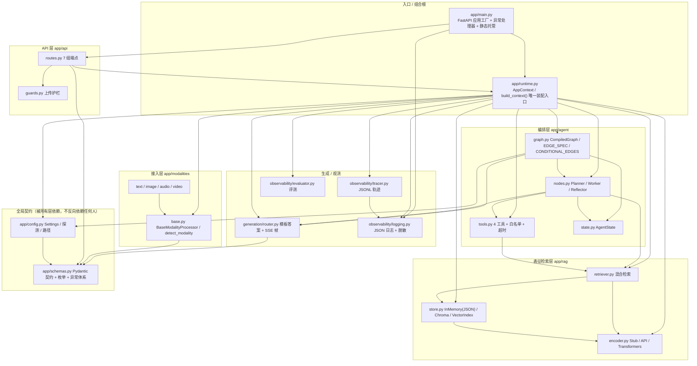
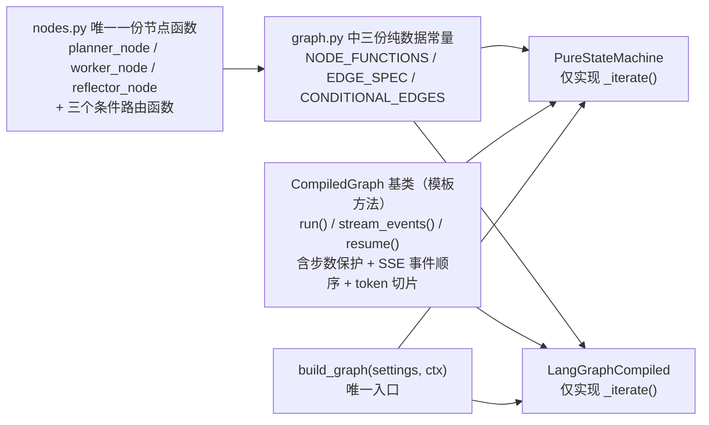
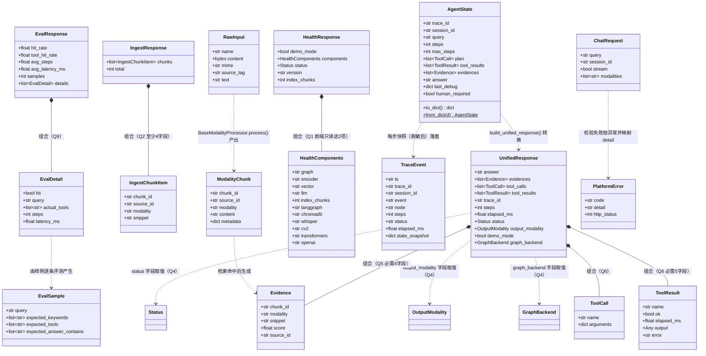
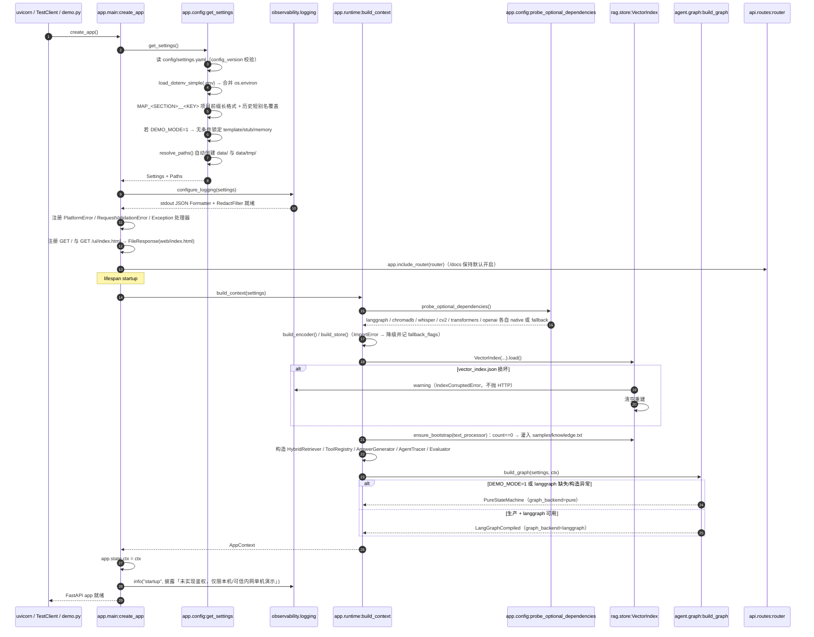
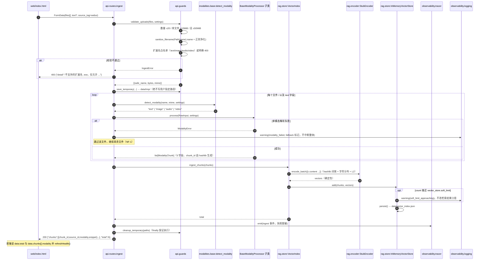
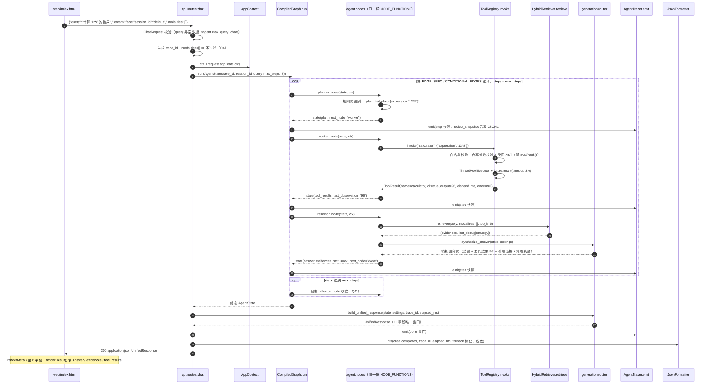
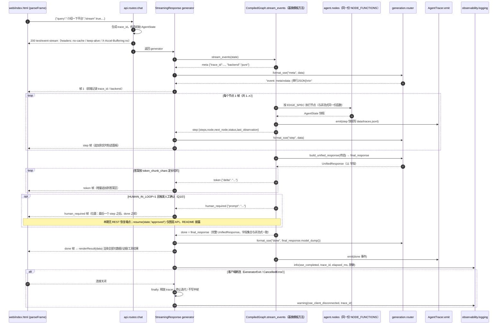
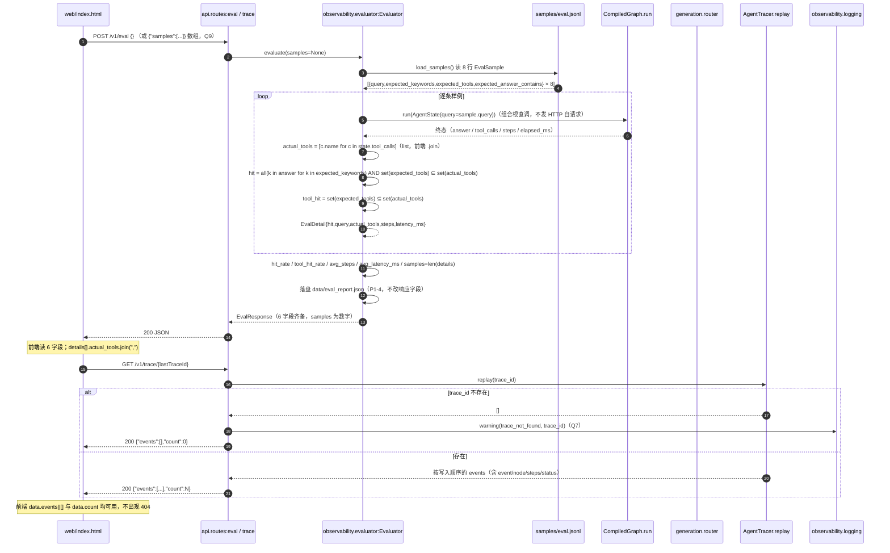

# 多模态通用智能体开发平台 · 系统架构设计（ARCHITECTURE）

| 项 | 值 |
| --- | --- |
| 文档类型 | 系统架构设计 + 实现规格（下游唯一实现依据） |
| 版本 | v1.0 |
| 编写 | 架构师 高见远（Gao） |
| 语言 | 简体中文 |
| 上游输入 | `docs/PRD.md`（§1.2 红线、§4 契约、§5 非功能、§7 Q1–Q15）、`docs/reference/platform-spec-README.md`（主契约）、`docs/reference/design-project10.md`（辅）、`requirements.txt`、`samples/knowledge.txt`、`web/index.html` |
| 裁决依据 | 主理人对 §7 Q1–Q15 的拍板结论 + 8 条额外硬约束（已全文并入本文，不再回问） |
| 实现基线 | **Python 3.13（本机）** + FastAPI + Pydantic v2 + Uvicorn + 原生 JS（无构建工具）；核心依赖仅限 `requirements.txt`，零新增必需依赖 |
| 交付边界 | 本机从零实现完整源码；**不做远端推送**；`web/index.html` / `requirements.txt` / `samples/knowledge.txt` 零改动 |
| 下游读者 | 工程师（照 `docs/TASKS.md` 一次性批量实现）、QA（照 §7 质量守卫清单回归） |

> 本文与 `docs/TASKS.md` 的关系：本文回答「系统长什么样、为什么这样设计、接口精确到字段」；TASKS.md 回答「按什么顺序写哪些文件、每个文件写完怎么验」。二者冲突时以 **PRD §4 契约红线** 为最高优先级，其次本文。

---

## 0. 阅读指引与红线复述

### 0.1 「文档即契约」七条红线（PRD §1.2，逐条不可破）

| # | 红线 | 本设计对应的保护措施 |
| --- | --- | --- |
| 1 | 7 组 REST 端点之路径／方法／请求字段／响应字段集合 | §3.6 端点契约速查表逐字段锁定；响应模型只允许「加可选字段」，不允许删改重命名 |
| 2 | 入库 → 混合检索问答 → SSE → 轨迹回放 → 自动评测 时序与前端交互 | §4 四张时序图 + §5.7 SSE 帧规范 |
| 3 | `UnifiedResponse` 11 字段、`ModalityChunk` 5 字段、SSE 帧格式与事件顺序、JSONL 轨迹格式 | §3.1 Pydantic 模型 + §5.7 + §5.2 |
| 4 | DEMO 模板答案结构、stub 确定性特征、混合检索回退策略、评测指标口径 | §1.6 / §5.8 / §3.3 |
| 5 | `DEMO_MODE` 优先级、§4.6 既有配置键名与取值、`.env` 覆盖规则 | §3.5 配置键全集 + §5.1 三层合并 |
| 6 | `web/index.html` 调用的接口与消费的数据格式一字不改 | §0.3 前端事实契约清单；`web/index.html` 零改动 |
| 7 | 无鉴权／无会话持久化／无并发写入锁须如实披露，不得偷偷补齐 | §6 假设与边界 + README + 启动日志 |

**允许改变的范围**：补齐缺失交付物；在内部实现层增加异常处理、结构化日志与脱敏、配置分层校验、测试、性能护栏、上传安全护栏、注释与文档；内部模块划分与重构（§6 目录对外可见部分保持一致）。

### 0.2 主理人 Q1–Q15 裁决落地索引（工程师逐条对照）

| 裁决 | 结论摘要 | 落地文件 | 验收条目 |
| --- | --- | --- | --- |
| Q1 | `/health` 必需 `demo_mode` + `components`；可附加 `status`/`version`/`index_chunks`（顶层与 `components.index_chunks` 同值）；附加字段不影响前端 | `app/api/routes.py`、`app/schemas.py` | §7-A3 |
| Q2 | `/v1/ingest` → `{chunks, total}`；`chunks[]` 至少 `chunk_id`/`source_id`/`modality`/`snippet`；错误统一 `{"detail":"..."}` | `app/api/routes.py`、`app/schemas.py` | §7-A4 |
| Q3 | 上传护栏：扩展名白名单、单文件 ≤10 MiB、单次总 ≤50 MiB、≤20 文件、`Path(name).name` + 正则净化、临时文件 `data/tmp/` + `finally` 清理、绝不写用户指定路径；不破坏前端 `FormData` | `app/api/guards.py`、`config/settings.yaml` | §7-D2 |
| Q4 | `status`∈{ok,degraded,error}；`output_modality`∈{text,image,audio,video,mixed}；`graph_backend`∈{pure,langgraph}；`modalities` 缺省≡空数组（=不过滤）；`session_id` 仅透传轨迹 | `app/schemas.py`、`app/agent/state.py`、`app/api/routes.py` | §7-A5 |
| Q5 | `evidences[]` 必需 `chunk_id`/`modality`/`snippet`/`score`；`source_id`/`content` 可选附加 | `app/schemas.py`、`app/rag/retriever.py` | §7-A6 |
| Q6 | `tool_results[]` 必需 `name`/`ok`/`elapsed_ms`/`output`/`error`（无错时 `error` 仍须存在，取 `null`/`""`）；`tool_calls[]` 至少 `name`/`arguments` | `app/schemas.py`、`app/agent/tools.py` | §7-A7 |
| Q7 | `/v1/trace/{trace_id}` 不存在 → **HTTP 200** `{"events":[],"count":0}` + warning 日志；README 写明 | `app/api/routes.py`、`app/observability/tracer.py`、`README.md` | §7-A8 |
| Q8 | `/v1/tools` 保留 `tools[]`（`name`/`description`/`parameters`），附加 `whitelist`/`max_steps`/`tool_timeout_seconds` | `app/api/routes.py`、`app/agent/tools.py` | §7-A9 |
| Q9 | 请求 `samples`=数组、响应 `samples`=数量数字（同名不同义保持）；`eval.jsonl` 每行 schema 固定；命中判定 = 期望关键词全部出现在 answer **且** `expected_tools ⊆ actual_tools`；前端 6 个字段齐备 | `app/observability/evaluator.py`、`samples/eval.jsonl`、`app/schemas.py` | §7-A10 |
| Q10 | `human_required` 在需人工确认的 `step` 之后、`done` 之前；本期**不新增** REST 恢复端点；`resume(state,"approved")` 仅图层 API，README 披露 | `app/agent/graph.py`、`app/generation/router.py`、`README.md` | §7-A11 |
| Q11 | 默认 `agent.max_steps=8`、`agent.tool_timeout_seconds=3.0`、`vector_store.soft_limit=10000`（接近时 warning + `last_debug` 标注，不改检索口径） | `config/settings.yaml`、`app/rag/store.py`、`app/agent/graph.py`、`app/agent/tools.py` | §7-H5 |
| Q12 | 标准库 `logging` + 自写 JSON Formatter → stdout；字段 `ts`/`level`/`event`/`component`/`trace_id`/`message`；强制脱敏清单；异常结构化反馈，禁止堆栈／密钥直出 HTTP；日志不写第三方服务 | `app/observability/logging.py`、`app/main.py`、`README.md` | §7-D4 |
| Q13 | `/docs` 保持 FastAPI 默认开启，不列入 7 组红线端点 | `app/main.py` | §7-A1 |
| Q14 | `config/settings.yaml` 补齐完整键集合 + `config_version: 1`；所有键支持环境变量覆盖（**长格式统一带 `MAP_` 项目前缀**：`MAP_<SECTION>__<KEY>`，避免误读宿主注入的 `SERVER__HOST`/`SERVER__PORT`；规格 §4.6 历史短别名不带前缀、优先级不变）；`DEMO_MODE=1` 无条件锁定 `llm_backend=template`/`encoder_backend=stub`/`vector_backend=memory` | `app/config.py`、`config/settings.yaml`、`.env.example` | §7-B1 |
| Q15 | 维持单机演示假设，不加并发写入锁，README 如实披露 | `README.md`、`app/rag/store.py` | §7-E3 |

**8 条额外硬约束落地索引**：文档即契约 → 全文；零新增依赖 → §1.2 / §5.2；无冗余图实现 → §1.5；确定性 → §1.6；无不安全配置 → §5.4；前端零改动 → §0.3；目录结构 → §2；`make` 不可用但 Makefile 仍提供 → TASKS.md §4。

### 0.3 前端事实契约清单（从 `web/index.html` 逐行提取，**不得改动**）

| 端点 | 前端实际读取／发送的字段（既成事实） |
| --- | --- |
| `GET /health` | `data.demo_mode`(bool)；`data.components.{graph, encoder, vector, llm, index_chunks, langgraph, chromadb, whisper, cv2, transformers, openai}` |
| `POST /v1/ingest` | 发送 `FormData`：`files`(可多)、`text`(**仅非空时 append**)、`source_tag`(默认 `webui`)；读取 `data.total`、`data.chunks[].modality`；错误读 `data.detail` |
| `POST /v1/chat` | 发送 `{query, session_id, stream, modalities}`（`stream` 默认 `true`，`modalities` 为 `[]` 或单元素数组）；非流式 `renderResult(data)` |
| 非流式响应 | `renderMeta`: `trace_id`/`steps`/`elapsed_ms`/`status`/`output_modality`/`graph_backend`；`renderResult`: `answer`、`evidences[].{modality,score,snippet,chunk_id}`、`tool_results[].{name,ok,elapsed_ms,output,error}` |
| SSE | `parseFrame()` 按 `\n\n` 切帧，逐行读 `event:` / `data:` 并 `JSON.parse`；`meta`→`trace_id`,`backend`；`step`→`steps`,`node`,`next_node`,`status`,`last_observation`；`token`→`delta`；`human_required`→`prompt`；`done`→ 完整 `UnifiedResponse` 直接送 `renderResult()` |
| `GET /v1/trace/{id}` | `data.events[].{event,node,steps,status}`、`data.count` |
| `GET /v1/tools` | `data.tools[].{name,description,parameters}` |
| `POST /v1/eval` | 发送 `{}`；读取 `hit_rate`/`tool_hit_rate`/`avg_steps`/`avg_latency_ms`/`samples`/`details[].{hit,query,actual_tools,steps,latency_ms}`，其中 `actual_tools.join(",")` **必须是数组** |
| 静态托管 | `GET /` 与 `GET /ui/index.html` 返回 `web/index.html`（`text/html`） |

> ⚠️ `data:` 行必须是**单行 JSON**。前端 `parseFrame` 逐行累加 `data:` 行内容后 `JSON.parse`；若使用缩进多行 JSON 或 `indent=`，`JSON.parse` 失败被 `catch` 吞掉成 `data={}`，面板静默空白且无任何报错。详见 §5.7。

---

## 1. 实现方案与框架选型

### 1.1 核心难点与对策

| # | 难点 | 对策 | 落地位置 |
| --- | --- | --- | --- |
| D1 | **零依赖端到端可跑通**：不能用任何模型权重／API Key／GPU／联网，却要跑通四模态 + RAG + Agent + SSE + 评测 | 统一抽象层 `ModalityChunk` 把图像／音频／视频全部转成**描述性文本**（颜色网格／感知指纹／WAV 元信息／抽帧描述），与文本共用同一个 `StubEncoder` + `InMemoryVectorStore`；所有可选后端用 `importlib.util.find_spec` + `try/except ImportError` 降级 | `app/modalities/*`、`app/rag/encoder.py`、`app/config.py` |
| D2 | **确定性可复现**：同输入多次运行检索结果、工具选择、评测命中率必须一致 | 禁用 Python 内置 `hash()`（PYTHONHASHSEED 随机化）；`StubEncoder` 用 `hashlib.sha256` 词频分桶 + 字符分布 + L2 归一；`chunk_id` 用 `hashlib` 内容哈希；视频降级帧用 `hashlib.sha256(content)[:8]` 作 `numpy.random.default_rng(seed)` 种子 | §1.6 |
| D3 | **图编排零冗余**：`PureStateMachine` 与 `LangGraphCompiled` 不得出现两套业务逻辑 | `EDGE_SPEC` / `CONDITIONAL_EDGES` / `NODE_FUNCTIONS` 三份**纯数据**常量 + `nodes.py` 唯一一份节点函数；`CompiledGraph` 基类用**模板方法**统一实现 `run()` / `stream_events()` / `resume()`（含 SSE 事件顺序），子类仅实现 `_iterate()` 一个差异点 | §1.5、`app/agent/graph.py` |
| D4 | **契约零漂移**：前端零改动、11 字段一个不少、SSE 帧格式逐字节兼容 | Pydantic 模型集中定义于 `app/schemas.py`；`UnifiedResponse` 用显式字段（禁止 `extra="allow"` 偷偷改结构之外的随意增删）；非流式与 SSE `done` **由同一个 `build_unified_response()` 产出**，天然字段集合一致 | `app/schemas.py`、`app/generation/router.py` |
| D5 | **企业级横切不触碰契约**：异常／日志脱敏／上传护栏／配置分层／性能护栏全部是内部增量 | 异常处理器与中间件挂在 FastAPI 应用层；脱敏在「日志 Formatter + 轨迹落盘前 + HTTP 响应构造」三个出口统一收口；上传护栏在 `guards.py` 前置校验，不改动 `FormData` 字段 | §5 全章 |
| D6 | **可选依赖探测 ≠ 启用**：`components.langgraph` 报 `native` 不代表启用 langgraph | 探测结果（`native`/`fallback`）与「生效后端」（`pure`/`langgraph`）是两条独立数据流；DEMO 下即使装了 langgraph 也强制 `pure` | §1.7、`app/runtime.py` |
| D7 | **Agent 失控防护**：最大步数 / 工具白名单 / 单工具超时 / 人工断点 | `CompiledGraph` 基类步数保护（超限强制进 Reflector 收敛）；`ToolRegistry` 白名单 + `ThreadPoolExecutor` + `future.result(timeout=...)`；`HUMAN_IN_LOOP` 断点仅图层可恢复 | `app/agent/graph.py`、`app/agent/tools.py` |

### 1.2 技术选型与「不得引入」清单

**核心技术栈（锁定，不得更改）**

| 层 | 选型 | 理由 |
| --- | --- | --- |
| Web 框架 | FastAPI ≥0.110 + Uvicorn ≥0.27 | 契约指定；原生 `StreamingResponse` 支持 SSE，`UploadFile` + `Form` 支持 multipart，`/docs` 自动开启（Q13） |
| 数据校验 | Pydantic v2 | 契约指定；集中承载 `UnifiedResponse` 等 11 项契约模型 |
| 数值 | numpy ≥1.24 | `StubEncoder` 向量、余弦相似度、颜色网格、降级合成帧 |
| 图像 | Pillow ≥10.0（+ numpy） | 图像归一化与颜色网格／感知指纹；DEMO 无模型推理 |
| 视频 | opencv-python-headless ≥4.8（cv2） | 核心依赖，抽帧；不可解码时走确定性合成帧 |
| 音频 | 标准库 `wave` | 仅解析 PCM WAV 元信息，不引入解码库 |
| 配置 | PyYAML ≥6.0 + 标准库 `os` | `config/settings.yaml` + 环境变量 / `.env` |
| HTTP 客户端 | httpx ≥0.27 | 生产模式直连 OpenAI 兼容端点（**不依赖 `openai` SDK**）；DEMO 下**禁止发出任何请求** |
| 前端 | 原生 JS 单页（`web/index.html`） | 契约指定，无构建工具，同源托管 |
| 测试 | pytest ≥8.0 + `fastapi.testclient.TestClient` | 契约指定；`make demo` 用 `TestClient` 冒烟所有端点 |
| 日志 | 标准库 `logging` + 自写 `JsonFormatter` | Q12；不写第三方服务 |

> **🚫 绝对禁止出现在 `import` 语句中的库**（不在 `requirements.txt`，引入即违约）：
> `python-dotenv`（`.env` 用自写极简解析器，见 §5.1）、`jsonschema`（工具参数校验自写，见 §3.3）、`langchain`/`langgraph` 顶层硬 import（只允许 `find_spec` + 局部 `try/except ImportError`）、`chromadb`/`whisper`/`transformers`/`torch`/`openai` 顶层硬 import（同上）、任何 `eval`/`exec` 用于计算器。
> **可选依赖的唯一合法用法**：
> ```python
> spec = importlib.util.find_spec("langgraph")
> if spec is not None:
>     try:
>         from langgraph.graph import StateGraph   # 局部导入，必须在 try 内
>         ...
>     except ImportError:
>         ...  # 标记 fallback，绝不向上抛
> ```

### 1.3 分层架构与依赖方向



**依赖方向铁律（防循环导入）**

1. `app/config.py` 与 `app/schemas.py` 是最底层，**不得 import 任何 `app.*` 业务模块**。
2. 五个业务子包之间**只允许单向依赖**：`rag → {config, schemas}`（**`rag` 不 import `modalities`**；空索引灌库所需的 `TextProcessor` 由组合根通过 `ensure_bootstrap(text_processor)` 运行时注入）、`agent → rag`（经 `HybridRetriever` 抽象）、`generation → schemas`；`observability` 只依赖 `config`/`schemas` 与状态字典快照（用 `TYPE_CHECKING` 或 `Protocol`，不硬 import 具体类）。因此 **`app/modalities/`（T02）与 `app/rag/`+`app/agent/`+`app/generation/`（T03）在代码层互不 import，可并行编写，二者均只硬依赖 T01**。
3. `app/api/routes.py` **不得 import `app.main`**；端点通过 `request.app.state.ctx` 拿组合根（避免循环）。
4. `nodes.py` 需要组合根时，参数类型标注用 `TYPE_CHECKING` + 字符串注解或 `Protocol`，**运行时不 import `app.runtime`**。
5. 唯一允许「认识所有人」的模块是 `app/runtime.py`；唯一允许「被所有人 import」的是 `app/config.py` / `app/schemas.py`。

### 1.4 架构模式

| 模式 | 应用位置 | 说明 |
| --- | --- | --- |
| **组合根（Composition Root）** | `app/runtime.py::build_context()` | 全进程唯一装配点；`app/main.py`、`scripts/demo.py`、`tests/conftest.py` 三处复用同一装配逻辑，不各自 new 依赖 |
| **抽象工厂 / 策略** | `build_encoder()`、`build_store()`、`build_graph()` | 切换后端只改配置，不改编排／生成层 |
| **模板方法** | `CompiledGraph`（基类实现 `run`/`stream_events`/`resume`，子类只实现 `_iterate`） | 保证两种图后端零业务逻辑重复 |
| **适配器** | `LangGraphCompiled`、`ChromaVectorStore`、`APIEncoder` | 把外部库适配到本平台唯一接口 |
| **DTO / 契约模型** | `app/schemas.py` | 跨层唯一数据契约，`ModalityChunk` 是唯一跨模态载体 |
| **分层异常处理** | `PlatformError` 子类树 + FastAPI `exception_handler` | 领域异常 → 统一 `{"detail": ...}`，堆栈只进日志 |

### 1.5 无冗余设计：唯一组合根 + 唯一图接口（硬约束 3 的落地）



**强制约定**

- `NODE_FUNCTIONS: dict[str, Callable[[AgentState, AppContext], AgentState]]`、`EDGE_SPEC: dict[str, str]`、`CONDITIONAL_EDGES: dict[str, tuple[Callable, dict[str, str]]]` 必须是**模块级纯数据常量**，两种图后端都从这三份常量读取，不得各自硬编码节点顺序或边。
- `nodes.py` 的三个节点函数是**纯函数**（`state in → state out`），不持有状态、不直接写日志／轨迹／SSE；副作用由 `CompiledGraph` 基类与外部 `AgentTracer` 统一负责，这样两种后端行为完全一致。
- `PureStateMachine._iterate()` 与 `LangGraphCompiled._iterate()` 的差异**只允许**是「如何按 `EDGE_SPEC`/`CONDITIONAL_EDGES` 驱动节点」，产出的都是 `AgentState` 快照流；**禁止**在子类里生成 SSE 事件、拼接答案、执行工具或写轨迹。
- `build_graph()` 是创建图实例的**唯一入口**，`CompiledGraph` 是对外的**唯一接口**；任何模块不得直接 `PureStateMachine(...)` 或 `LangGraphCompiled(...)`。
- `LangGraphCompiled` 构造若抛任何异常（版本不兼容、StateGraph API 变化等），`build_graph()` 必须捕获 → 记 warning 日志 → 回退 `PureStateMachine` → 在 `fallback_flags` 与 `/health.components.langgraph` 标记 `fallback`，**绝不崩溃**。

### 1.6 确定性设计（硬约束 4）

| 场景 | 规定 |
| --- | --- |
| 所有 DEMO 分支 | **禁用 Python 内置 `hash()`**，一律 `hashlib.sha256` / `sha1`；全局搜索 `hash(` 时只允许出现 `hashlib` 相关调用 |
| `chunk_id` | `"chk_" + hashlib.sha256(f"{source_id}|{modality}|{index}|{content}".encode("utf-8")).hexdigest()[:16]` |
| `StubEncoder` | 分词（中文按字 + 英文按词，正则 `[\u4e00-\u9fff]|[a-zA-Z0-9]+`）→ `int(sha256(token)[:8],16) % dim` 累加词频 → 追加字符分布分桶 → `numpy.linalg.norm` L2 归一化；固定 `dim=256`，零向量返回全零而非 NaN |
| 视频降级帧 | `seed = int.from_bytes(hashlib.sha256(raw_content).digest()[:8], "big")`；`rng = numpy.random.default_rng(seed)`；合成帧再走 `ImageProcessor` 同一链路 |
| 检索排序 | 得分相同时以 `chunk_id` 字典序作稳定次级排序键；`dict` 遍历顺序不参与结果 |
| 集合／去重 | 用有序 `list` + `set` 辅助，最终输出按固定键排序，禁止用 `set` 直接决定输出顺序 |
| `current_time` 工具 | 唯一非确定性来源，但**输出不参与命中判定**；确定性口径限定为「检索结果、工具选择、模板结构、评测命中率／平均步数」，时间字符串与 `elapsed_ms`／`ts` 属观测元数据，不进入这些口径（见 §6-U2） |
| `trace_id` | `"tr_" + hashlib.sha256(f"{monotonic_ns}|{query}|{session_id}").hexdigest()[:16]` 或 `uuid4`；**不要求逐次一致**，但同一请求内全局唯一且贯穿日志／轨迹／响应 |

### 1.7 DEMO_MODE 锁定矩阵（Q14 + PRD §4.5）

| 配置项 | `DEMO_MODE=1` | `DEMO_MODE=0` |
| --- | --- | --- |
| `llm.backend` | **无条件锁定 `template`** | `api` \| `template`（无 Key 自动 `template`） |
| `encoder.backend` | **无条件锁定 `stub`** | `api` \| `transformers` \| `stub` |
| `vector_store.backend` | **无条件锁定 `memory`** | `chroma` \| `memory` |
| `graph` 生效后端 | **强制 `pure`**（PRD §4.5-8「图编排 PureStateMachine」） | langgraph 可用则 `langgraph`，否则 `pure` |
| `/health.components.langgraph` 等 6 项 | 仍如实报 `native`/`fallback`（= 探测结果，**不代表启用**） | 同左 |
| httpx 外部请求 | **0 次**，即使配置了 `LLM_API_KEY`/`LLM_BASE_URL`/`LLM_MODEL` | 仅生产模式且显式 `backend=api` 时允许 |
| 模型权重 | 不加载 `torch`/`transformers`，不调用 CUDA | `transformers` 仅从 `encoder.local_model_path` 本地目录 `local_files_only=True` 加载 |
| 可选依赖 | 只 `find_spec` 探测 + `try/except ImportError` 降级，绝不崩溃 | 同左 |

> 实现顺序要求：`get_settings()` 必须先合并 YAML → `.env` → `os.environ`，**最后一步**才执行 DEMO 锁定（覆盖写回三个字段），确保「即使 `.env` 填了 `LLM_API_KEY`／`LLM_BACKEND=api`，生效后端仍为 `template`/`stub`/`memory`」（P0-10 验收）。锁定发生在配置层，不是各后端各自判断。

---

## 2. 完整文件清单

> 状态：🆕 本期新建（**45 个**）｜🔒 已存在且**零改动**（5 个）｜📄 本轮设计文档（2 个，非源码）
> 「任务」列对应 `docs/TASKS.md` 的 T01–T05。

### 2.1 项目根与配置（10 🆕 + 3 🔒）

| 相对路径 | 职责 | 任务 | 状态 |
| --- | --- | --- | --- |
| `requirements.txt` | 核心依赖基线；仅核对，**不得改动**（含「Python 3.11 沙箱」历史注释，见 §6-U1） | T01 | 🔒 |
| `Makefile` | `demo` / `test` / `run` / `eval` 四目标，命令与规格 §2 逐字一致 | T01 | 🆕 |
| `.env.example` | **仅占位符**（`LLM_API_KEY=`、`LLM_BASE_URL=` 等空值 + 注释），禁止出现任何真实凭据 | T01 | 🆕 |
| `.gitignore` | 覆盖 `.env`、`data/`、`__pycache__/`、`*.py[cod]`、`.pytest_cache/`、`*.egg-info/` | T01 | 🆕 |
| `config/settings.yaml` | 主配置完整键集合 + `config_version: 1`（§3.5） | T01 | 🆕 |
| `README.md` | 快速启动、架构、已知限制、无鉴权披露、HOST 覆盖风险、Q7/Q10/Q15 披露 | T05 | 🆕 |
| `samples/knowledge.txt` | 内置检索知识，空索引启动时自动灌入；**零改动** | T02 | 🔒 |
| `samples/eval.jsonl` | 自建 8 条评测样例，每行严格 §3.5-A schema | T04 | 🆕 |
| `web/index.html` | 原生 JS 单页控制台；**零改动**（前端事实契约来源） | — | 🔒 |
| `data/.gitkeep` | 运行期目录占位；`data/` 由 `resolve_paths()` 自动创建 | T05 | 🆕 |
| `data/tmp/.gitkeep` | 上传临时目录占位，`finally` 清理 | T05 | 🆕 |

### 2.2 `app/` 根（5 🆕）

| 相对路径 | 职责 | 任务 | 状态 |
| --- | --- | --- | --- |
| `app/__init__.py` | `__version__ = "1.0.0"`（供 `/health.version`） | T01 | 🆕 |
| `app/config.py` | `Settings` 模型、三层配置合并、DEMO 锁定、`.env` 自写解析、可选依赖探测、`resolve_paths()`、启动期校验 | T01 | 🆕 |
| `app/schemas.py` | 全部 Pydantic 契约模型、三个枚举、统一异常体系、`SSEFrame` 工具 | T01 | 🆕 |
| `app/main.py` | `create_app()` FastAPI 应用工厂（异常处理器 / 静态托管 / lifespan / router 注册 / `/docs` 默认开启）、`app = create_app()`、`__main__` 分支支持 `HOST`/`PORT` | T01 | 🆕 |
| `app/runtime.py` | **组合根**：`AppContext` dataclass + `build_context()` 唯一装配入口（无 FastAPI 副作用） | T04 | 🆕 |

### 2.3 `app/modalities/`（6 🆕）

| 相对路径 | 职责 | 任务 |
| --- | --- | --- |
| `app/modalities/__init__.py` | 导出 `PROCESSORS` 映射（`modality → processor 类`） | T02 |
| `app/modalities/base.py` | `RawInput`、`BaseModalityProcessor`(ABC)、`detect_modality()`、`MODALITY_BY_EXT`、`make_chunk_id()`（hashlib）、`build_chunk()` | T02 |
| `app/modalities/text.py` | `TextProcessor`：清洗 + 定长重叠切片（`chunk_size`/`chunk_overlap`） | T02 |
| `app/modalities/image.py` | `ImageProcessor`：Pillow 归一 32×32 → numpy 4×4 颜色网格 + 感知指纹 → 描述性文本 `content` | T02 |
| `app/modalities/audio.py` | `AudioProcessor`：`wave` 解析 PCM WAV 元信息 + `hashlib` 确定性占位 ASR；whisper 可选降级 | T02 |
| `app/modalities/video.py` | `VideoProcessor`：cv2 等间隔抽帧（≤3 帧）复用 `ImageProcessor`；不可解码时内容哈希 → `default_rng(seed)` 合成帧；带时间戳 metadata | T02 |

### 2.4 `app/rag/`（4 🆕）

| 相对路径 | 职责 | 任务 |
| --- | --- | --- |
| `app/rag/__init__.py` | 导出 `build_encoder` / `build_store` / `HybridRetriever` | T03 |
| `app/rag/encoder.py` | `BaseEncoder`(ABC)、`StubEncoder`、`APIEncoder`(httpx)、`TransformersEncoder`(本地 `local_files_only=True`)、`build_encoder()` 工厂降级 | T03 |
| `app/rag/store.py` | `VectorStore`(ABC)、`InMemoryVectorStore`(numpy 暴力余弦 + JSON 持久化 + 损坏恢复)、`ChromaVectorStore`(可选)、`VectorIndex`(encode+store+软上限告警+空索引灌库) | T03 |
| `app/rag/retriever.py` | `HybridRetriever`：稠密余弦 + 简化 BM25 + 加权融合 + 重排（子串命中加权／同源去重）+ 全零／无结果时纯关键词回退；产出 `Evidence[]` 与 `last_debug` | T03 |

### 2.5 `app/agent/`（5 🆕）+ `app/generation/`（2 🆕）

| 相对路径 | 职责 | 任务 |
| --- | --- | --- |
| `app/agent/__init__.py` | 导出 `build_graph` / `CompiledGraph` | T03 |
| `app/agent/state.py` | `AgentState` dataclass + `to_dict()` / `from_dict()`（可序列化快照，脱敏在 tracer 落盘前） | T03 |
| `app/agent/tools.py` | `BaseTool`(ABC)、4 个内置工具、`ToolRegistry`（白名单 / JSON Schema / 自写参数校验 / `ThreadPoolExecutor` 超时）、`calculator` 受限 AST | T03 |
| `app/agent/nodes.py` | **唯一一份** `planner_node` / `worker_node` / `reflector_node` + `route_after_planner/worker/reflector` 条件函数（纯函数） | T03 |
| `app/agent/graph.py` | `NODE_FUNCTIONS` / `EDGE_SPEC` / `CONDITIONAL_EDGES` 三份常量、`CompiledGraph` 基类模板方法、`PureStateMachine`、`LangGraphCompiled`、`build_graph()` 唯一入口 | T03 |
| `app/generation/__init__.py` | 导出 `synthesize_answer` / `build_unified_response` / `format_sse` | T03 |
| `app/generation/router.py` | `route_output()`、`synthesize_answer()`（模板四段式 / 生产 LLM 降级）、`build_unified_response()`（**11 字段唯一出口**）、`format_sse()`、`slice_tokens()`、`LAST_DEBUG` 汇总 | T03 |

### 2.6 `app/observability/`（4 🆕）+ `app/api/`（3 🆕）

| 相对路径 | 职责 | 任务 |
| --- | --- | --- |
| `app/observability/__init__.py` | 包初始化 | T01 |
| `app/observability/logging.py` | `JsonFormatter`、`RedactFilter`、`configure_logging()`、`get_logger()`、`TraceLoggerAdapter`、`redact_text()` / `redact_snapshot()` 公共脱敏函数 | T01 |
| `app/observability/tracer.py` | `AgentTracer.emit()` 追加写 `data/traces.jsonl`、`replay(trace_id)`、快照脱敏；**不存在时返回空列表**由 routes 层转 200 | T04 |
| `app/observability/evaluator.py` | `Evaluator.load_samples()` / `evaluate()` / `evaluate_one()`；`python3 -m app.observability.evaluator` 输出报告 + 落盘 `data/eval_report.json` | T04 |
| `app/api/__init__.py` | 导出 `router` | T04 |
| `app/api/guards.py` | `sanitize_filename()`、`validate_uploads()`、`save_temporary()` / `cleanup_temporary()`；扩展名／MIME 白名单、大小／数量上限、路径穿越防护 | T04 |
| `app/api/routes.py` | 7 组 REST 端点（§3.6）+ `/health` 组件报告 + SSE `StreamingResponse`（`try/finally` 释放）+ trace 不存在 200 空集 | T04 |

### 2.7 `scripts/`（2 🆕）+ `tests/`（6 🆕）

| 相对路径 | 职责 | 任务 |
| --- | --- | --- |
| `scripts/__init__.py` | 包初始化 | T04 |
| `scripts/demo.py` | `make demo` 入口：**不启动服务器**，调 `build_context()` 自生成四种样例资源 + 四模态入库 + Agent 运行 + `TestClient` 冒烟全部 API 端点 | T04 |
| `tests/__init__.py` | 包初始化 | T05 |
| `tests/conftest.py` | `DEMO_MODE=1` 固定 fixture、`build_context()` 隔离 fixture（临时 `data/`）、`TestClient` fixture、四模态样例资源生成器 | T05 |
| `tests/test_modalities.py` | 四模态接入 / 确定性 / 单模态失败隔离 / 未知扩展名 | T05 |
| `tests/test_rag.py` | StubEncoder 确定性、混合检索命中、全零回退、JSON 持久化与损坏恢复、软上限 | T05 |
| `tests/test_agent.py` | 三节点、4 工具成功与失败、受限 AST、白名单、超时、max_steps、两图后端行为一致、`resume()` | T05 |
| `tests/test_api.py` | 7 组端点契约、SSE 帧序列与 `done` 字段完整性、trace 不存在 200、eval 字段齐备、DEMO 锁定、脱敏、上传护栏 | T05 |

### 2.8 设计文档（2 📄，本轮产出，非源码）

| 相对路径 | 职责 |
| --- | --- |
| `docs/ARCHITECTURE.md` | 本文 |
| `docs/TASKS.md` | 有序任务列表、依赖图、验收判据 |

> **统计**：待实现源码／配置／文档 **45 个新建文件**；已存在且零改动 **3 个源码相关文件**（`requirements.txt`、`samples/knowledge.txt`、`web/index.html`）+ 2 份参考文档；本轮新增 2 份设计文档。项目源码树合计 **50 个文件**。
> **目录结构**：严格保持规格 §6 的 `app/{modalities,rag,agent,generation,observability,api}`、`tests`、`scripts`、`config`、`samples`、`web`、`data`；`app/` 下仅新增 `runtime.py` 一个**内部装配模块**（PRD §1.2 允许的「内部模块划分与重构」，六个对外可见子包与顶层目录零增删、零改名），理由见 §1.3–1.4：组合根必须能被 `scripts/demo.py` / `tests/conftest.py` 无副作用复用，而 `app/main.py` 带 FastAPI 副作用不适合承担该职责。

---

## 3. 核心数据结构与接口

### 3.1 Pydantic 契约模型（`app/schemas.py`）

> 所有响应模型显式声明字段；**不得删改／重命名**下表中标注「契约」的字段。可选附加字段只允许「新增」，且不得改变前端已有消费路径。

| 模型 | 字段（类型） | 说明 / 来源 |
| --- | --- | --- |
| `ModalityType`(str Enum) | `TEXT="text"`, `IMAGE="image"`, `AUDIO="audio"`, `VIDEO="video"` | 契约；`ModalityChunk.modality` 取值 |
| `Status`(str Enum) | `OK="ok"`, `DEGRADED="degraded"`, `ERROR="error"` | **Q4**；亦用于 `/health.status` |
| `OutputModality`(str Enum) | `TEXT`, `IMAGE`, `AUDIO`, `VIDEO`, `MIXED` | **Q4** |
| `GraphBackend`(str Enum) | `PURE="pure"`, `LANGGRAPH="langgraph"` | **Q4** |
| `ModalityChunk` | `chunk_id:str`, `source_id:str`, `modality:str`, `content:str`, `metadata:dict[str,Any]` | **契约 5 字段**（PRD §1.2-3），一字不改 |
| `RawInput` | `name:str`, `content:bytes`, `mime:str`, `source_tag:str`, `text:str\|None=None` | 接入层内部输入 |
| `IngestChunkItem` | `chunk_id:str`, `source_id:str`, `modality:str`, `snippet:str` | **Q2**；`snippet` = `content` 前 `retrieval.snippet_chars` 字符 |
| `IngestResponse` | `chunks:list[IngestChunkItem]`, `total:int` | **Q2**；顶层仅这两个字段 |
| `ChatRequest` | `query:str`, `session_id:str="default"`, `stream:bool=True`, `modalities:list[str]=Field(default_factory=list)` | **Q4**：缺省与 `[]` 等价；`query` 长度上限由 `agent.max_query_chars` 在路由层校验 |
| `Evidence` | `chunk_id:str`, `modality:str`, `snippet:str`, `score:float` **必需**；`source_id:str\|None=None` 可选 | **Q5**；本设计只附加 `source_id`，不附加 `content`（减小响应体积，前端不消费） |
| `ToolCall` | `name:str`, `arguments:dict[str,Any]` **必需**；`id:str\|None=None` 可选 | **Q6** |
| `ToolResult` | `name:str`, `ok:bool`, `elapsed_ms:float`, `output:Any`, `error:str\|None=None` | **Q6**：`error` 字段**恒存在**，成功时 `null`；前端 `r.ok ? JSON.stringify(r.output) : r.error` |
| `UnifiedResponse` | `answer:str`, `evidences:list[Evidence]`, `tool_calls:list[ToolCall]`, `tool_results:list[ToolResult]`, `trace_id:str`, `steps:int`, `elapsed_ms:float`, `status:Status`, `output_modality:OutputModality`, `demo_mode:bool`, `graph_backend:GraphBackend` | **契约 11 字段**；由 `build_unified_response()` 唯一产出，非流式与 SSE `done` 共用 |
| `MetaEventData` | `trace_id:str`, `backend:str` | SSE `meta` |
| `StepEventData` | `steps:int`, `node:str`, `next_node:str`, `status:str`, `last_observation:str` | SSE `step`；`next_node` 末尾节点填 `"done"` / `""` |
| `TokenEventData` | `delta:str` | SSE `token` |
| `HumanRequiredEventData` | `prompt:str` | SSE `human_required`（Q10） |
| `HealthComponents` | `graph:str`, `encoder:str`, `vector:str`, `llm:str`, `index_chunks:int`, `langgraph:str`, `chromadb:str`, `whisper:str`, `cv2:str`, `transformers:str`, `openai:str` | 前端逐一读取，11 项一个不少 |
| `HealthResponse` | `demo_mode:bool`, `components:HealthComponents` **必需**；`status:Status`, `version:str`, `index_chunks:int` 附加；`configured_backends:dict[str,str] \| None`（**仅生产模式**附加） | **Q1**；顶层 `index_chunks` 与 `components.index_chunks` 同值；DEMO 下 `configured_backends=None` 由 `exclude_none=True` 剔除，**响应中连键都不存在**；开源徽章／版本／许可／repo 信息一律不得写入 `/health`（文档一致性补充，非契约变更） |
| `ToolsResponse` | `tools:list[ToolDescriptor]`, `whitelist:list[str]`, `max_steps:int`, `tool_timeout_seconds:float` | **Q8**；`ToolDescriptor{name,description,parameters:dict}` |
| `TraceEvent` | `ts:str`, `trace_id:str`, `session_id:str`, `event:str`, `node:str`, `steps:int`, `status:str`, `elapsed_ms:float`, `state_snapshot:dict`（脱敏后） | 前端消费 `event`/`node`/`steps`/`status`；JSONL 每行一条 |
| `TraceResponse` | `events:list[dict]`, `count:int` | **Q7**；不存在 → `{"events":[],"count":0}` |
| `EvalSample` | `query:str`, `expected_keywords:list[str]`, `expected_tools:list[str]`, `expected_answer_contains:list[str]` | **Q9** `samples/eval.jsonl` 每行 schema |
| `EvalRequest` | `samples:list[EvalSample]\|None=None` | **Q9**：请求 `samples` 是数组；前端发 `{}` |
| `EvalDetail` | `hit:bool`, `query:str`, `actual_tools:list[str]`, `steps:int`, `latency_ms:float` | **Q9**：`actual_tools` **必须是数组**（前端 `.join(",")`） |
| `EvalResponse` | `hit_rate:float`, `tool_hit_rate:float`, `avg_steps:float`, `avg_latency_ms:float`, `samples:int`, `details:list[EvalDetail]` | **Q9**：响应 `samples` 是**数量数字** |

**统一异常体系**（同放 `app/schemas.py`，避免新增 app 级模块）

| 异常 | `http_status` | 触发场景 |
| --- | --- | --- |
| `PlatformError(Exception)` | 500 | 基类，含 `code:str` / `detail:str` / `http_status:int` |
| `ConfigError` | 500 | 配置键名／取值域／路径非法（启动期） |
| `IngestError` | 400 | 扩展名不在白名单、超限、文件名非法、单模态解析失败 |
| `ModalityError` | 400 | 单文件解析失败（被 ingest 捕获为「跳过该文件」并降级） |
| `ToolError` | 200(业务内) | 未注册工具 / 参数校验失败 → 转 `ToolResult(ok=False)`，**不抛到 HTTP 层** |
| `ToolTimeoutError` | 200(业务内) | `future.result` 超时 → 转 `ToolResult(ok=False, error="tool timeout")` |
| `IndexCorruptedError` | 200(内部) | `vector_index.json` 损坏 → 清空重建 + warning 日志，**不抛到 HTTP 层** |

### 3.2 服务类接口签名（工程师照此实现）

```python
# ---- app/config.py ----
class Settings(BaseModel):
    config_version: int
    server: ServerCfg; demo: DemoCfg; llm: LLMCfg; encoder: EncoderCfg
    vector_store: VectorStoreCfg; retrieval: RetrievalCfg; ingest: IngestCfg
    agent: AgentCfg; observability: ObservabilityCfg; eval: EvalCfg

def get_settings() -> Settings: ...                 # 三层合并 + 最后 DEMO 锁定 + 校验
def load_dotenv_simple(path: Path) -> dict[str, str]: ...   # 自写，见 §5.1
def probe_optional_dependencies() -> dict[str, str]: ...   # -> {"langgraph": "native"|"fallback", ...} 6 项
def resolve_paths() -> Paths: ...                  # PROJECT_ROOT / DATA_DIR / TMP_DIR / WEB_DIR / ... 自动 mkdir
def env_override(section: str, key: str) -> str | None: ... # MAP_<SECTION>__<KEY> 项目前缀长格式 + 历史短别名

# ---- app/runtime.py ----
@dataclass
class AppContext:
    settings: Settings; paths: Paths; probes: dict[str, str]
    encoder: BaseEncoder; store: VectorStore; index: VectorIndex
    retriever: HybridRetriever; tools: ToolRegistry; graph: CompiledGraph
    tracer: AgentTracer; evaluator: Evaluator; generator: AnswerGenerator
    graph_backend: str; fallback_flags: list[str]; started_at: float

def build_context(settings: Settings | None = None) -> AppContext: ...  # 唯一装配入口，无 FastAPI 副作用

# ---- app/modalities/base.py ----
class BaseModalityProcessor(ABC):
    modality: str
    @abstractmethod
    def process(self, raw: RawInput, settings: Settings) -> list[ModalityChunk]: ...
def detect_modality(name: str, mime: str, settings: Settings) -> str: ...   # 扩展名优先，MIME 兜底
def make_chunk_id(source_id: str, modality: str, index: int, content: str) -> str: ...  # hashlib

# ---- app/rag/encoder.py ----
class BaseEncoder(ABC):
    dim: int
    @abstractmethod
    def encode(self, text: str) -> list[float]: ...
    def encode_batch(self, texts: list[str]) -> list[list[float]]: ...
def build_encoder(settings: Settings, ctx_partial) -> BaseEncoder: ...  # 工厂 + 降级标记

# ---- app/rag/store.py ----
class VectorStore(ABC):
    @abstractmethod
    def add(self, chunks: list[ModalityChunk], vectors: list[list[float]]) -> int: ...
    @abstractmethod
    def search(self, vector: list[float], top_k: int, modalities: list[str]) -> list[tuple[ModalityChunk, float]]: ...
    @abstractmethod
    def count(self) -> int: ...
    @abstractmethod
    def persist(self) -> None: ...
    @abstractmethod
    def load(self) -> None: ...
class VectorIndex:
    def __init__(self, encoder: BaseEncoder, store: VectorStore, settings: Settings, paths: Paths): ...
    def ingest_chunks(self, chunks: list[ModalityChunk]) -> int: ...
    def ensure_bootstrap(self, text_processor) -> None: ...  # 组合根注入 TextProcessor，空索引灌入 knowledge.txt
    def count(self) -> int: ...

# ---- app/rag/retriever.py ----
class HybridRetriever:
    def __init__(self, index: VectorIndex, settings: Settings): ...
    def retrieve(self, query: str, modalities: list[str], top_k: int = 5
                 ) -> tuple[list[Evidence], dict[str, Any]]: ...  # (evidences, last_debug)
    # last_debug.strategy ∈ {"hybrid", "keyword_fallback", "empty"}
    # last_debug.soft_limit_warning: bool（接近软上限时 True，不改检索口径）

# ---- app/agent/state.py ----
@dataclass
class AgentState:
    trace_id: str; session_id: str; query: str; steps: int; max_steps: int
    plan: list[ToolCall]; tool_calls: list[ToolCall]; tool_results: list[ToolResult]
    evidences: list[Evidence]; answer: str; status: str; node: str; next_node: str
    last_observation: str; last_debug: dict[str, Any]; human_required: bool
    pending_step: str | None; fallback_flags: list[str]; elapsed_ms: float
    def to_dict(self) -> dict[str, Any]: ...
    @classmethod
    def from_dict(cls, d: dict[str, Any]) -> "AgentState": ...

# ---- app/agent/tools.py ----
class BaseTool(ABC):
    name: str; description: str; parameters: dict[str, Any]
    @abstractmethod
    def run(self, **kwargs) -> Any: ...
class ToolRegistry:
    def __init__(self, retriever: HybridRetriever, settings: Settings): ...
    def register(self, tool: BaseTool) -> None: ...
    def whitelist(self) -> list[str]: ...
    def describe(self) -> list[ToolDescriptor]: ...
    def invoke(self, name: str, arguments: dict[str, Any]) -> ToolResult: ...  # 白名单+校验+超时+elapsed_ms
    def shutdown(self) -> None: ...

# ---- app/agent/graph.py ----
NODE_FUNCTIONS: dict[str, Callable[[AgentState, AppContext], AgentState]]
EDGE_SPEC: dict[str, str]
CONDITIONAL_EDGES: dict[str, tuple[Callable[[AgentState], str], dict[str, str]]]
class CompiledGraph(ABC):
    def __init__(self, ctx: AppContext): ...
    @abstractmethod
    def _iterate(self, state: AgentState) -> Iterator[AgentState]: ...   # 子类唯一差异点
    def run(self, state: AgentState) -> AgentState: ...                   # 模板方法
    def stream_events(self, state: AgentState) -> Iterator[SSEFrame]: ... # 模板方法：统一事件顺序
    def resume(self, state: AgentState, decision: str = "approved") -> AgentState: ...  # Q10 仅图层 API
def build_graph(settings: Settings, ctx: AppContext) -> CompiledGraph: ...  # 唯一入口

# ---- app/generation/router.py ----
def route_output(state: AgentState) -> OutputModality: ...                 # DEMO 固定 text
def synthesize_answer(state: AgentState, settings: Settings) -> str: ...   # 模板四段式 / LLM 降级
def build_unified_response(state: AgentState, settings: Settings,
                           trace_id: str, elapsed_ms: float) -> UnifiedResponse: ...  # 11 字段唯一出口
def format_sse(event: str, data: dict[str, Any]) -> str: ...              # "event: X\ndata: <单行JSON>\n\n"
def slice_tokens(answer: str, chunk_chars: int) -> list[str]: ...

# ---- app/observability/logging.py ----
class JsonFormatter(logging.Formatter): ...
class RedactFilter(logging.Filter): ...
def configure_logging(settings: Settings) -> None: ...
def get_logger(component: str, trace_id: str | None = None) -> logging.LoggerAdapter: ...
def redact_text(text: str, secrets: set[str]) -> str: ...
def redact_snapshot(snapshot: dict[str, Any], secrets: set[str]) -> dict[str, Any]: ...

# ---- app/observability/tracer.py ----
class AgentTracer:
    def emit(self, event: TraceEvent) -> None: ...        # 追加写 JSONL，快照先脱敏
    def replay(self, trace_id: str) -> list[dict[str, Any]]: ...   # 不存在返回 []
    def close(self) -> None: ...

# ---- app/observability/evaluator.py ----
class Evaluator:
    def __init__(self, ctx: AppContext): ...
    def load_samples(self, override: list[EvalSample] | None = None) -> list[EvalSample]: ...
    def evaluate(self, samples: list[EvalSample] | None = None) -> EvalResponse: ...
    def evaluate_one(self, sample: EvalSample) -> EvalDetail: ...

# ---- app/api/guards.py ----
def sanitize_filename(name: str) -> str: ...
def validate_uploads(files: list[UploadFile], settings: Settings) -> list[tuple[str, bytes, str]]: ...
def save_temporary(content: bytes, name: str, tmp_dir: Path) -> Path: ...
def cleanup_temporary(paths: list[Path]) -> None: ...

# ---- app/main.py ----
def create_app() -> FastAPI: ...
app = create_app()
```

### 3.3 Mermaid 类图（一）：契约数据模型与关系



### 3.4 Mermaid 类图（二）：服务类、继承与装配关系

```mermaid
classDiagram
    class BaseModalityProcessor {
        <<abstract>>
        +str modality
        +process(raw, settings)* list~ModalityChunk~
    }
    class TextProcessor { +process(raw, settings) list~ModalityChunk~ }
    class ImageProcessor { +process(raw, settings) list~ModalityChunk~ }
    class AudioProcessor { +process(raw, settings) list~ModalityChunk~ }
    class VideoProcessor { +process(raw, settings) list~ModalityChunk~ }
    class BaseEncoder {
        <<abstract>>
        +int dim
        +encode(text)* list~float~
        +encode_batch(texts) list~list~float~~
    }
    class StubEncoder { +encode(text) list~float~ }
    class APIEncoder { +encode(text) list~float~ }
    class TransformersEncoder { +encode(text) list~float~ }
    class VectorStore {
        <<abstract>>
        +add(chunks, vectors)* int
        +search(vec, top_k, mods)* list
        +count()* int
        +persist()* None
        +load()* None
    }
    class InMemoryVectorStore { +persist() None; +load() None }
    class ChromaVectorStore { +persist() None; +load() None }
    class VectorIndex {
        +ingest_chunks(chunks) int
        +ensure_bootstrap() None
        +count() int
    }
    class HybridRetriever {
        +retrieve(query, mods, top_k) tuple
    }
    class BaseTool {
        <<abstract>>
        +str name
        +str description
        +dict parameters
        +run(kwargs)* Any
    }
    class CalculatorTool { +run(expression) float }
    class CurrentTimeTool { +run(tz) dict }
    class KnowledgeSearchTool { +run(query, top_k) list }
    class TextStatsTool { +run(text) dict }
    class ToolRegistry {
        +register(tool) None
        +whitelist() list~str~
        +describe() list
        +invoke(name, args) ToolResult
        +shutdown() None
    }
    class CompiledGraph {
        <<abstract>>
        +run(state) AgentState
        +stream_events(state) Iterator
        +resume(state, decision) AgentState
        +_iterate(state)* Iterator~AgentState~
    }
    class PureStateMachine { +_iterate(state) Iterator~AgentState~ }
    class LangGraphCompiled { +_iterate(state) Iterator~AgentState~ }
    class AnswerGenerator {
        +route_output(state) OutputModality
        +synthesize_answer(state, settings) str
        +build_unified_response(...) UnifiedResponse
        +format_sse(event, data) str
        +slice_tokens(answer, n) list~str~
    }
    class AgentTracer {
        +emit(event) None
        +replay(trace_id) list~dict~
        +close() None
    }
    class Evaluator {
        +load_samples(override) list~EvalSample~
        +evaluate(samples) EvalResponse
        +evaluate_one(sample) EvalDetail
    }
    class AppContext {
        +Settings settings
        +dict probes
        +BaseEncoder encoder
        +VectorIndex index
        +HybridRetriever retriever
        +ToolRegistry tools
        +CompiledGraph graph
        +AgentTracer tracer
        +Evaluator evaluator
        +str graph_backend
        +list fallback_flags
    }
    class JsonFormatter { +format(record) str }
    class RedactFilter { +filter(record) bool }

    BaseModalityProcessor <|-- TextProcessor : 继承
    BaseModalityProcessor <|-- ImageProcessor : 继承
    BaseModalityProcessor <|-- AudioProcessor : 继承
    BaseModalityProcessor <|-- VideoProcessor : 继承
    VideoProcessor ..> ImageProcessor : 复用图像链路（抽帧/合成帧）
    BaseEncoder <|-- StubEncoder : 继承
    BaseEncoder <|-- APIEncoder : 继承
    BaseEncoder <|-- TransformersEncoder : 继承
    VectorStore <|-- InMemoryVectorStore : 继承
    VectorStore <|-- ChromaVectorStore : 继承
    BaseTool <|-- CalculatorTool : 继承
    BaseTool <|-- CurrentTimeTool : 继承
    BaseTool <|-- KnowledgeSearchTool : 继承
    BaseTool <|-- TextStatsTool : 继承
    CompiledGraph <|-- PureStateMachine : 继承（唯一差异 _iterate）
    CompiledGraph <|-- LangGraphCompiled : 继承（唯一差异 _iterate）
    CompiledGraph ..> NODE_FUNCTIONS : 读取同一份节点函数
    CompiledGraph ..> EDGE_SPEC : 读取同一份边规格
    CompiledGraph ..> CONDITIONAL_EDGES : 读取同一份条件边
    ToolRegistry o-- BaseTool : 聚合（白名单仅4个）
    ToolRegistry ..> HybridRetriever : knowledge_search 注入
    HybridRetriever --> VectorIndex : 依赖
    VectorIndex *-- BaseEncoder : 组合
    VectorIndex *-- VectorStore : 组合
    AppContext *-- BaseEncoder : 组合根装配
    AppContext *-- VectorIndex : 组合根装配
    AppContext *-- HybridRetriever : 组合根装配
    AppContext *-- ToolRegistry : 组合根装配
    AppContext *-- CompiledGraph : build_graph() 唯一入口
    AppContext *-- AgentTracer : 组合根装配
    AppContext *-- Evaluator : 组合根装配
    AppContext *-- AnswerGenerator : 组合根装配
    AnswerGenerator ..> UnifiedResponse : 唯一产出 11 字段
    AgentTracer ..> TraceEvent : 落盘 JSONL
    Evaluator ..> CompiledGraph : 逐样例复用 run()
    JsonFormatter ..> RedactFilter : 日志脱敏链路
```



### 3.5 `config/settings.yaml` 完整键集合（Q14）

```yaml
config_version: 1                       # 版本化，启动期校验

server:
  host: "0.0.0.0"                       # 规格 §2 保持 0.0.0.0；可用 HOST 覆盖（§5.4）
  port: 8000                            # 可用 PORT 覆盖

demo:
  enabled: true                         # DEMO_MODE=1（优先级最高）

llm:
  backend: template                     # api | template          [LLM_BACKEND]
  api_key: ""                           # 敏感，仅占位           [LLM_API_KEY]
  base_url: ""                          #                         [LLM_BASE_URL]
  model: ""                             #                         [LLM_MODEL]
  vision_model: ""                      # 留空复用 model          [LLM_VISION_MODEL]
  timeout_seconds: 10.0
  max_tokens: 512

encoder:
  backend: stub                         # api | transformers | stub [ENCODER_BACKEND]
  dim: 256                              # StubEncoder 固定维度
  local_model_path: ""                  # transformers 本地权重目录，local_files_only=True
  timeout_seconds: 10.0

vector_store:
  backend: memory                       # chroma | memory         [VECTOR_BACKEND]
  soft_limit: 10000                     # Q11：接近时 warning + last_debug 标注，不改检索口径
  index_path: "data/vector_index.json"
  top_k: 5

retrieval:
  dense_weight: 0.6
  bm25_weight: 0.4
  dense_floor: 1.0e-9                   # 稠密得分全零判定阈值
  substring_boost: 0.15                 # 重排：子串命中加权
  snippet_chars: 160

ingest:
  chunk_size: 320
  chunk_overlap: 64
  allowed_extensions:                   # Q3 白名单（保守默认）
    text:  [".txt", ".md", ".json", ".csv", ".text"]
    image: [".png", ".jpg", ".jpeg", ".webp", ".bmp"]
    audio: [".wav"]
    video: [".mp4", ".avi", ".mov", ".mkv", ".webm"]
  max_file_bytes: 10485760              # 10 MiB
  max_total_bytes: 52428800             # 50 MiB
  max_files: 20
  tmp_dir: "data/tmp"                   # 临时文件隔离目录，finally 清理

agent:
  max_steps: 8                          # Q11
  tool_timeout_seconds: 3.0             # Q11
  max_query_chars: 2000
  token_chunk_chars: 24                 # SSE token 定长切片
  human_in_loop: false                  # HUMAN_IN_LOOP=1

observability:
  trace_path: "data/traces.jsonl"
  eval_report_path: "data/eval_report.json"
  log_level: "INFO"
  log_json: true
  redact_keys: ["LLM_API_KEY", "Authorization", "Bearer", "token", "password", "secret", "api_key", ".env"]

eval:
  samples_path: "samples/eval.jsonl"
  default_samples: 8
```

**A. `samples/eval.jsonl` schema（Q9，每行一个 JSON 对象，共 8 行）**

```json
{"query": "请检索多模态平台的混合检索说明，并计算 12*8 的结果", "expected_keywords": ["混合检索", "96"], "expected_tools": ["knowledge_search", "calculator"], "expected_answer_contains": []}
```

- 四个键**全部存在**；`expected_answer_contains` 可为 `[]`。
- ⚠️ `expected_answer_contains` 是 Q9 schema 规定的字段，但**不参与命中判定**（判定口径见 §5.8），仅作样例元数据保留；工程师不得擅自把它加进 `hit` 计算，否则改变评测口径（PRD §1.2-4）。

**B. 环境变量覆盖规则表（Q14「所有键支持覆盖」）**

| settings 路径 | 历史短别名（**优先**，不带前缀） | 项目前缀长格式（`MAP_<SECTION>__<KEY>`） |
| --- | --- | --- |
| `demo.enabled` | `DEMO_MODE`（`1`/`0`/`true`/`false`） | `MAP_DEMO__ENABLED` |
| `server.host` | `HOST` | `MAP_SERVER__HOST` |
| `server.port` | `PORT` | `MAP_SERVER__PORT` |
| `llm.backend` | `LLM_BACKEND` | `MAP_LLM__BACKEND` |
| `llm.api_key` | `LLM_API_KEY` | `MAP_LLM__API_KEY` |
| `llm.base_url` | `LLM_BASE_URL` | `MAP_LLM__BASE_URL` |
| `llm.model` | `LLM_MODEL` | `MAP_LLM__MODEL` |
| `llm.vision_model` | `LLM_VISION_MODEL` | `MAP_LLM__VISION_MODEL` |
| `encoder.backend` | `ENCODER_BACKEND` | `MAP_ENCODER__BACKEND` |
| `encoder.local_model_path` | `ENCODER_LOCAL_MODEL_PATH` | `MAP_ENCODER__LOCAL_MODEL_PATH` |
| `vector_store.backend` | `VECTOR_BACKEND` | `MAP_VECTOR_STORE__BACKEND` |
| `vector_store.soft_limit` | `VECTOR_STORE_SOFT_LIMIT` | `MAP_VECTOR_STORE__SOFT_LIMIT` |
| `agent.max_steps` | `AGENT_MAX_STEPS` | `MAP_AGENT__MAX_STEPS` |
| `agent.tool_timeout_seconds` | `AGENT_TOOL_TIMEOUT_SECONDS` | `MAP_AGENT__TOOL_TIMEOUT_SECONDS` |
| `agent.human_in_loop` | `HUMAN_IN_LOOP`（`1`/`0`） | `MAP_AGENT__HUMAN_IN_LOOP` |
| `ingest.*` | `INGEST_MAX_FILE_BYTES` 等 | `MAP_INGEST__<KEY>` |
| **其余所有键** | — | **`MAP_<SECTION>__<KEY>` 全大写双下划线**（例如 `MAP_RETRIEVAL__DENSE_WEIGHT=0.7`） |

> 项目前缀长格式规则保证「所有键支持环境变量覆盖」而无须逐一列举。**`MAP_` 前缀用于避免与宿主环境注入的 `SERVER__HOST` / `SERVER__PORT` 等无关同名变量冲突**：裸 `<SECTION>__<KEY>` 会把它们误读为 `server.host` / `server.port`，使 `python3 -m app.main` 悄悄绑到非预期地址（甚至与宿主端口冲突）。规格 §4.6 的历史短别名不带前缀、行为与优先级不变；双下划线避免与 `LLM_BACKEND` 等短别名命名冲突。类型按 YAML 中该键的默认类型自动转换（bool/int/float/str/list）；转换失败抛 `ConfigError`（可读错误，不静默失败）。

### 3.6 7 组端点契约速查（PRD §4 + Q1–Q10 裁决）

| 端点 | 请求 | 响应（**必需字段**） | 附加字段 | 错误 |
| --- | --- | --- | --- | --- |
| `GET /health` | 无 | `demo_mode:bool`、`components:{graph,encoder,vector,llm,index_chunks,langgraph,chromadb,whisper,cv2,transformers,openai}` | 顶层 `status`、`version`、`index_chunks`（Q1）；`configured_backends:dict[str,str] \| None` **仅生产模式**附加，DEMO 下由 `exclude_none=True` 剔除、连键都不存在 | — |
| `POST /v1/ingest` | multipart `files`(多) / `text`(缺省 `""`) / `source_tag`(缺省 `webui`) | `total:int`、`chunks:[{chunk_id,source_id,modality,snippet}]`（Q2） | — | `400 {"detail":"..."}`（Q3 白名单/超限/文件名） |
| `POST /v1/chat` | `{query,session_id,stream,modalities}` | `stream=false` → `UnifiedResponse` 11 字段；`stream=true` → SSE（§5.7） | — | `400/422 {"detail":"..."}`；工具失败不抛 HTTP |
| `GET /v1/trace/{trace_id}` | 路径参数 | `events:[{event,node,steps,status,...}]`、`count:int` | `ts`/`trace_id`/`session_id`/`elapsed_ms`/`state_snapshot` | 不存在 → **200 `{"events":[],"count":0}`** + warning（Q7） |
| `GET /v1/tools` | 无 | `tools:[{name,description,parameters}]` | `whitelist:list[str]`、`max_steps:int`、`tool_timeout_seconds:float`（Q8） | — |
| `POST /v1/eval` | 可选 `{"samples":[...]}`（数组）；前端发 `{}` | `hit_rate,tool_hit_rate,avg_steps,avg_latency_ms,samples:int,details:[{hit,query,actual_tools,steps,latency_ms}]`（Q9） | — | `400 {"detail":"..."}` |
| `GET /`、`GET /ui/index.html` | 无 | `text/html` = `web/index.html` | — | — |
| `GET /docs` | — | FastAPI 默认开启（Q13） | 不列入 7 组红线 | — |

**`components` 取值约定**

- `graph` = `ctx.graph_backend`（`pure` / `langgraph`）；`encoder` / `vector` / `llm` = **生效**后端值（DEMO 下 `stub` / `memory` / `template`）。
- `index_chunks` = `ctx.index.count()`（实时刷新，P1-2）。
- `langgraph` / `chromadb` / `whisper` / `cv2` / `transformers` / `openai` = **探测结果** `native` / `fallback`；若有任何运行时降级，`ctx.fallback_flags` 中的项强制标记 `fallback`。
- `status` = 有 `fallback` → `degraded`，关键组件失效 → `error`，否则 `ok`。

---

## 4. 关键调用流程（Mermaid 时序图）

### 4.0 启动与组合根装配



### 4.1 `POST /v1/ingest`（四模态入库）



### 4.2 `POST /v1/chat` 非流式（`stream=false`）



### 4.3 `POST /v1/chat` SSE（`stream=true`）



> **帧顺序硬约束**（PRD §4.4 + Q10）：`meta(1) → step(1..n) → token(1..n) → [human_required] → done(1)`。`done` **恒为最后一帧且恒存在**；`human_required` 不减少 `done`；`token` 必须由最终答案定长切片模拟，**不得挂 `LLMClient.chat_stream`**（P2-4）。

### 4.4 `POST /v1/eval` 与轨迹回放



---

## 5. 横切设计

### 5.1 配置分层、校验与 `.env` 解析（NF-3 / Q14）

**三层优先级（低 → 高）**

```
config/settings.yaml（默认，config_version: 1）
        ↓ 覆盖
.env 文件（自写解析） → os.environ 真实环境变量（后者优先）
        ↓ 最终锁定
DEMO_MODE=1 → 无条件覆盖 llm.backend=template / encoder.backend=stub / vector_store.backend=memory
```

- **`.env` 解析必须自写**（`python-dotenv` 不在 `requirements.txt`）：`load_dotenv_simple(path)` 逐行读取，跳过空行与 `#` 注释，按第一个 `=` 切分，去除成对引号，**不做变量插值、不执行任何代码、不 `eval`**；若 `os.environ` 已存在同名键则**不覆盖**（真实环境变量优先于 `.env`）。`.env` 缺失是正常情况，不报错。
- `app/config.py` 是**唯一**路径解析入口：`PROJECT_ROOT` 取 `Path(__file__).resolve().parents[1]`，所有相对路径基于它解析（`web/index.html`、`samples/knowledge.txt`、`data/`、`config/settings.yaml`），**禁止依赖当前工作目录**；`data/`、`data/tmp/` 自动 `mkdir(parents=True, exist_ok=True)`；只读／不可写环境抛可读 `ConfigError` 而非崩溃（Q15）。
- **启动期校验**：`config_version` 必须为 `1`；枚举键取值域（`llm.backend` ∈ {api,template}、`encoder.backend` ∈ {api,transformers,stub}、`vector_store.backend` ∈ {chroma,memory}）；数值键 > 0；`chunk_overlap < chunk_size`；白名单扩展名以 `.` 开头；非法配置抛 `ConfigError` 并输出可读消息，**不静默失败**。
- `get_settings()` 建议 `functools.lru_cache` 缓存，但测试需提供 `reset_settings_cache()` 或在 fixture 中直接构造 `Settings`，避免 DEMO/生产切换被缓存污染。
- **敏感值不进日志／轨迹／HTTP 响应**：`llm.api_key` 等键在 Pydantic `repr=False`，`redact_snapshot()` 从 state 字典中剔除敏感键。

### 5.2 结构化日志与强制脱敏（NF-2 / Q12）

**格式**：标准库 `logging` + 自写 `JsonFormatter` → `StreamHandler(sys.stdout)`，**单行 JSON**，字段：

```json
{"ts":"2026-01-01T12:00:00.123Z","level":"INFO","event":"chat_completed","component":"api.routes","trace_id":"tr_ab12...","message":"chat completed","elapsed_ms":42.7,"fallback":false}
```

- 必需字段：`ts`（ISO 8601 UTC）、`level`、`event`、`component`、`trace_id`、`message`；可选 `elapsed_ms`、`fallback`、`node`、`strategy`。
- `trace_id` 通过 `TraceLoggerAdapter`（`logging.LoggerAdapter`）注入请求上下文，贯穿「请求 → Agent 节点 → 轨迹 → 响应」，可由 `trace_id` 串联一条请求全部日志。
- **日志不写第三方服务、不写文件**（仅 stdout，符合「日志不写第三方服务」；轨迹另走 `data/traces.jsonl`）。

**强制脱敏清单（三个出口统一收口）**

| # | 敏感项 | 处理 |
| --- | --- | --- |
| 1 | `LLM_API_KEY` / `LLM_BASE_URL` 中的凭据 / `.env` 中所有值 | 启动时收集 `secrets` 集合（凡键名含 `key`/`token`/`secret`/`password` 的非空值 + `.env` 全部值），对 `message` 与 `args` 做子串替换 → `***REDACTED***` |
| 2 | `Authorization` / `Bearer <...>` / `token=` / `password=` / `sk-xxxx` | `RedactFilter` 用正则 `(?i)(authorization\s*[:=]\s*|bearer\s+|token=|password=|sk-)[^\s,;&}]+` 替换 |
| 3 | 上传文件正文 / 完整 prompt 原文 | 日志中**只记文件名、字节数、模态、hashlib 前 8 位**，绝不记 `content`；`message` 超过 `N=512` 字符截断；轨迹 `state_snapshot` 中 `query`/`answer` 只保留长度与前 120 字符摘要 |
| 4 | 轨迹状态快照中的敏感原文 | `tracer.emit()` 落盘前统一调 `redact_snapshot(snapshot, secrets)`，剔除 `api_key`/`raw_content`/`content`/文件 bytes 等键 |
| 5 | HTTP 异常响应 | 统一异常处理器只返回 `{"detail": 可读短消息}`，**禁止把 `traceback.format_exc()`、密钥、堆栈直出响应**；堆栈仅以 `exc_info` 写入结构化日志（且经脱敏） |
| 6 | 第三方服务 | 不配置任何远端 handler；`httpx` 在 DEMO 下不得实例化客户端发请求 |

- 任何 `fallback` 必须同时：① 写 warning 日志（含 `component` + `fallback:true`）；② 进入 `ctx.fallback_flags`；③ 反映到 `/health.components` 对应项（NF-1「降级必须可观测」）。

### 5.3 统一异常体系与 HTTP 映射（NF-1）

```mermaid
flowchart LR
    A["参数校验失败 / 单模态失败 / 工具超时 / 索引损坏 / ImportError"] --> B{"异常类型"}
    B -->|PlatformError 子类| C["@app.exception_handler(PlatformError)"]
    B -->|RequestValidationError| D["@app.exception_handler(RequestValidationError)"]
    B -->|未预期 Exception| E["@app.exception_handler(Exception)"]
    C --> F["{\"detail\": e.detail} + 对应 http_status"]
    D --> F
    E --> G["{\"detail\": \"内部错误，请查看服务端日志\"} + 500"]
    F --> H["结构化日志（脱敏，含 trace_id）"]
    G --> H
    H --> I["绝不崩溃 / 绝不直出堆栈与密钥 / 链路可继续"]
```

- **不中断链路的三类内部失败**（转成业务结果而非 HTTP 错误）：工具超时／未注册工具 → `ToolResult(ok=False, error=...)`；单模态解析失败 → 跳过该文件 + warning；`vector_index.json` 损坏 → 清空重建 + warning。
- 所有 `detail` 为用户可读中文短消息；上传护栏错误须明确（如「不支持的扩展名 `.exe`，仅允许 .txt/.md/... 」），不得只回 `400 Bad Request`。

### 5.4 安全护栏（NF-6 / Q3 / 硬约束 5）

| 护栏 | 实现规定 | 位置 |
| --- | --- | --- |
| **扩展名白名单** | `text: .txt/.md/.json/.csv/.text`；`image: .png/.jpg/.jpeg/.webp/.bmp`；`audio: .wav`；`video: .mp4/.avi/.mov/.mkv/.webm`。大小写不敏感；不支持 → `400 {"detail":"不支持的扩展名 ..."}`。MIME 仅作兜底，白名单判定以扩展名为准 | `guards.py` + `base.MODALITY_BY_EXT` |
| **大小／数量** | 单文件 ≤ `10 MiB`、单次总 ≤ `50 MiB`、最多 `20` 个；用 `await f.read()` 的实际字节数判定，不信任 `UploadFile.size` | `guards.py` |
| **文件名净化** | `Path(name).name` 去掉路径部分 → 正则 `re.sub(r"[^A-Za-z0-9._\-\u4e00-\u9fff]", "_", name)` → 拒绝含 `..`、空名、以 `.` 开头的隐藏名；`..%2f` 等编码穿越亦被净化 | `guards.py` |
| **写入隔离** | 临时文件只写 `data/tmp/`，文件名 = `uuid4().hex + "_" + safe_name`；**绝不写用户指定路径**；解析完在 `finally: cleanup_temporary(paths)` 删除；不保留上传正文 | `guards.py` + `routes.ingest` |
| **不破坏前端 FormData** | `files: list[UploadFile] = File(default=[])`、`text: str = Form("")`、`source_tag: str = Form("webui")` 三个参数**必须给默认值**（前端 `text` 仅在非空时 append，无默认值会 422） | `routes.ingest` |
| **`calculator` 受限 AST** | `ast.parse(expr, mode="eval")` → 白名单节点仅 `Expression` / `BinOp`(`Add,Sub,Mult,Div,FloorDiv,Mod,Pow`) / `UnaryOp`(`UAdd,USub`) / `Constant`(仅 `int`/`float`，禁 `bool`/`str`)；**拒绝** `Call` / `Attribute` / `Name` / `Subscript` / `Import` / `Lambda` / 比较 / 位运算；嵌套深度上限、`Pow` 指数绝对值上限防 DoS；除零转 `ToolResult(ok=False)`；**禁止 `eval`/`exec`** | `tools.CalculatorTool` |
| **工具白名单** | `ToolRegistry` 仅注册 4 个工具；`invoke()` 先查白名单，未注册 → `ToolResult(ok=False, error="tool not in whitelist")`；参数按各工具 `parameters` JSON Schema **自写校验**（类型 / required / 未知键），不引入 `jsonschema` | `tools.ToolRegistry` |
| **无鉴权披露** | README「已知限制」+ 启动日志 `warning("未实现鉴权/多租户/会话持久化/并发写入锁，仅限本机或可信内网单机演示，勿暴露公网")`；**本期不新增任何鉴权** | `README.md` + `main.lifespan` |
| **`HOST` 覆盖与暴露风险** | Makefile `run` 保持规格 §2 的 `--host 0.0.0.0 --port 8000` 不变；`app/main.py` 提供 `__main__` 分支读 `settings.server.host`，用户可用 `HOST=127.0.0.1 python3 -m app.main` 收紧；README 明确披露 `0.0.0.0` 会监听所有网卡 | `Makefile` + `main.py` + `README.md` |
| **不安全配置防护** | `.env.example` **只放占位符**（空值 + 注释），无真实凭据、无示例 Key；`.gitignore` 覆盖 `.env`、`data/`、`__pycache__/`、`.pytest_cache/` | T01 三个文件 |

### 5.5 性能预算与资源释放（NF-5 / Q11）

| 机制 | 规定 |
| --- | --- |
| 暴力扫描软上限 | `vector_store.soft_limit=10000`；`count() >= 0.9 * soft_limit` 时写 warning 日志并置 `last_debug.soft_limit_warning=True`；**绝不截断候选集、绝不改变检索结果口径** |
| 单工具超时 | `ThreadPoolExecutor(max_workers=4)` + `future.result(timeout=agent.tool_timeout_seconds=3.0)`；超时 → `ToolResult(ok=False, error="tool timeout after 3.0s")`，链路继续；`ToolRegistry.shutdown(wait=False, cancel_futures=True)` 在 shutdown 时释放 |
| 最大步数 | `agent.max_steps=8`；`CompiledGraph` 基类在 `steps >= max_steps` 时**强制进入 Reflector 收敛**，不再走条件边 |
| SSE 断连 | generator `try/finally` 捕获 `GeneratorExit` / `asyncio.CancelledError`，停止迭代、停止 tracer 写入、不写半帧；`StreamingResponse` 设置 `X-Accel-Buffering: no` |
| `elapsed_ms` | 用 `time.perf_counter()` 端到端计时，如实反映（含检索 + 工具 + 生成）；`tool_results[].elapsed_ms` 单工具计时 |
| 评测 | 组合根直调 `graph.run()`，**不做 HTTP 自请求**（避免端口依赖与额外延迟） |
| 索引持久化 | 每次 `ingest` 后 `persist()`；`data/vector_index.json` 采用紧凑 JSON（`separators=(",", ":")`），不写 embedding 之外的冗余大字段 |

### 5.6 降级与可观测性传播链（P0-7 / NF-1）

```
find_spec 探测缺失 / try-except ImportError / 构造异常
   → ctx.fallback_flags.append("langgraph" ...)
   → logging.warning(event="fallback", component=..., trace_id=..., fallback=true)
   → /health.components.<name> = "fallback"（探测结果）
   → /health.components.<生效后端> 报实际生效值（DEMO 下 pure/stub/memory/template）
   → /health.status = "degraded"
   → UnifiedResponse.status 在链路出现降级时取 "degraded"
```

> ⚠️ **探测结果 ≠ 启用状态**：`/health.components.langgraph` 报 `native` 只说明包装已安装；DEMO 下 `components.graph` 必须是 `pure`。二者是独立字段，工程师不得用 `components.langgraph == "native"` 去决定启用 LangGraph。

### 5.7 SSE 帧格式规范（逐字节约定，前端事实契约）

```python
def format_sse(event: str, data: dict) -> str:
    payload = json.dumps(data, ensure_ascii=False, separators=(",", ":"))
    assert "\n" not in payload          # 必须单行；JSON 会把字符串内换行转义为 \n
    return f"event: {event}\ndata: {payload}\n\n"
```

- 每帧 = `event: <name>\n` + `data: <单行 JSON>\n` + `\n`（帧间空行 `\n\n`）。
- **禁止** `indent=`、多行 JSON、`:` 注释行、单独 `data:` 空帧（前端 `JSON.parse` 失败会静默 `{}`）。
- `event` 名称仅 `meta` / `step` / `token` / `human_required` / `done`。
- `done` 的 `data` 必须是 `UnifiedResponse.model_dump(mode="json")` 的**完整 11 字段**，与非流式响应由同一函数产出（P0-4「字段集合一致，无缺字段」）。
- `token` 的 `delta` 由 `slice_tokens(final_answer, agent.token_chunk_chars)` 产生；所有 `token.delta` 拼接后应等于 `done.answer`（便于 QA 断言）。
- `human_required` 位置：最后一个 `step` 帧之后、`done` 帧之前（Q10）；`done` 恒为最后一帧。
- 响应头：`Content-Type: text/event-stream`、`Cache-Control: no-cache`、`Connection: keep-alive`、`X-Accel-Buffering: no`。

### 5.8 评测口径（Q9，不得擅自更改）

```
hit        := all(k in answer for k in sample.expected_keywords)
              AND set(sample.expected_tools) ⊆ set(actual_tools)
tool_hit   := set(sample.expected_tools) ⊆ set(actual_tools)
hit_rate        := sum(hit)        / len(samples)
tool_hit_rate   := sum(tool_hit)  / len(samples)
avg_steps       := mean(details[].steps)
avg_latency_ms  := mean(details[].latency_ms)
samples(响应)   := len(details)                 # 数量数字
samples(请求)   := list[EvalSample] | None      # 数组，同名不同义保持
actual_tools    := [call.name for call in state.tool_calls]   # 必须是 list
```

- `expected_answer_contains` **不参与** `hit` 判定（§3.5-A），仅作样例元数据。
- 空 `expected_keywords` 时 `all([]) == True`（Python 语义），空 `expected_tools` 时子集恒真；样例集应避免出现两条都空的样例导致指标虚高。
- DEMO 下 `hit_rate` / `tool_hit_rate` / `avg_steps` 可复现（同输入多次一致）；`avg_latency_ms` 属观测指标允许波动。
- 指标只用于链路正确性与回归验证，**不代表业务准确率**（README 如实说明）。

---

## 6. Anything UNCLEAR：假设、边界与已明示的取舍

> 以下事项文档／前端／主理人裁决未完全覆盖，本设计按**最保守、最不触碰契约**的方式给出假设并落地；如需变更须回报主理人并经用户确认。

| # | 事项 | 本设计假设 / 处置 |
| --- | --- | --- |
| U1 | **Python 版本差异**：PRD §0 与 `requirements.txt` 注释写「Python 3.11 + Ubuntu 22.04 沙箱」，主理人明确「本机 Python 3.13」 | 实现与验证以**本机 Python 3.13** 为准；全部代码保持 **3.11+ 兼容语法**（不使用 3.12/3.13 独有特性，如 PEP 695 `type` 语句）；`requirements.txt` 注释属历史描述，**零改动**（契约零漂移）。工程师不得因「注释写 3.11」而改用 3.11 专属 API |
| U2 | **确定性 vs `current_time`**：工具返回真实时间，与「全链路确定性可复现」存在张力 | 确定性口径限定为「检索结果、工具选择、模板结构、评测命中率／平均步数」；`current_time` 输出、`ts`、`elapsed_ms` 属观测元数据，**不参与命中判定、不影响上述口径**。不为演示伪造固定时钟，以保持 `current_time` 业务语义正确。若 QA 需要字节级一致，可临时用 monkeypatch 注入时钟，不作为默认行为 |
| U3 | **`human_required` 发出后 SSE 如何收尾**（Q10 未给 REST 恢复端点） | 唯一自洽解释：`human_required` 作为提示帧插入 `step` 与 `done` 之间，**`done` 仍恒存在且为最后一帧**，携带当前状态合成的 `UnifiedResponse`（等待确认时 `status="degraded"`）；`resume(state, "approved")` 仅作为图层 API 由 `scripts/demo.py` 演示，README 披露「本期无 REST 恢复通道」。不新增端点、不改变事件顺序 |
| U4 | **`expected_answer_contains` 是否参与命中** | Q9 明确判定只有「关键词全出现 + 工具子集」两条，故该字段**不参与**判定，仅按 schema 保留在 `eval.jsonl` 中。工程师不得擅自加入，否则改变评测口径（PRD §1.2-4） |
| U5 | **`/health` 顶层 `status` 与 `UnifiedResponse.status` 同名** | 二者共用 `Status` 枚举 `{ok,degraded,error}`，语义一致（链路有降级则 `degraded`）；前端不消费顶层 `status`，不冲突 |
| U6 | **`components.cv2` 的 native/fallback**：cv2 是核心依赖（opencv-python-headless），正常应为 `native` | 仍按 Q1/规格逐一报告；若 `find_spec("cv2")` 失败（极端的依赖缺失环境），报 `fallback` 且 `VideoProcessor` 走确定性合成帧，服务不崩溃 |
| U7 | **`make` 命令不可用**（主理人明确） | Makefile **仍必须提供**且四目标命令与规格 §2 逐字一致；本机验证一律用规格 §2 的等价 `python3` 命令（见 TASKS.md §4），不以「make 不存在」为由删减目标 |
| U8 | **`LLMClient.chat_stream`** | 本期未实现 `LLMClient.chat_stream`；原始规格 §8 曾提及该接口，本仓库未包含该类／方法；SSE `token` 恒由最终答案按 `agent.token_chunk_chars=24` 定长切片模拟；本期不新增该能力（原 PRD P2-4） |
| U9 | **`session_id`** | 仅透传进 `AgentState` 与 `TraceEvent.session_id`，**不做任何会话持久化／查找**；`modalities` 缺省与 `[]` 等价（均不过滤）；`status` 等枚举见 Q4 |
| U10 | **只读 / 多进程 / 并发写入**（Q15） | 维持单机演示假设，不加并发写入锁；`data/` 不可写时抛可读 `ConfigError`；README 明确「`/v1/chat` 流式与入库共享进程内索引，适合单机演示」 |
| U11 | **`/docs`** | 保持 FastAPI 默认开启（Q13），不列入 7 组红线端点，不额外配置鉴权 |
| U12 | **`app/runtime.py` 是否为「新增顶层模块」** | 规格 §6 列出的 `app/` 六个子包与顶层目录零增删；`runtime.py` 是 `app/` 下的**内部装配模块文件**（PRD §1.2 明确允许「内部模块划分与重构」），用于让 `scripts/demo.py`／`tests/conftest.py` 无副作用复用组合根。若主理人要求 `app/` 下文件清单与规格逐字一致，可将 `build_context()` 合并进 `app/main.py`，但需接受 demo/tests 导入时附带 FastAPI 应用构造副作用 |
| U13 | **轨迹 `events[]` 的 `event` 字段取值** | 前端只做字符串展示，不枚举；本设计取 `meta`/`step`/`token`/`human_required`/`done`/`ingest` 等节点事件名，`node` 取 `planner`/`worker`/`reflector`/`ingest`/`done`，`steps` 取当轮步数，`status` 取 `ok`/`degraded`/`error` |
| U14 | **生产模式真实 API 行为** | 本期只保证「依赖齐备时可用、失败一律回退 `template`/`stub`/`memory` 且不崩溃」（P1-1）；不承诺任何第三方端点的具体兼容范围；DEMO 下 httpx 请求数必须为 0 |

---

## 7. 质量守卫清单（工程师自检 / QA 回归共用）

> 勾选栏：`[ ]` 未验 / `[x]` 通过。任何一项不通过即不得交付。

### A. 契约零漂移（PRD §4 / §1.2）

- [ ] A1 7 组端点路径与方法完全一致；`/docs` 默认开启且未被列入红线保护（Q13）
- [ ] A2 `web/index.html` / `requirements.txt` / `samples/knowledge.txt` 三个文件**字节级零改动**
- [ ] A3 `GET /health` 含 `demo_mode` + `components`（11 项齐备）+ 附加 `status`/`version`/`index_chunks`；顶层 `index_chunks` 与 `components.index_chunks` 同值（Q1）
- [ ] A4 `POST /v1/ingest` 响应 `{chunks:[{chunk_id,source_id,modality,snippet}], total}`；错误 `{"detail":...}`（Q2）
- [ ] A5 `UnifiedResponse` **恰好 11 字段**且枚举取值符合 Q4；`modalities` 缺省≡`[]`；`session_id` 仅透传（Q4）
- [ ] A6 `evidences[]` 必需 4 字段齐备；`tool_calls[].{name,arguments}` 齐备（Q5）
- [ ] A7 `tool_results[]` 必需 5 字段齐备，**`error` 成功时仍存在**（Q6）
- [ ] A8 `/v1/trace/{不存在}` 返回 **HTTP 200** `{"events":[],"count":0}` + warning 日志，README 写明（Q7）
- [ ] A9 `/v1/tools` 保留 `tools[]` 三项 + 附加 `whitelist`/`max_steps`/`tool_timeout_seconds`（Q8）
- [ ] A10 `/v1/eval` 6 个响应字段齐备；请求 `samples`=数组 / 响应 `samples`=数字；`details[].actual_tools` 为 list（Q9）
- [ ] A11 `human_required` 在 `step` 之后 `done` 之前；无新增 REST 恢复端点；README 披露 `resume()`（Q10）
- [ ] A12 SSE 帧 `event:` + 单行 `data:` + `\n\n`；事件顺序 `meta→step*→token*→[human_required]→done`；`done` 与非流式字段集合一致（§5.7）
- [ ] A13 非流式与 SSE `done` 由**同一个 `build_unified_response()`** 产出
- [ ] A14 `GET /` 与 `GET /ui/index.html` 返回 `web/index.html`；从任意 cwd 启动均不 404（路径基于 `PROJECT_ROOT`）

### B. DEMO_MODE / 配置（Q14 / P0-8 / P0-10）

- [ ] B1 `config/settings.yaml` 含完整键集合与 `config_version: 1`；所有键支持 `MAP_<SECTION>__<KEY>` 项目前缀长格式覆盖（裸 `SERVER__HOST` 等宿主变量不得生效）；§4.6 历史短别名全部生效且不带前缀（Q14）
- [ ] B2 `.env` 填 `LLM_API_KEY` / `LLM_BACKEND=api` 且 `DEMO_MODE=1` 时，生效后端仍为 `template`/`stub`/`memory`
- [ ] B3 断网 + 无 Key + 无可选依赖下四条等价命令全部通过；**httpx 外部请求数 = 0**
- [ ] B4 DEMO 下 `components.graph == "pure"`，即使 langgraph 已安装（§1.7）
- [ ] B5 配置非法（枚举越界 / 数值为负 / overlap≥size）给出可读 `ConfigError`，不静默失败
- [ ] B6 `.env.example` 只有占位符，无任何真实凭据

### C. 确定性 / 无冗余（硬约束 3、4）

- [ ] C1 全局搜索 DEMO 分支**不存在 Python 内置 `hash(`** 调用（仅 `hashlib.*`）
- [ ] C2 `StubEncoder` 同文本多次编码结果逐位相等；检索结果顺序稳定
- [ ] C3 视频降级帧 RNG 种子来自 `hashlib.sha256(content)`
- [ ] C4 `PureStateMachine` 与 `LangGraphCompiled` **共用** `NODE_FUNCTIONS` / `EDGE_SPEC` / `CONDITIONAL_EDGES` 三份常量；两类的 `_iterate()` 之外无业务逻辑重复
- [ ] C5 `build_graph()` 是创建图的唯一入口；代码中无直接实例化两个具体图类
- [ ] C6 `CompiledGraph` 基类模板方法统一产出 SSE 事件顺序；子类不生成任何 SSE 帧
- [ ] C7 `scripts/demo.py` / `tests/conftest.py` / `app/main.py` 三处复用同一个 `build_context()`

### D. 安全 / 日志 / 异常（硬约束 5、Q3、Q12、NF-1/2/6）

- [ ] D1 `.gitignore` 覆盖 `.env`/`data/`/`__pycache__/`、`.pytest_cache/`；启动 host 保持 `0.0.0.0` 且提供 `HOST` 覆盖 + README 风险披露
- [ ] D2 上传护栏：白名单/10 MiB/50 MiB/20 文件/文件名净化/`data/tmp/` + `finally` 清理/绝不写用户指定路径；正常 `FormData` 流程不被拒绝（Q3）
- [ ] D3 `calculator` 受限 AST 拒绝 `Call`/`Attribute`/`Name`/`Import`/`__import__`，**无 `eval`/`exec`**；未注册工具被拒
- [ ] D4 日志为单行 JSON 且含 `ts`/`level`/`event`/`component`/`trace_id`/`message`，仅输出 stdout；全文检索日志、`data/traces.jsonl`、所有 HTTP 响应**不出现 `LLM_API_KEY` 明文 / Bearer / 文件正文 / 完整 prompt**；异常响应无堆栈（Q12）
- [ ] D5 每个 `fallback` 同时出现在日志、`ctx.fallback_flags`、`/health.components`（P0-7）
- [ ] D6 畸形文件 / 非法 JSON / 超长 query / 工具超时 / 损坏索引 / 可选依赖缺失 六类注入下服务均可用且返回可读错误，不崩溃
- [ ] D7 README + 启动日志明确「未实现鉴权/多租户/会话持久化/并发写入锁，仅限本机或可信内网单机演示」

### E. 目录 / 依赖 / 文档（硬约束 2、7、Q15）

- [ ] E1 目录结构严格按规格 §6；六个 `app/` 子包与顶层目录零增删零改名
- [ ] E2 `requirements.txt` 之外**无任何新增必需依赖**；全局搜索无 `python-dotenv`/`jsonschema` 等禁用库 import；可选依赖仅 `find_spec` + 局部 `try/except ImportError`
- [ ] E3 不加并发写入锁；README 如实披露单机假设（Q15）
- [ ] E4 `README.md` 覆盖快速启动、架构、DEMO_MODE、已知限制、无鉴权披露、HOST 风险、Q7/Q10/Q15 披露
- [ ] E5 `Makefile` 提供 `demo`/`test`/`run`/`eval` 四目标，命令与规格 §2 一致（本机 `make` 不可用不影响交付）

### F. DEMO_MODE 十条红线（PRD §4.5）

- [ ] F1 零 API Key（配置 Key 也不读取不发请求） F2 零 GPU（不加载 torch/transformers） F3 零联网（httpx 0 请求）
- [ ] F4 零权重下载（`local_files_only=True`） F5 三后端无条件锁定 F6 可选依赖只探测不硬依赖且不崩溃
- [ ] F7 确定性（hashlib） F8 实现形态锁定（规则 Planner / 模板生成器 / PureStateMachine / InMemory+JSON / Pillow+numpy / wave / cv2）
- [ ] F9 `make demo` 不启动服务器（组合根直调 + `TestClient` 冒烟全部端点），`demo/test/run/eval` 四命令独立可跑
- [ ] F10 业务结果不变（模板答案四段式 / stub 特征 / 混合检索回退 / 评测口径）

### G. 功能 P0 验收（PRD §3.1）

- [ ] G1 四模态各 ≥1 切片、`total>0`（P0-1）
- [ ] G2 「混合检索说明」类问题命中内置知识切片且 `evidences[]` 非空；全零场景 `last_debug.strategy="keyword_fallback"`（P0-2）
- [ ] G3 `{"query":"计算 12*8 的结果","stream":false}` 的 `answer` 含 `96`，`tool_results[]` 含 `calculator` 且 `ok=true`；`/v1/tools` 返回 4 个工具（P0-3）
- [ ] G4 前端 SSE 可实时显示 `step`/`token`/`done`（P0-4）
- [ ] G5 chat 后按 `trace_id` 回放，`count ≥ 该轮步数` 且顺序一致（P0-5）
- [ ] G6 `make eval` 输出 8 条样例报告，DEMO 下指标可复现（P0-6）
- [ ] G7 无可选依赖时 `/health` 全部 `fallback` 且服务不崩溃（P0-7）
- [ ] G8 P0-8 / P0-9 / P0-10 见 B、A、B 组
- [ ] G9 P0-11～P0-15 见 D 组与 H 组

### H. 测试与性能（NF-4 / NF-5 / Q11）

- [ ] H1 `tests/` 四组 pytest（模态 / RAG / Agent / API）+ `conftest.py` 隔离 fixture
- [ ] H2 `DEMO_MODE=1 python3 -m pytest -q tests` 退出码 0
- [ ] H3 边界覆盖：空/超长 query、未知扩展名与畸形文件、非法 JSON、空索引与损坏索引、工具超时、超 `max_steps`、`trace_id` 不存在、SSE 断连、可选依赖缺失、配置 Key 仍 DEMO
- [ ] H4 软上限 `10000` 接近时 warning + `last_debug.soft_limit_warning`，**检索结果口径不变**（Q11）
- [ ] H5 `agent.max_steps=8`、`tool_timeout_seconds=3.0` 生效；超步数强制 Reflector 收敛；工具超时返回结构化失败且链路继续（Q11）
- [ ] H6 SSE 断连资源释放；`elapsed_ms` 如实端到端计时

---

> **文档状态**：已按主理人 Q1–Q15 裁决与 8 条硬约束定稿，交付工程师（`docs/TASKS.md`）与 QA（§7 质量守卫清单）。任何对 PRD §4 契约的偏离须回报主理人并经用户确认后方可进行。
