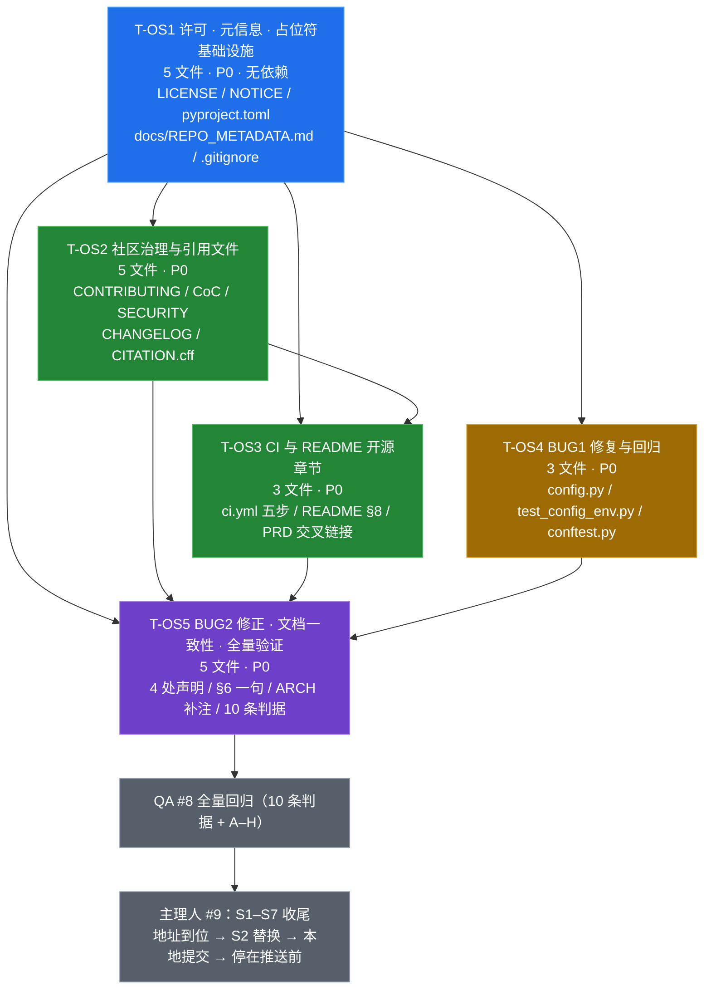

# 多模态通用智能体开发平台 · 开源化增量任务列表（TASKS-OPENSOURCE）

| 项 | 值 |
| --- | --- |
| 文档类型 | 增量实现任务分解（工程师 #7 执行依据） |
| 版本 | **v1.1**（按主理人对 `docs/PRD-OPENSOURCE.md` §6 的裁决修订；替代 v1.0） |
| 编写 | 架构师 高见远（Gao） |
| 上游依据 | `docs/PRD.md` §4（行为契约，最高优先级）、`docs/PRD-OPENSOURCE.md`、`docs/ARCHITECTURE-OPENSOURCE.md` v1.1（本文所有 §x 引用均指向该文档）、**主理人裁决**、主理人实测现状 |
| 任务数 | **5 个**（T-OS1–T-OS5，按功能模块分组，不按单文件拆分） |
| 文件数 | **11 个新建** + **6 个限定范围修改** + **2 个仅核对**；业务代码仅 `app/config.py` 一个文件的两处函数 |
| 语言 | 简体中文 |
| 环境 | 本机 Python 3.13（代码 3.11+ 兼容）；CI 仅 3.11；`make` 不可用但 Makefile 四目标零改动；验证一律用 §6 等价 `python3` 命令 |

---

## 0. 使用说明（必读）

1. **本轮是增量，不是重建**：45 个源码／配置／测试文件与 80 passed 基线**已落地**，结构化日志脱敏／异常处理／输入校验／上传护栏／四组 pytest 均已完成。**禁止**借「完善核心功能」之名重构已落地模块、偷偷补鉴权／会话持久化／并发锁，或改动任何对外契约。
2. **按序一次性写完、最后统一验证**：T-OS1 → T-OS2 → T-OS3 → T-OS4 → T-OS5，全部写完后执行 §6 验证命令。`README.md` 与 `docs/PRD.md` 由 T-OS3 与 T-OS5 分别修改，**必须按 §5-S9 的行号／章节严格分区**，禁止整体重写或格式化重排。
3. **主理人已拍板 Q-OS1～Q-OS12**（见 §7 裁决索引），本设计**直接落地裁决**，不再有待确认决策门。工程师按本版实现即可。
4. **地址未到位 = 占位符版交付**：12 个 RP 点一律引用 **`docs/REPO_METADATA.md`**（本轮新建的唯一登记处）中的符号。此时全仓允许存在 `__...__` 残留，但**不得推送**；S2 替换与 S4–S6 git 操作全部归主理人 #9。
5. **架构师（#6）／工程师（#7）／QA（#8）均不执行任何 git 操作、不推送、不新建仓库**。
6. 每个任务的验收判据逐条自检；全量回归以 `docs/ARCHITECTURE-OPENSOURCE.md` §7 A–H + `docs/PRD-OPENSOURCE.md` §3 十条判据为准。

### v1.1 相对 v1.0 的六处实质变更

| # | 变更 | 影响任务 |
| --- | --- | --- |
| 1 | 新增 `docs/REPO_METADATA.md`（第 10 个开源／元信息文件）作为占位符唯一登记处 | T-OS1，及全部含 URL 的文件 |
| 2 | 作者／版权用可核实默认值：`Nephets1010`／`2026`／`Nephets1010@users.noreply.github.com` | T-OS1、T-OS2 |
| 3 | `pyproject.toml` 明确**不加 `[build-system]`**，补 `[tool.pytest.ini_options]`（不得破坏 80 用例）、可选 `[tool.coverage.*]` 纯配置 | T-OS1 |
| 4 | CI 由三步扩为**五步**（+ evaluator + 契约冒烟），配 pip 缓存与失败-fast | T-OS3 |
| 5 | README §6 **增加一句** reference 消解说明 | T-OS5 |
| 6 | BUG2 明确 reference 原始规格清洗副本字节级零改动；4 处断言精确清单 | T-OS5 |

---

## 1. 依赖包清单（Required Packages）

> **硬约束：零新增必需依赖、不改技术栈。** 不得修改 `requirements.txt`（一字不改），不得 `pip install` 任何表外包。

**运行期（既有，零改动）**：`fastapi>=0.110`、`uvicorn>=0.27`、`pydantic>=2.0`、`python-multipart>=0.0.9`、`numpy>=1.24`、`pillow>=10.0`、`PyYAML>=6.0`、`httpx>=0.27`、`pytest>=8.0`、`opencv-python-headless>=4.8`。

**可选依赖（仅探测降级，不安装）**：`langgraph`、`chromadb`、`openai-whisper`、`transformers`(+`torch`)、`openai`（`pyproject.toml` 的可选分组只复制 `requirements.txt` 注释中这 6 个包名与版本下限）。

**本轮新用到的既有能力（非新依赖）**：`PyYAML`（校验 `CITATION.cff`）、标准库 `compileall`（CI lint／compile）、`pytest` + `monkeypatch`（BUG1 回归）、`pathlib`/`shutil`（复制配置到测试沙箱）、`fastapi.testclient`（CI 契约冒烟）。

**🚫 禁止**：`python-dotenv`、`jsonschema`、`ruff`／`flake8`／`mypy`／**`coverage` 包**、任何 `[build-system]` 构建后端、任何新 pip 包、`git init`／`commit`／`push`／配 remote、任何仓库创建动作。

**CI 允许的 GitHub 官方 action**（非 pip 依赖、非外部 API）：`actions/checkout@v4`、`actions/setup-python@v5`（含 `cache: "pip"`，只缓存 `requirements.txt` 对应 wheel）。

---

## 2. 任务总览

| 任务 ID | 任务名称 | 优先级 | 依赖 | 文件数 | 核心交付 |
| --- | --- | --- | --- | --- | --- |
| **T-OS1** | **开源许可、元信息与占位符基础设施** | P0 | 无 | 5 | `LICENSE` / `NOTICE` / `pyproject.toml` / `docs/REPO_METADATA.md` / `.gitignore` 补充 —— 许可 + 元信息 + 占位符登记 + 忽略规则，全部放一个任务 |
| **T-OS2** | 社区治理与引用文件 | P0 | T-OS1 | 5 | `CONTRIBUTING.md` / `CODE_OF_CONDUCT.md` / `SECURITY.md` / `CHANGELOG.md` / `CITATION.cff` |
| **T-OS3** | CI 工作流与 README 开源章节 | P0 | T-OS1, T-OS2 | 3 | `.github/workflows/ci.yml`（五步）/ `README.md` §8 / `docs/PRD.md` 交叉链接 |
| **T-OS4** | BUG1 空环境变量修复与回归用例 | P0 | T-OS1 | 3 | `app/config.py`（唯一业务代码改动）/ `tests/test_config_env.py` / `tests/conftest.py` |
| **T-OS5** | BUG2 不实声明修正、文档一致性与全量验证 | P0 | T-OS1–T-OS4 | 5 | 4 处声明 + README §6 一句 + ARCH §3.1/§3.6 补注 + 2 处仅核对 + 10 条判据 |

> 任务数 **5**（硬上限内）；每任务 ≥3 个文件；按功能分组，无「一文件一任务」；T-OS1 为项目元信息基础设施。

---

## 3. 任务依赖图



**说明**：T-OS2／T-OS3／T-OS4 均只依赖 T-OS1 的元信息与占位符约定，可并行开工；T-OS5 汇聚全部文档修正与验证。QA #8 与主理人 #9 不是实现任务，仅表示交接界面。

---

## 4. 逐任务详述

### T-OS1 · 开源许可、元信息与占位符基础设施

| 项 | 内容 |
| --- | --- |
| **目标** | 建立全仓唯一的许可、元信息与**占位符登记**基线，补齐构建产物忽略规则 |
| **依赖** | 无 |
| **优先级** | P0 |
| **涉及文件** | 5 个（4 🆕 + 1 ✏️） |

| # | 文件 | 本任务内要写完的内容 |
| --- | --- | --- |
| 1 | `LICENSE` | Apache License Version 2.0 **完整原文、条款零改写**（含 §3 专利／§6 商标／§7 免责／§8 责任限制 + APPENDIX） |
| 2 | `NOTICE` | 版权行 `Copyright (c) __COPYRIGHT_YEAR__ __COPYRIGHT_HOLDER__` + 10 核心／6 可选依赖归属（ARCH §8.3） |
| 3 | `pyproject.toml` | `[project]` 11 类字段 + `[tool.pytest.ini_options]`（+ 可选 `[tool.coverage.*]` 纯配置）；**无 `[build-system]`** |
| 4 | `docs/REPO_METADATA.md` | **占位符唯一登记处**，表格结构见 ARCH §5.1：11 个符号 × 6 列 + 12 个 RP 点映射 + 派生规则 + S2 替换顺序 |
| 5 | `.gitignore` | **仅追加** `dist/`、`build/`、`.mypy_cache/`、`.ruff_cache/`、`.coverage`；现有 6 类零删减 |

**实现要点**

1. `pyproject.toml` 逐项照 ARCH §3：`name=multimodal-agent-platform`、`version=1.0.0`（静态镜像 `app/__init__.py::__version__`，**不得反向写业务代码**）、`description` 与 README 首段一致且不夸大、`readme="README.md"`、`license={text="Apache-2.0"}`、`requires-python=">=3.11"`、authors、keywords、`classifiers`（**Development Status 仅 `3 - Alpha`／`4 - Beta`**）、`[project.urls]` 五子键全部由占位符派生、`[project.optional-dependencies]` 只复制 `requirements.txt` 注释中的 6 个可选包。
2. **不加 `[build-system]`**、不引入任何打包期依赖；顶部注释写明「以 `requirements.txt` + 四条 `python3` 命令运行，不执行打包安装；`requirements.txt` 是唯一依赖来源」。`[project.scripts]` 可选，若写只写 `multimodal-agent-demo = "scripts.demo:main"`（`scripts/demo.py:129` 已有 `main() -> int`）；**不得**为 `evaluator.py` 造 `main()`，其保持 `python3 -m ...`。
3. `[tool.pytest.ini_options]` **最小配置**：只写 `testpaths = ["tests"]`；**建议不配 `addopts`**，禁止 `--import-mode`/`--strict-markers`/`-x`/`filterwarnings=["error"]` 等会改变默认行为导致 80 用例失败的选项。新增 pyproject 后必须重跑全量 pytest 确认收集行为未变；若变化则移除该节。`[tool.coverage.*]` 只是纯静态配置，**不安装 coverage 包、CI 不执行 coverage**。
4. `docs/REPO_METADATA.md` 表结构（6 列）：`占位符键 | 类别 | 用途 | 默认取值（用户可替换） | 出现文件（RP 点） | 替换后校验方式`，逐行照 ARCH §5.1 的 11 个符号；再附 12 个 RP 点映射表（ARCH §5.2）与派生规则（`__CI_BADGE_URL__ = __REPO_URL__ + /actions/workflows/ci.yml/badge.svg`；`__OWNER__`/`__REPO_NAME__` 由 URL 解析；`__DEFAULT_BRANCH__` 默认 `main`）。
5. **身份默认值按裁决登记为「默认取值，用户可替换」**：`__AUTHOR_NAME__` = `Nephets1010`、`__AUTHOR_EMAIL__` = `Nephets1010@users.noreply.github.com`、`__COPYRIGHT_YEAR__` = `2026`、`__COPYRIGHT_HOLDER__` = `Nephets1010`、`__SECURITY_CONTACT__` 默认取 noreply 邮箱。**地址类（`__REPO_URL__` 等）无默认值、保持占位符**；明确写「禁止用账号名拼装 URL、禁止臆造 owner/repo、禁止挪用工作区其它 24 个子仓库 origin」。
6. `LICENSE`／`NOTICE`／`pyproject.toml`／`CITATION.cff`（T-OS2）／README §8.1（T-OS3）五处许可表述**完全一致为 `Apache-2.0`**；`NOTICE` 只列包名与归属，**不臆造逐包许可证文本**；不含真实凭据／URL。
7. `.gitignore` 追加后确认 10 个新建开源／元信息文件**均未被忽略**；现有 6 类（`.env`、`data/` 规则、`__pycache__`、`*.py[cod]`、`.pytest_cache/`、`*.egg-info/`、`.venv/`）零删减。

**验收判据**

- [ ] 5 个文件存在；`LICENSE` 为 Apache-2.0 全文、条款零改写
- [ ] `pyproject.toml` 11 类字段齐备；`version=1.0.0` 与 `app/__init__.py` 一致；`requires-python>=3.11`；classifiers 无 Production/Stable
- [ ] **无 `[build-system]`**；`requirements.txt` 一字不改；可选依赖只含既有 6 包、无新包名、非必需
- [ ] `[tool.pytest.ini_options]` 为最小配置；`DEMO_MODE=1 python3 -m pytest -q tests` 仍 ≥80 passed 且收集行为未变
- [ ] `docs/REPO_METADATA.md` 含 11 个符号 + 12 个 RP 点 + 派生规则 + 身份默认值；无臆造 URL
- [ ] 全仓许可表述一致；`.gitignore` 现有条目零删减、新增 5 项、10 个新文件均未被忽略

**禁止事项**：新增必需依赖或 `[build-system]`；改 `requirements.txt`；给 evaluator 造 `main()`；用账号 `Nephets1010` 拼装仓库 URL；臆造逐包许可证文本；配置改变 pytest 默认行为的 `addopts`；执行任何 git 操作。

---

### T-OS2 · 社区治理与引用文件

| 项 | 内容 |
| --- | --- |
| **目标** | 补齐贡献／行为准则／安全策略／变更日志／引用 5 份文件，与 README、pyproject、LICENSE、REPO_METADATA 措辞一致 |
| **依赖** | T-OS1（占位符与许可基线） |
| **优先级** | P0 |
| **涉及文件** | 5 个 🆕 |

| # | 文件 | 必备内容 |
| --- | --- | --- |
| 1 | `CONTRIBUTING.md` | 开发环境（Python 3.11+／`pip install -r requirements.txt`）、四条 DEMO 等价命令、代码风格（标准库优先／零新增必需依赖／禁内置 `hash()` 与 `eval`／`MAP_` 前缀规则）、提交与 PR 流程、测试要求（pytest 全绿 + 边界用例）、Issue 规范、克隆命令 |
| 2 | `CODE_OF_CONDUCT.md` | 适用范围、行为准则正文、举报渠道 `__SECURITY_CONTACT__` |
| 3 | `SECURITY.md` | 支持版本 `1.0.0`、报告渠道、响应预期、敏感信息不入 Issue、**无鉴权属设计边界非漏洞**、`0.0.0.0` 风险与 HOST 收紧 |
| 4 | `CHANGELOG.md` | Keep a Changelog；`## [1.0.0] - __RELEASE_DATE__` 记录 10 个开源要素／2 个缺陷修复／80 passed 基线；底部比较链接（RP-11） |
| 5 | `CITATION.cff` | CFF 1.2.0 全字段，`yaml.safe_load` 可解析；`version: 1.0.0`、`license: Apache-2.0` |

**实现要点**

1. `CONTRIBUTING.md` 明确列出**零改动清单**：`web/index.html`／`requirements.txt`／`samples/knowledge.txt`／`docs/reference/*`／`Makefile` 四目标命令／`config/settings.yaml`；写明「不新增必需依赖、不引入外部 lint、DEMO 下零联网零 Key」；所有 URL 引用 REPO_METADATA.md 符号。
2. `SECURITY.md` 复述 README §6 口径：**「未实现鉴权、多租户、会话持久化与并发写入锁，属已知设计边界而非漏洞；仅限本机或可信内网单机演示，勿暴露公网」**；保留 `HOST=127.0.0.1 PORT=8000 DEMO_MODE=1 python3 -m app.main` 收紧方式；明确 API Key 不得进入 Issue／PR／日志／轨迹。
3. `CODE_OF_CONDUCT.md` 举报渠道用 `__SECURITY_CONTACT__`（默认 noreply 邮箱，用户可替换）；不引入第三方原文（本轮裁决未要求 CoC 具体版本，自写精简三节即可）。
4. `CHANGELOG.md` `[1.0.0]` **不得**声称「新增鉴权／真实增量输出／生产可用」；日期与底部链接用 REPO_METADATA.md 符号（RP-11）。
5. `CITATION.cff` 必备字段：`cff-version: 1.2.0`、`message`、`title`、`type: software`、`version: 1.0.0`、`abstract`、`keywords`、`authors`、`url`、`repository-code`、`license: Apache-2.0`；**所有占位符值加引号**（含 `date-released: "__RELEASE_DATE__"`）保证 `PyYAML.safe_load` 可解析；`abstract` 与 README 定位一致、不夸大；作者／URL 用表内符号。
6. 5 份文件**不散落硬编码不同写法的 URL**；任何新增引用点回填 `docs/REPO_METADATA.md` 的 RP 表。

**验收判据**

- [ ] 5 份文件存在；必备章节／字段齐全
- [ ] `DEMO_MODE=1 python3 -c "import yaml,pathlib; d=yaml.safe_load(pathlib.Path('CITATION.cff').read_text(encoding='utf-8')); print(d['cff-version'], d['version'], d['license'])"` → `1.2.0 1.0.0 Apache-2.0`
- [ ] `SECURITY.md` 含「无鉴权属设计边界非漏洞」与 `0.0.0.0`／HOST 收紧；`CONTRIBUTING.md` 含零改动清单
- [ ] 5 份文件无真实凭据、无臆造 URL；与 README §8／pyproject／LICENSE／REPO_METADATA 措辞一致
- [ ] 无「生产级／企业级安全／90% 准确率／已实现鉴权／已提供 chat_stream」等过度声明

**禁止事项**：把无鉴权写成「待修复漏洞」；臆造发布日期或作者姓名；`CITATION.cff` 用裸占位符导致 YAML 解析失败；散落硬编码 URL。

---

### T-OS3 · CI 工作流与 README 开源章节

| 项 | 内容 |
| --- | --- |
| **目标** | 建立零联网零 Key 的**五步** CI（含 pip 缓存与失败-fast），并在 README 追加开源章节（§1–§7 零删减），补一条文档交叉链接 |
| **依赖** | T-OS1、T-OS2 |
| **优先级** | P0 |
| **涉及文件** | 3 个（1 🆕 + 2 ✏️） |

| # | 文件 | 本任务内改动范围 |
| --- | --- | --- |
| 1 | `.github/workflows/ci.yml` | 新建，五步流水线（ARCH §4.2 骨架） |
| 2 | `README.md` | **仅**在第 176 行 `---` **之前**插入 `## 8. 开源与社区`（ARCH §3.5 八小节）；§1–§7 与文件尾说明行逐字零删减；**§6 的一句消解说明归 T-OS5** |
| 3 | `docs/PRD.md` | **仅**加 1 行指向 `docs/PRD-OPENSOURCE.md` 的交叉链接；**不动** §4 契约红线、不动 `:115`/`:263`（归 T-OS5） |

**实现要点**

1. `ci.yml`：触发 `push` / `pull_request`；`runs-on: ubuntu-latest`；**`timeout-minutes: 15`**；`env: DEMO_MODE: "1"`；`actions/setup-python@v5` 指定 `python-version: "3.11"` + **`cache: "pip"` + `cache-dependency-path: "requirements.txt"`**；唯一安装步骤 `python3 -m pip install -r requirements.txt`。
2. **五步顺序**（不可增减、不可换成外部 lint）：
   ① `python3 -m compileall -q app scripts tests`
   ② `DEMO_MODE=1 python3 -m pytest -q tests`
   ③ `DEMO_MODE=1 python3 scripts/demo.py`
   ④ `DEMO_MODE=1 python3 -m app.observability.evaluator`
   ⑤ **契约冒烟**：内联 `python3 - <<'PY'`（不新增文件、不新增依赖），用 `fastapi.testclient.TestClient` 断言 `len(UnifiedResponse.model_fields)==11`、非流式响应字段数 11、`/health` 中 **`"configured_backends" not in h`**、`answer` 含 `96`。骨架见 ARCH §4.2。
3. **失败-fast**：每个 step 独立 `run`，任一非 0 即终止 job；**不使用** `continue-on-error`／`|| true`／重试循环；pip 安装失败即终止；不吞错、不加 `2>/dev/null`；job 级 `timeout-minutes` 防挂起。
4. CI **不得**出现：secrets／API Key／Token、外部 API 调用、产物上传、可选依赖安装、`ruff`/`flake8`/`mypy`/`coverage` 包、git 写操作、真启动端口、改动零改动文件、把 `configured_backends` 写入 DEMO `/health`；**不额外做多版本矩阵**（本期仅 3.11）。
5. README §8 八小节按 ARCH §3.5：8.1 徽章与许可证、8.2 克隆与快速开始（补克隆步骤即可，**不重复 §1 的四条命令**）、8.3 能力边界与定位、8.4 贡献方式、8.5 行为准则、8.6 安全披露、8.7 引用与变更、8.8 致谢。§8 全部 URL 引用 REPO_METADATA.md 符号；不得出现过度声明。
6. `docs/PRD.md` 交叉链接只加 1 行，**不得**顺手改 `:115`/`:263`。

**验收判据**

- [ ] `ci.yml` 存在；触发／Python 3.11／全局 DEMO_MODE=1／pip 缓存／timeout-minutes／五步命令与 ARCH §4 一致
- [ ] `compileall`、`pytest`、`demo.py`、`evaluator`、契约冒烟五步本机逐条可执行且退出码 0
- [ ] CI 无 secrets／Key／外部 API／产物上传／可选依赖／外部 lint／git 写操作／额外真启动；失败-fast 机制齐备
- [ ] README §8 八类内容齐备；§1–§7 与尾行**零删减**（按行号核对）
- [ ] `docs/PRD.md` 仅新增 1 行交叉链接；§4 与 `:115`/`:263` 未被本任务改动

**禁止事项**：CI 真启动服务或引入外部 lint；用外部包做契约冒烟；重写／格式化 README 既有章节；把许可证徽章信息写进 `/health`；在 `docs/PRD.md` 顺手改不实声明。

---

### T-OS4 · BUG1 空环境变量修复与回归用例

| 项 | 内容 |
| --- | --- |
| **目标** | 修复 `cp .env.example .env` 后 `get_settings()` 抛 `ConfigError` 的缺陷，补 4 条回归用例，且不破坏既有覆盖／校验／DEMO 锁定 |
| **依赖** | T-OS1 |
| **优先级** | P0 |
| **涉及文件** | 3 个（1 🆕 + 2 ✏️） |

| # | 文件 | 本任务内改动范围 |
| --- | --- | --- |
| 1 | `app/config.py` | **唯一业务代码改动**：`load_dotenv_simple()` + `env_override()` 两处空串短路（ARCH §6.2）；其余一行不动 |
| 2 | `tests/test_config_env.py` | 新建，4 条 BUG1 回归用例（ARCH §6.4） |
| 3 | `tests/conftest.py` | 新增 `env_sandbox` fixture（`PROJECT_ROOT` 隔离，ARCH §6.5） |

**实现要点**

1. **修复点 1** — `load_dotenv_simple()`：解析出 `value` 后，若 `value.strip() == ""` 则**不写入 `result`**。
2. **修复点 2** — `env_override()`：短别名或 `MAP_<SECTION>__<KEY>` 命中后，若 `str(source[key]).strip() == ""` 则返回 `None`。同时覆盖主合并循环（第 347–349 行）与 `config_version` 单独覆盖（第 352–356 行），**无需改调用点**。
3. **一行不得改动**：`SHORT_ALIASES`、`ENV_PREFIX="MAP_"`、`_coerce()`、`_validate_settings()`、`get_settings()` 合并顺序、`os.environ` 优先级、**DEMO 最后一步三后端锁定**（第 365–369 行）、`app/observability/logging.py`（`collect_secrets` 已过滤空串）、`.env.example` 模板形态、`config/settings.yaml`。**不得新增 `server.host` 非空校验逻辑**（超出本轮允许增量）。
4. **六项必须保持的行为**（ARCH §6.3）：短别名优先级、`MAP_` 长格式（裸格式不读取）、DEMO 三后端锁定、非空覆盖生效、**`server.host` 非空（空 `HOST=` 回落 `"0.0.0.0"`，非空 `HOST`/`MAP_SERVER__HOST` 正常生效，启动期校验链路不变）**、非法非空值仍抛可读 `ConfigError`。
5. **`env_sandbox` fixture**：`monkeypatch.setattr(config, "PROJECT_ROOT", tmp_path)` + 复制真实 `config/settings.yaml` 到 `tmp_path/config/` + 把空占位符 `.env` 写到 `tmp_path/.env` + `config.reset_settings_cache()`，退出时恢复并再次清缓存。**绝不在仓库根生成真实 `.env`**。
6. **4 条回归用例**：① 空占位符 `.env` 下 `get_settings()` 正常、`server.port=8000`／`max_steps=8`／`tool_timeout_seconds=3.0`／`human_in_loop=false`／**`server.host=="0.0.0.0"`**；② 非空覆盖 `PORT=8123`／`MAP_RETRIEVAL__DENSE_WEIGHT=0.7`／`HOST=127.0.0.1` 生效，裸格式不生效；③ `PORT=abc` 抛可读 `ConfigError`；④ `LLM_BACKEND=api`+`LLM_API_KEY=sk-should-not-leak`+`DEMO_MODE=1` 仍锁定三后端且 Key 不进日志／异常消息。每条前后 `reset_settings_cache()`。

**验收判据**

- [ ] `cp .env.example .env && DEMO_MODE=1 python3 -m pytest -q tests && DEMO_MODE=1 python3 scripts/demo.py` **不抛 `ConfigError`**，两步全绿（M-3）；验证后删除 `.env`
- [ ] `DEMO_MODE=1 python3 -c "from app.config import get_settings; s=get_settings(); print(s.server.host, s.server.port, s.agent.max_steps, s.agent.tool_timeout_seconds, s.agent.human_in_loop)"` 在含空占位符 `.env` 下 → `0.0.0.0 8000 8 3.0 False`
- [ ] 4 条回归用例全绿；`pytest -q tests` ≥ **80 passed** 且退出码 0（M-1）
- [ ] 六项必须保持的行为全部验证通过；`app/config.py` diff 仅限两个函数；零改动文件零改动
- [ ] 测试用 `tmp_path` 隔离，仓库根不残留 `.env`，`data/` 不被污染

**禁止事项**：改 `.env.example` 模板（把空占位符填默认值是最常见错解）；在 `_coerce()` 吞异常；改动 DEMO 锁定步骤；新增 host 非空校验；为凑入口点改业务代码；仓库根创建真实 `.env`；把 Key 明文写进测试输出。

---

### T-OS5 · BUG2 不实声明修正、文档一致性与全量验证

| 项 | 内容 |
| --- | --- |
| **目标** | 统一「本期未实现 `LLMClient.chat_stream`」口径、补 README §6 消解说明、补架构文档 `configured_backends` 注记、核对零改动清单，执行 10 条判据 |
| **依赖** | T-OS1–T-OS4 |
| **优先级** | P0 |
| **涉及文件** | 5 个（3 ✏️ + 2 🔍 仅核对） |

| # | 文件 | 本任务内改动范围 |
| --- | --- | --- |
| 1 | `README.md` | **只改 `:154` 一行** → 统一口径；**§6 增加一句** reference 消解说明（见下）；§1–§7 其余内容与 T-OS3 新增的 §8 均不得再动 |
| 2 | `docs/PRD.md` | **只改 `:115`、`:263` 两行** → 统一口径（T-OS3 加的交叉链接保留） |
| 3 | `docs/ARCHITECTURE.md` | `:1389`（U8）→ 统一口径；**§3.1 `HealthResponse` 表 + §3.6 端点表**补 `configured_backends: dict\|None`（仅生产模式附加，DEMO 下 `exclude_none=True` 不输出）。**§7 质量守卫清单零改动** |
| 4 | `docs/TASKS.md` | 🔍 仅核对「不得改挂」中性措辞（`:256/276/454`）与 S1–S20，**可保留、不改** |
| 5 | `app/generation/router.py` | 🔍 仅核对 `:8` 中性措辞，**可保留、不改**；业务代码零改动 |

**统一口径（逐字采用）**

> 本期未实现 `LLMClient.chat_stream`；原始规格 §8 曾提及该接口，本仓库未包含该类／方法；SSE `token` 恒由最终答案按 `agent.token_chunk_chars=24` 定长切片模拟；本期不新增该能力（原 PRD P2-4）。

**README §6 新增一句（主理人裁决，逐字采用）**

> 说明：`docs/reference/` 为原始规格清洗副本，描述目标态设计基线；本仓库的实际实现状态以本 README 与 §6「已知限制」为准（例如 `LLMClient.chat_stream` 本期未实现）。

**实现要点**

1. 4 处「已提供」断言（`README.md:154`、`docs/PRD.md:115`、`:263`、`docs/ARCHITECTURE.md:1389`）全部按统一口径改写，**不得只改 README 一行**。
2. `docs/reference/platform-spec-README.md`（**原始规格清洗副本**）🔒 字节级零改动；`web/index.html` 🔒 零改动。靠 README §6 新增的一句消解「规格说已提供、实现说未实现」的表面矛盾。
3. `docs/TASKS.md` 与 `app/generation/router.py` 的「不得改挂」是中性措辞，**可保留**；不得改成「已提供」，也不得删掉「不得改挂」约束。
4. `docs/ARCHITECTURE.md` §3.1／§3.6 补 `configured_backends` 说明时写明「仅生产模式附加；DEMO 下为 `None` 且被 `exclude_none=True` 剔除，响应中连键都不存在；开源徽章／版本／许可／repo 信息一律不得写入 `/health`」。这是**文档补注，不是契约变更**。
5. 全仓检索：`chat_stream` + 「已提供／已实现／已具备」断言为 **0**（排除 `docs/reference/*`）；地址未到位时 `__...__` 占位符**允许残留**（不得推送）。
6. 执行 §6 的十条判据，并按 ARCH-OPENSOURCE §7 A–H 逐条勾选；零改动文件字节级核对（本阶段不执行 git 写操作）。

**验收判据**

- [ ] 4 处不实声明全部改为统一口径；项目自有文件检索 `chat_stream` 无「已提供／已实现／已具备」断言（M-4）
- [ ] README §6 已增加消解说明一句；§1–§7 零删减；`docs/reference/*`、`web/index.html`、`requirements.txt`、`samples/knowledge.txt` 字节级零改动
- [ ] `docs/ARCHITECTURE.md` §3.1／§3.6 已补 `configured_backends` 说明；§7 清单零改动；`docs/TASKS.md` S1–S20 零改动
- [ ] `docs/TASKS.md` / `router.py` 的「不得改挂」约束仍在
- [ ] 文档交叉链接无死链；「DEMO_MODE 十条红线」「11 字段」「7 组端点」表述一致
- [ ] §6 十条判据全部通过，ARCH-OPENSOURCE §7 A–H 全部勾选
- [ ] **未执行任何 git 操作、未推送、未新建仓库**；地址未到位时交付「占位符版」

**禁止事项**：改动 `docs/reference/*` 的「已提供」原文；整体重写／格式化 README 或 PRD；把 `docs/ARCHITECTURE.md` §7 清单当作「可顺手更新」；把许可证／版本／徽章信息写进 `/health`；执行 git init／commit／push。

---

## 5. 共享约定（Shared Knowledge · 全任务通用）

| # | 约定 |
| --- | --- |
| S-OS1 | **最高优先级**：`docs/PRD.md` §4 契约红线 > `docs/PRD-OPENSOURCE.md` §1.3 > **主理人裁决** > 本文 / ARCH-OPENSOURCE v1.1 > 其它文档 |
| S-OS2 | 成功响应直接返回业务 JSON；错误统一 `{"detail":"可读中文"}`；7 组端点／`UnifiedResponse` 11 字段／SSE 帧格式与顺序**一字不改** |
| S-OS3 | **`DEMO_MODE=1` 下 `/health` 逐字段冻结**：`demo_mode` + `components`(11 项) + `status` + `version`(1.0.0) + `index_chunks`；**不多不少**（冻结=不增不删，`version` 不得删）。`configured_backends` 仅生产模式，DEMO 下连键都不存在 |
| S-OS4 | **零改动清单**：`web/index.html`、`requirements.txt`（一字不改）、`samples/knowledge.txt`、`docs/reference/*`、`Makefile` 四目标命令、`config/settings.yaml`、`.env.example`、`docs/ARCHITECTURE.md` §7、`docs/TASKS.md` S1–S20、`docs/PRD-OPENSOURCE.md`、`app/` 除 `config.py` 外全部源码 |
| S-OS5 | **唯一业务代码改动**是 `app/config.py` 的 `load_dotenv_simple()` + `env_override()` 空串短路；`_coerce`／校验／合并顺序／DEMO 三后端锁定一行不改；**不得新增 host 非空校验** |
| S-OS6 | 配置覆盖规则：历史短别名**不带前缀且优先**；长格式必须 `MAP_<SECTION>__<KEY>`；**裸 `<SECTION>__<KEY>` 不得被读取**；`config_version: 1` |
| S-OS7 | **零新增必需依赖**：只用 `requirements.txt` + 标准库；禁 `python-dotenv`／`jsonschema`／`ruff`／`flake8`／`mypy`／`coverage` 包；**不加 `[build-system]`**；可选依赖仅 `find_spec` + 局部 `try/except ImportError` 降级 |
| S-OS8 | **许可一致性**：`LICENSE`／`NOTICE`／`pyproject.toml`／`CITATION.cff`／README §8.1 全部为 `Apache-2.0`；`NOTICE` 不臆造逐包许可证文本 |
| S-OS9 | **跨任务同文件分区规则**：`README.md` = T-OS3 只在第 176 行 `---` 之前追加 §8 + T-OS5 只改 `:154` 一行并在 §6 增加一句；`docs/PRD.md` = T-OS3 只加 1 行交叉链接 + T-OS5 只改 `:115`/`:263`。按行号／章节严格分区，**禁止整体重写、禁止格式化重排** |
| S-OS10 | **占位符唯一登记处 = `docs/REPO_METADATA.md`**：12 个 RP 点只引用表内符号，禁止散落硬编码不同写法；`__CI_BADGE_URL__ = __REPO_URL__ + /actions/workflows/ci.yml/badge.svg`；身份类有默认值（`Nephets1010`／`2026`／noreply 邮箱，用户可替换），地址类保持占位符；**禁止用账号名拼 URL、禁止臆造 owner/repo、禁止挪用其它 24 个子仓库 origin** |
| S-OS11 | **无 git 操作、不新建仓库**：架构师／工程师／QA 一律不 `git init`／`commit`／`push`／配 remote；S1–S7 归主理人 #9；地址未到位 → 交付占位符版、停在推送前 |
| S-OS12 | **CI 边界**：仅 Python 3.11、全局 `DEMO_MODE=1`、唯一安装 `pip install -r requirements.txt`、pip 缓存 + 失败-fast、五步（compileall／pytest／demo.py／evaluator／契约冒烟）；无 secrets／Key／外部 API／产物上传／可选依赖／外部 lint／git 写操作／多版本矩阵 |
| S-OS13 | **如实披露**：未实现鉴权／多租户／会话持久化／并发锁属**已知设计边界而非漏洞**；仅限本机或可信内网单机演示、勿暴露公网；`0.0.0.0` 风险与 `HOST=127.0.0.1 PORT=8000 DEMO_MODE=1 python3 -m app.main` 四方一致（README §6／SECURITY.md／启动日志／增量 PRD） |
| S-OS14 | **BUG2 统一口径**：本期未实现 `LLMClient.chat_stream`、本仓库无该类／方法、SSE `token` 恒为定长切片模拟、本期不新增（P2-4）；4 处断言精确清单；「不得改挂」中性措辞保留；`docs/reference/*` 原始规格清洗副本字节级零改动；README §6 增加消解说明 |
| S-OS15 | **版本号五处一致**：`app/__init__.py::__version__`／pyproject／CITATION／CHANGELOG／`/health.version` = `1.0.0`；不得改业务代码凑入口点；`scripts.demo:main` 可作入口，`evaluator.py` 无 `main()` 保持 `python3 -m ...` |
| S-OS16 | **确定性／脱敏／单机假设**（原 S1–S20 继续有效）：DEMO 禁内置 `hash()`、三出口强制脱敏、`trace_id` 贯穿、`/v1/trace` 不存在返回 200 空集、评测请求 `samples` 数组／响应 `samples` 数字、`resume()` 仅图层 API、无并发锁 |

---

## 6. 等效验证命令清单

> 本机 `make` 不可用，但 **Makefile 四目标必须存在且命令逐字一致**（M-4）。以下为规格 §2 的等价 `python3` 命令 + 本轮增量验证，默认在项目根执行、`DEMO_MODE=1`。

### 6.1 规格 §2 四条等价命令（基线）

```bash
DEMO_MODE=1 python3 scripts/demo.py                                   # = make demo（不启动服务器）
DEMO_MODE=1 python3 -m pytest -q tests                                # = make test（≥80 passed）
DEMO_MODE=1 python3 -m uvicorn app.main:app --host 0.0.0.0 --port 8000  # = make run
DEMO_MODE=1 python3 -m app.observability.evaluator                    # = make eval（samples=8）
```

### 6.2 可运行（R-1～R-3）

```bash
# R-1 真启动 + /health 冻结（另开终端）
curl -s http://localhost:8000/health
#   期望：demo_mode=true / components.graph="pure" / 6 项 fallback / index_chunks>0 /
#         version="1.0.0" / 顶层 status 与 index_chunks 存在 /
#         **DEMO 下无 configured_backends 且无任何新增字段** /
#         启动日志含「未实现鉴权…勿暴露公网」
curl -s http://localhost:8000/                          # R-2 同一份 HTML
curl -s http://localhost:8000/ui/index.html             # R-2 同一份 HTML
curl -s -o /dev/null -w "%{http_code}" http://localhost:8000/docs   # R-2 → 200
curl -s -X POST http://localhost:8000/v1/chat \
  -H 'Content-Type: application/json' \
  -d '{"query":"计算 12*8 的结果","stream":false}'      # R-3 → 恰好 11 字段 / answer 含 96 / calculator.ok=true
```

### 6.3 可复现（C-1～C-3）

```bash
DEMO_MODE=1 python3 scripts/demo.py                                                # C-1
DEMO_MODE=1 python3 -m app.observability.evaluator                                # C-2 连跑两次，3 指标一致
DEMO_MODE=1 python3 -m app.observability.evaluator
LLM_API_KEY=sk-should-not-leak DEMO_MODE=1 python3 scripts/demo.py 2>&1 | grep -c "sk-should-not-leak"   # C-3 → 0
```

### 6.4 可维护（M-1～M-4）与本轮增量

```bash
DEMO_MODE=1 python3 -m pytest -q tests                                # M-1 ≥80 passed
python3 -m compileall -q app scripts tests                            # M-2 退出码 0（CI 等价）
cp .env.example .env
DEMO_MODE=1 python3 -m pytest -q tests                                # M-3 不抛 ConfigError
DEMO_MODE=1 python3 scripts/demo.py
rm -f .env                                                            # M-3 验证后必须删除，不得提交

# 新增 pyproject 后 pytest 配置核对（C-5）
DEMO_MODE=1 python3 -m pytest -q tests                                # 收集行为未变、仍 ≥80 passed
# CITATION 可解析
DEMO_MODE=1 python3 -c "import yaml,pathlib; d=yaml.safe_load(pathlib.Path('CITATION.cff').read_text(encoding='utf-8')); print(d['cff-version'], d['version'], d['license'])"
# 配置默认值 + DEMO 锁定
DEMO_MODE=1 python3 -c "from app.config import get_settings; s=get_settings(); print(s.server.host, s.server.port, s.llm.backend, s.encoder.backend, s.vector_store.backend)"
# 版本号五处一致（人工核对 + /health）
curl -s http://localhost:8000/health   # version == "1.0.0"

# M-4：Makefile 四目标逐字一致；项目自有文件「chat_stream + 已提供」断言为 0；
#      零改动文件字节级核对；地址未到位时占位符残留允许（但不得推送）
```

### 6.5 CI 五步本地等价（提交前逐条跑一遍）

```bash
python3 -m compileall -q app scripts tests
DEMO_MODE=1 python3 -m pytest -q tests
DEMO_MODE=1 python3 scripts/demo.py
DEMO_MODE=1 python3 -m app.observability.evaluator
DEMO_MODE=1 python3 - <<'PY'
from fastapi.testclient import TestClient
from app.main import app
from app.schemas import UnifiedResponse
c = TestClient(app)
h = c.get("/health").json()
assert h["demo_mode"] is True and "configured_backends" not in h
r = c.post("/v1/chat", json={"query": "计算 12*8 的结果", "stream": False})
assert r.status_code == 200 and len(r.json()) == 11 and "96" in r.json()["answer"]
assert len(UnifiedResponse.model_fields) == 11
print("contract smoke OK")
PY
```

### 6.6 S2 替换后的占位符残留检查（**主理人 #9 执行**）

```bash
grep -r "__[A-Z_]*__" --exclude-dir=data --exclude-dir=__pycache__ --exclude-dir=.pytest_cache .   # 期望 0 命中
```

---

## 7. 主理人裁决索引与 S1–S7 交接

> Q-OS1～Q-OS12 **已由主理人拍板**，本设计直接落地，无待确认决策门。

| 裁决 | 落地位置 |
| --- | --- |
| Q-OS1 统一占位符 + `docs/REPO_METADATA.md` 唯一登记 + 禁止臆造／挪用 origin | ARCH §5、T-OS1 |
| Q-OS2 不新建仓库，只写 S1–S7 | ARCH §5.4、本节 |
| Q-OS3 身份默认值 `Nephets1010`／`2026`／noreply 邮箱 | ARCH §5.1、T-OS1/T-OS2 |
| Q-OS5 不加 `[build-system]`，pyproject = 元信息 + 工具配置 | ARCH §3、T-OS1 |
| Q-OS8 不允许外部 lint，CI 标准库五步 | ARCH §4、T-OS3 |
| 许可 Apache-2.0 / BUG2 精确范围 / README §6 消解说明 / 版本号五处一致 / CI 仅 3.11 | ARCH §2／§6.6／§3.6／§4、T-OS1/T-OS5 |

**S1–S7 交接界面**（工程师与 QA 均不得执行）：

```
S1 用户提供真实 URL（主理人已提示并等待） → S2 一次性全量替换 12 个 RP 点
   → grep 确认 0 残留 → S3 本地最终验证（十条判据 + 零改动核对）
   → S4 git init + remote（只用用户地址）+ 本地首次提交【停在推送前】
   → S5 用户授权后推送 → S6 设 public + description/homepage/topics/license
   → S7 反馈推送结果 / 仓库可见性 / 开源配置状态
```

> ⚠️ 若 S4 提交时地址仍未到位，提交必然含占位符；**推送前必须完成 S2 并追加一次提交**，严禁把占位符或臆造 URL 推入公开仓库。**不设计任何仓库创建动作。**

---

## 8. ⚠️ 最容易被实现错走的 3 个点（交付前重点复核）

### ⚠️ 1 · 把「`/health` 冻结」误读成「删掉 `version`」，或为展示开源信息改端点

PRD-OPENSOURCE §1.3.5 的「DEMO 下 `/health` 响应逐字段冻结，开源化不得把版本／许可／徽章信息塞进 `/health`」约束的是**新增**，不是删除。当前 `version="1.0.0"`、顶层 `status`/`index_chunks` 都是既有冻结字段，R-1 明确要求 `version="1.0.0"` 存在。三类常见错误：① 因「版本不该进 /health」删掉 `version`；② 为展示许可证／徽章顺手改 `app/api/routes.py` 加字段；③ 让 `configured_backends` 在 DEMO 下输出（哪怕 `null` 也违约——实测 `exclude_none=True` 使 DEMO 下**连键都不能有**）。**正确做法**：10 个新增文件全部静态、不 import 任何 `app.*`、不注册路由，`/health` 保持 `demo_mode + components(11) + status + version + index_chunks` 不多不少。

### ⚠️ 2 · BUG1 修错位置、破坏 DEMO 锁定，或回归测试污染仓库根

- 最常见的「省事」做法是**直接改 `.env.example`**，把 `PORT=` 之类空占位符填成默认值 —— 违反「模板形态零改动」，且没修到 `os.environ` 注入空串的真实路径。正确修复只在 `load_dotenv_simple()`（解析层跳过空值）+ `env_override()`（空串返回 `None`）两处；**`_coerce()` 不得吞异常**（非法非空值仍抛可读 `ConfigError`）、**DEMO 最后一步三后端锁定一行不改**、**不得新增 `server.host` 非空校验**。
- 第二个坑：`get_settings()` 读 `PROJECT_ROOT / ".env"`，而 `conftest.py::_demo_env` 只重定向 `data_dir`/`tmp_dir`。回归用例若直接在仓库根 `cp .env.example .env`，会留下真实 `.env`、污染工作区甚至被提交。必须用 T-OS4 的 `env_sandbox` fixture monkeypatch `PROJECT_ROOT` → `tmp_path`。
- 附带：`logging.py::collect_secrets` 已用 `if value and len(value) >= 4` 过滤空串，**不需要改 logging 层**；改了反而扩大本轮改动范围。

### ⚠️ 3 · 占位符散落硬编码／臆造 URL，或「顺手修正」上游规格原文

- 所有 12 个 RP 点只引用 **`docs/REPO_METADATA.md`**（本轮新建的唯一登记处）中的符号，禁止在多个文件里写不同写法的 URL。账号 `Nephets1010` 只用于**作者／版权**（可核实默认值），**禁止**据此拼装 `https://github.com/Nephets1010/<repo>`（仓库名未确认、同名仓库 404）；**禁止**挪用工作区其它 24 个子仓库的 origin。
- `docs/reference/platform-spec-README.md`（原始规格清洗副本）的「`LLMClient.chat_stream` 已提供」是上游原文，🔒 字节级零改动。BUG2 只改项目自有文件 4 处；靠 **README §6 新增一句**「reference 目录是目标态设计基线，实现状态以本 README 与 §6 为准」消解表面矛盾，而不是去改上游文档。
- **架构师／工程师／QA 一律不执行 git 操作、不推送、不新建仓库**；地址未到位时交付占位符版、停在推送前，S2（含 grep 0 残留）与 S4–S6 归主理人 #9。

> **补充易错点（第 4 类）**：`pyproject.toml` 新增后 pytest 会把它所在目录识别为 `rootdir` —— 必须重跑 `DEMO_MODE=1 python3 -m pytest -q tests` 确认仍 ≥80 passed、收集行为未变；若变化则移除 `[tool.pytest.ini_options]`。另外 **CI 是五步不是三步**（别漏 `python3 -m app.observability.evaluator` 与内联契约冒烟），且**不加 `[build-system]`**、不引入 `ruff`/`flake8`/`mypy`/`coverage` 包。

---

## 9. 交付前最终自检

- [ ] 11 个新建文件全部落盘（含 `docs/REPO_METADATA.md`）；6 个限定范围修改按行号／章节分区完成；2 个仅核对文件未被改动
- [ ] 零改动清单（S-OS4）字节级核对通过；`app/config.py` diff 仅限两个函数
- [ ] §6 十条判据 + CI 五步本地等价全部通过；`docs/ARCHITECTURE-OPENSOURCE.md` §7 A–H 全部勾选
- [ ] §8 三个最易错走点逐条复核完毕
- [ ] 12 个 RP 点全部引用 REPO_METADATA.md 符号；无散落硬编码／臆造 URL；身份默认值按裁决
- [ ] 版本号五处一致；许可表述五处一致；`pyproject.toml` 无 `[build-system]`、`requirements.txt` 一字不改
- [ ] **未执行任何 git 操作、未推送、未新建仓库**；地址未到位时停在占位符版
- [ ] 任何对 `docs/PRD.md` §4 契约的偏离均已回报主理人（**预期为 0 项**）

---

> **文档状态**：v1.1 定稿（按主理人裁决修订，替代 v1.0）。与 `docs/ARCHITECTURE-OPENSOURCE.md` v1.1 配套使用；`docs/PRD.md` §4 契约红线为最高优先级。
