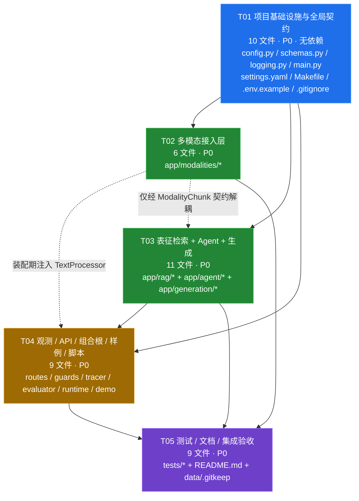

# 多模态通用智能体开发平台 · 有序任务列表（TASKS）

| 项 | 值 |
| --- | --- |
| 文档类型 | 实现任务分解（工程师执行依据） |
| 版本 | v1.0 |
| 编写 | 架构师 高见远（Gao） |
| 上游依据 | `docs/PRD.md`、`docs/ARCHITECTURE.md`（本文所有 §x 引用均指向该文档）、主理人 Q1–Q15 裁决 + 8 条硬约束 |
| 任务数 | **5 个**（T01–T05，按功能层次分组，不按单文件拆分） |
| 待实现文件数 | **45 个新建**；`requirements.txt` / `samples/knowledge.txt` / `web/index.html` 及 2 份参考文档**零改动** |
| 语言 | 简体中文 |
| 环境 | Python 3.13（本机）；`make` 命令不可用但 Makefile 仍须交付；验证一律用 §6 等价 `python3` 命令 |

---

## 0. 使用说明（必读）

1. **一次性批量写完，最后统一验证**：本任务列表按「引用依赖」而非「运行阻塞」编排。T01 的 `app/main.py` 会引用 T04 才落地的 `app.runtime` / `app.api.routes`，这是**刻意设计的依赖方向**（入口文件在最前面锁定应用骨架），不是文件缺失。请严格按 T01 → T02 → T03 → T04 → T05 顺序把 45 个文件**连续写完**，再执行 §6 的验证命令；**中途不要 `import app.main` 或跑 pytest**。
2. **T01 的独立验证范围**：只允许单独验证 `app/config.py`、`app/schemas.py`、`app/observability/logging.py`、`config/settings.yaml` 与三个根级配置文件；这四个模块不依赖后续任务。
3. **T02 与 T03 可并行**：二者在代码层互不 import（`rag` 不 import `modalities`，`TextProcessor` 由组合根运行时注入，见 ARCH §1.3 铁律 2），均只硬依赖 T01。若多人协作可同时开工；单人按序写亦可。
4. **不得新增任何业务代码之外的产物**：本轮设计阶段只产出两份设计文档；T01–T05 由工程师落地。任何对 PRD §4 契约的偏离须先回报主理人。
5. **每个任务的验收判据**在交付前逐条自检；全量回归以 ARCH §7「质量守卫清单」为准。

---

## 1. 依赖包清单（Required Packages）

> **硬约束：零新增必需依赖。** 下表即 `requirements.txt` 现有内容，工程师**不得修改该文件、不得 `pip install` 任何表外包**。可选依赖只允许 `importlib.util.find_spec` + 局部 `try/except ImportError` 探测降级。

**核心运行依赖（必须）**

| 包 | 版本 | 用途 | 主要落地任务 |
| --- | --- | --- | --- |
| `fastapi` | `>=0.110` | REST 路由、`UploadFile`/`Form`、`StreamingResponse`(SSE)、`TestClient`、`/docs` | T01, T04 |
| `uvicorn` | `>=0.27` | ASGI 服务器（`app.main:app`） | T01 |
| `pydantic` | `>=2.0` | 全部契约模型与 `Settings` 校验 | T01 |
| `python-multipart` | `>=0.0.9` | `/v1/ingest` 的 multipart 解析 | T04 |
| `numpy` | `>=1.24` | Stub 向量／余弦／颜色网格／降级帧 RNG | T02, T03 |
| `pillow` | `>=10.0` | 图像归一化 | T02 |
| `PyYAML` | `>=6.0` | 读取 `config/settings.yaml` | T01 |
| `httpx` | `>=0.27` | 生产模式直连 OpenAI 兼容端点（**DEMO 下 0 请求**） | T03 |
| `pytest` | `>=8.0` | 四组测试 | T05 |
| `opencv-python-headless` | `>=4.8` | `cv2` 视频抽帧 | T02 |

**可选依赖（仅探测，缺失即降级标 `fallback`）**：`langgraph`、`chromadb`、`openai-whisper`、`transformers`(+`torch`)、`openai`。

**🚫 禁止 import 清单**（不在依赖表内，引入即违约）：`python-dotenv`、`jsonschema`、`langchain`、`dotenv`、`requests`、`aiofiles`、任何前端构建工具。`eval` / `exec` 禁止用于计算器。

**标准库允许且鼓励使用**：`hashlib`（替代内置 `hash()`）、`wave`、`ast`、`logging`、`json`、`pathlib`、`re`、`concurrent.futures.ThreadPoolExecutor`、`time`、`uuid`、`io.BytesIO`、`functools`、`importlib.util`、`typing`、`dataclasses`、`contextlib`。

---

## 2. 任务总览

| 任务 ID | 任务名称 | 优先级 | 依赖 | 文件数 | 核心交付 |
| --- | --- | --- | --- | --- | --- |
| **T01** | **项目基础设施与全局契约** | P0 | 无 | 10 🆕 | 配置／契约／日志／入口／根级文件，**全部放一个任务** |
| **T02** | 多模态接入层 | P0 | T01 | 6 🆕 | 四模态 → `ModalityChunk` 统一产出 |
| **T03** | 表征检索 + Agent 编排 + 生成层 | P0 | T01 | 11 🆕 | RAG 主链路、唯一图实现、11 字段应答、SSE 帧 |
| **T04** | 观测、API、组合根、样例与演示脚本 | P0 | T01, T02, T03 | 9 🆕 | 7 组端点、上传护栏、轨迹、评测、`build_context()`、`make demo` |
| **T05** | 测试、文档与最终集成验收 | P0 | T01–T04 | 9 🆕 | 四组 pytest、README、运行期目录占位、全量回归 |

> 任务数 **5**（不超过 5 个的硬上限）；每任务 ≥6 个文件（最小粒度要求为 ≥3）；按功能层次分组，无「一文件一任务」；T01 为项目基础设施（配置文件 + 入口文件 + 依赖声明齐全）。

---

## 3. 任务依赖图



**说明**：实线 = 编译期 import 依赖；虚线 = 装配期／契约解耦（无 import，故 T02 与 T03 均只硬依赖 T01，可并行）。T04 是组合根，天然需要汇聚 T01–T03；T05 是全量回归，依赖全部。

---

## 4. 逐任务详述

### T01 · 项目基础设施与全局契约

| 项 | 内容 |
| --- | --- |
| **目标** | 建立可运行的配置分层、全局数据契约、结构化脱敏日志与 FastAPI 应用骨架，并锁定根级工程文件。**这是唯一一个包含全部配置文件 + 入口文件 + 依赖声明的任务。** |
| **依赖** | 无 |
| **优先级** | P0 |
| **涉及文件** | 10 个新建（下表） |

| # | 文件 | 本任务内要写完的内容 |
| --- | --- | --- |
| 1 | `app/__init__.py` | `__version__ = "1.0.0"`（供 `/health.version`） |
| 2 | `app/config.py` | `Settings` + 9 个嵌套 Cfg（Pydantic BaseModel）；`load_dotenv_simple()`；`env_override()`；`get_settings()`；`probe_optional_dependencies()`；`resolve_paths()`；`Paths` dataclass；`reset_settings_cache()` |
| 3 | `app/schemas.py` | ARCH §3.1 全部模型（约 20 个）、3 个枚举、`PlatformError` 异常树、`SSEFrame` 类型别名 |
| 4 | `app/observability/__init__.py` | 包初始化（为 `logging.py` / T04 的 `tracer.py` / `evaluator.py` 准备） |
| 5 | `app/observability/logging.py` | `JsonFormatter`、`RedactFilter`、`configure_logging()`、`get_logger()`、`TraceLoggerAdapter`、`redact_text()`、`redact_snapshot()` |
| 6 | `app/main.py` | `create_app()`（3 个异常处理器 / 2 个静态路由 / lifespan / `include_router` / `/docs` 默认开启）、`app = create_app()`、`__main__` 分支 |
| 7 | `config/settings.yaml` | ARCH §3.5 完整 YAML（含 `config_version: 1`） |
| 8 | `.env.example` | **仅占位符**：`DEMO_MODE=1`、`LLM_API_KEY=`、`LLM_BASE_URL=`、`LLM_MODEL=`、`LLM_BACKEND=template` 等空值 + 中文注释 |
| 9 | `.gitignore` | `.env`、`data/`、`__pycache__/`、`*.py[cod]`、`.pytest_cache/`、`*.egg-info/`、`.venv/` |
| 10 | `Makefile` | `demo` / `test` / `run` / `eval` 四目标，命令与规格 §2 逐字一致 |
| — | `requirements.txt` | 🔒 **仅核对，零改动** |

**实现要点**

1. `get_settings()` 合并顺序必须是：① `yaml.safe_load(settings.yaml)` → ② `load_dotenv_simple(.env)`（**不覆盖已有 `os.environ`**）→ ③ `os.environ` 历史短别名（规格 §4.6，不带前缀） + `MAP_<SECTION>__<KEY>` 项目前缀长格式兜底覆盖 → ④ 启动期校验 → ⑤ **`if demo.enabled: 无条件覆写 llm.backend="template" / encoder.backend="stub" / vector_store.backend="memory"`（最后一步）**。锁定必须发生在配置层，不是各后端各自判断。
2. `load_dotenv_simple()` 自写：逐行、跳空行与 `#`、按首个 `=` 切分、去成对引号、**不插值、不执行、不 eval**；文件不存在返回 `{}`。禁止 import `python-dotenv`。
3. 历史短别名表照 ARCH §3.5-B（**不带前缀**）；长格式统一带 `MAP_` 项目前缀：`MAP_<SECTION>__<KEY>` 全大写双下划线保证「所有键可覆盖」，同时**避免误读宿主注入的 `SERVER__HOST` / `SERVER__PORT` 等无关同名变量**（裸 `<SECTION>__<KEY>` 会让 `python3 -m app.main` 悄悄绑到非预期地址）；类型转换按 YAML 默认值类型，失败抛 `ConfigError`。
4. 校验：`config_version==1`、三个 backend 枚举取值域、数值键 >0、`chunk_overlap < chunk_size`、白名单扩展名以 `.` 开头；非法给可读中文错误。
5. `resolve_paths()`：`PROJECT_ROOT = Path(__file__).resolve().parents[1]`，全部路径基于它（**禁止依赖 cwd**），自动 `mkdir(parents=True, exist_ok=True)` 创建 `data/` 与 `data/tmp/`；不可写时抛 `ConfigError`。
6. `probe_optional_dependencies()` 返回 6 项 `{"langgraph","chromadb","whisper","cv2","transformers","openai"}`，每项 `"native"`/`"fallback"`；只用 `importlib.util.find_spec`，**不得顶层 import 这些包**；`cv2` 虽是核心依赖也纳入探测（ARCH §6-U6）。
7. `app/schemas.py` 中 `UnifiedResponse` 必须**恰好 11 字段**；`ToolResult.error` 无默认值歧义（恒存在，成功为 `None`）；`ChatRequest.modalities` 用 `Field(default_factory=list)` 使缺省≡`[]`。
8. `JsonFormatter` 输出单行 JSON，必需 `ts`/`level`/`event`/`component`/`trace_id`/`message`；`RedactFilter` 收集 `secrets`（键名含 key/token/secret/password 的非空配置值 + `.env` 全部值）并正则脱敏 `Authorization`/`Bearer`/`token=`/`password=`/`sk-`；`configure_logging()` 只挂 `StreamHandler(sys.stdout)`，**不写文件、不写第三方服务**。
9. `app/main.py` 三个异常处理器：`PlatformError` → `{"detail": e.detail}` + `e.http_status`；`RequestValidationError` → `{"detail": 可读中文}` + 422/400；`Exception` → `{"detail":"内部错误，请查看服务端日志"}` + 500，堆栈只以 `exc_info` 进结构化日志且经脱敏。**禁止把堆栈／密钥直出 HTTP 响应**。
10. `app/main.py` 的两个静态路由用 `FileResponse(paths.WEB_DIR / "index.html", media_type="text/html")`；`/docs` 保持 FastAPI 默认开启（Q13，不列入 7 组红线）。
11. `app/main.py` lifespan：`configure_logging` → `build_context(settings)`（T04 落地）→ `app.state.ctx = ctx` → `logging.warning("未实现鉴权/多租户/会话持久化/并发写入锁，仅限本机或可信内网单机演示，勿暴露公网")`。
12. `app/main.py` 的 `__main__` 分支：`uvicorn.run("app.main:app", host=settings.server.host, port=settings.server.port)`，使 `HOST=127.0.0.1 python3 -m app.main` 可收紧监听；**Makefile `run` 目标保持 `--host 0.0.0.0 --port 8000` 不变**。
13. `Makefile` 四目标（本机 `make` 不可用不影响交付）：
    ```make
    demo:  ; DEMO_MODE=1 python3 scripts/demo.py
    test:  ; DEMO_MODE=1 python3 -m pytest -q tests
    run:   ; DEMO_MODE=1 python3 -m uvicorn app.main:app --host 0.0.0.0 --port 8000
    eval:  ; DEMO_MODE=1 python3 -m app.observability.evaluator
    ```
14. `app/main.py` 引用 `app.runtime` / `app.api.routes`（T04）是刻意的；T01 独立验证时**不要 import `app.main`**。

**验收判据**

- [ ] `DEMO_MODE=1 python3 -c "from app.config import get_settings; s=get_settings(); print(s.llm.backend,s.encoder.backend,s.vector_store.backend)"` → `template stub memory`（此时无需 T04）
- [ ] 临时 `.env` 写 `LLM_BACKEND=api` + `LLM_API_KEY=sk-test` 且 `DEMO_MODE=1`，生效仍是 `template/stub/memory`；`DEMO_MODE=0` 且 `LLM_BACKEND=api` 时生效为 `api`
- [ ] `MAP_RETRIEVAL__DENSE_WEIGHT=0.7` 项目前缀长格式覆盖生效；裸 `RETRIEVAL__DENSE_WEIGHT` 与宿主 `SERVER__HOST` / `SERVER__PORT` 均不得生效（默认仍 `0.0.0.0:8000`，`MAP_SERVER__HOST` 可正确覆盖）；非法枚举抛 `ConfigError` 且消息可读
- [ ] `probe_optional_dependencies()` 返回 6 个键，值 ∈ {native, fallback}，无异常、无顶层硬 import
- [ ] `python3 -c "from app.schemas import UnifiedResponse as U; print(len(U.model_fields))"` → `11`
- [ ] `configure_logging` 后打印含 `sk-abcdef` 的消息，stdout 中**不出现** `sk-abcdef`，且每行是可 `json.loads` 的单行 JSON
- [ ] `.env.example` 中无任何非空凭据值；`.gitignore` 含 4 类必需忽略项
- [ ] `Makefile` 四目标命令与规格 §2 等价命令一致（文本核对）
- [ ] `requirements.txt` 字节级零改动

**禁止事项**：新增必需依赖；修改 `requirements.txt`；在 `config.py`/`schemas.py` 中 import 任何 `app.*` 业务模块；`app/main.py` 里 `from app.main import ...` 造成循环；`.env.example` 放真实 Key；把堆栈写进 HTTP 响应。

---

### T02 · 多模态接入层

| 项 | 内容 |
| --- | --- |
| **目标** | 文本／图像／音频／视频四类输入统一产出 `ModalityChunk`（5 字段），DEMO 下零模型、零联网、全确定性，单模态失败可隔离 |
| **依赖** | T01 |
| **优先级** | P0 |
| **涉及文件** | 6 个新建 |

| # | 文件 | 本任务内要写完的内容 |
| --- | --- | --- |
| 1 | `app/modalities/__init__.py` | `PROCESSORS: dict[str, type[BaseModalityProcessor]]` 映射 + 导出 |
| 2 | `app/modalities/base.py` | `RawInput`、`BaseModalityProcessor`(ABC)、`detect_modality()`、`MODALITY_BY_EXT`、`make_chunk_id()`、`build_chunk()` |
| 3 | `app/modalities/text.py` | `TextProcessor`：清洗 + 定长重叠切片 |
| 4 | `app/modalities/image.py` | `ImageProcessor`：Pillow 归一 + numpy 颜色网格／感知指纹 → 描述性文本 |
| 5 | `app/modalities/audio.py` | `AudioProcessor`：`wave` 元信息 + `hashlib` 确定性占位 ASR；whisper 可选降级 |
| 6 | `app/modalities/video.py` | `VideoProcessor`：cv2 等间隔抽帧复用图像链路；不可解码时内容哈希合成帧 |

**实现要点**

1. `MODALITY_BY_EXT` 与 Q3 白名单逐字一致：`text: .txt/.md/.json/.csv/.text`；`image: .png/.jpg/.jpeg/.webp/.bmp`；`audio: .wav`；`video: .mp4/.avi/.mov/.mkv/.webm`；大小写不敏感。`detect_modality(name, mime, settings)` **扩展名优先、MIME 兜底**，未知抛 `IngestError`（400 + 明确 `detail`）。
2. `make_chunk_id(source_id, modality, index, content)` 用 `hashlib.sha256(f"{source_id}|{modality}|{index}|{content}".encode()).hexdigest()[:16]`，前缀 `chk_`。**禁用内置 `hash()`**。
3. `build_chunk()` 保证产出恰好 5 字段 `chunk_id`/`source_id`/`modality`/`content`/`metadata`；`metadata` 至少含 `source_tag`、原始文件名（净化后）、`chunk_index`。
4. `TextProcessor`：去 BOM、统一 `\r\n`→`\n`、合并 3+ 空行；按 `ingest.chunk_size=320` / `chunk_overlap=64` 定长重叠切片，步进 `chunk_size - chunk_overlap`（>0 已由 T01 校验保证），保留段落边界优先；空文本返回 `[]` 而非报错。
5. `ImageProcessor`：`Image.open(io.BytesIO(...))` → `convert("RGB")` → `resize((32,32))` → numpy；4×4 网格平均 RGB → 描述性 `content`（含「图像」「颜色」「指纹」等可检索关键词）；感知指纹用灰度相邻像素比较位串（结果由图像像素决定，确定性）；`metadata` 含 `width`/`height`/`format`/`fingerprint`。异常（非图片字节）抛 `ModalityError`。
6. `AudioProcessor`：`wave.open(io.BytesIO(...))`，捕获 `wave.Error`/`EOFError` → `ModalityError`；读 `nchannels`/`sampwidth`/`framerate`/`nframes` 算 `duration`；占位 ASR 从固定中文词表按 `hashlib.sha256(content).digest()` 字节索引取词，拼成确定性描述性 `content`（含「音频」「WAV」「时长」等关键词）；`metadata` 含采样率／声道／时长。whisper 只在**生产 + `find_spec` 命中 + 局部 `try/except ImportError`** 时使用，失败回退占位 ASR 并标 `fallback`。
7. `VideoProcessor`：`cv2.VideoCapture(str(tmp_path))` 等间隔抽 **≤3 帧**，每帧 `RGB→BGR` 转换后走 **同一个 `ImageProcessor.process()`**（不得另写一套图像处理逻辑），`metadata` 带 `timestamp`。不可解码（cap 未打开 / 0 帧 / cv2 缺失）时：`seed = int.from_bytes(hashlib.sha256(raw_content).digest()[:8], "big")`，`rng = numpy.random.default_rng(seed)` 生成 3 张合成帧 → **仍走 `ImageProcessor`**；记 warning 日志 + `fallback` 标记。
8. 所有 processor 的 `process(raw, settings)` 是同步纯函数，不写日志／不写文件／不发请求；异常向上抛 `ModalityError`，由 T04 的 `routes.ingest` 统一「跳过该文件 + warning + 其余继续」。
9. `app/modalities/` **不得 import `app.rag.*` / `app.agent.*` / `app.runtime`**；只依赖 T01 的 `schemas` / `config`。

**验收判据**

- [ ] 四种样例资源分别产出 ≥1 个 `ModalityChunk`，`total>0`，四模态各 ≥1（P0-1）
- [ ] 每个 chunk 恰好 5 字段；`modality` ∈ {text,image,audio,video}
- [ ] 同一 `RawInput` 连续调用两次，`[c.model_dump() for c in ...]` **逐字节相等**（含 `chunk_id`、指纹、占位 ASR）
- [ ] 全局搜索 `app/modalities/` 无内置 `hash(` 调用；视频降级帧种子来自 `hashlib.sha256(content)`
- [ ] 传入损坏 PNG / 非 WAV / 不可解码 MP4 时抛 `ModalityError` 或走确定性降级，**不出现未捕获异常、不崩溃**
- [ ] `detect_modality("x.exe", ...)` 抛 `IngestError`，`detail` 含「不支持的扩展名」与允许列表
- [ ] `VideoProcessor` 复用 `ImageProcessor`（代码层可见调用，无重复图像处理逻辑）

**禁止事项**：引入 `torch`/`transformers` 顶层 import；使用内置 `hash()`；把图像／音频字节写进 `content`（只写描述性文本）；在 processor 内吞掉异常或写日志；另写一套图像处理逻辑。

---

### T03 · 表征检索 + Agent 编排 + 生成层（核心主链路）

| 项 | 内容 |
| --- | --- |
| **目标** | 实现 RAG（Stub 编码 + 内存向量库 + 混合检索回退）、唯一图实现（两后端共用同一份节点与边）、4 个白名单工具、模板生成器与 `UnifiedResponse` 11 字段 / SSE 帧 |
| **依赖** | T01（与 T02 无 import 依赖，可并行） |
| **优先级** | P0 |
| **涉及文件** | 11 个新建 |

| # | 文件 | 本任务内要写完的内容 |
| --- | --- | --- |
| 1 | `app/rag/__init__.py` | 导出 `build_encoder` / `build_store` / `HybridRetriever` / `VectorIndex` |
| 2 | `app/rag/encoder.py` | `BaseEncoder`、`StubEncoder`、`APIEncoder`、`TransformersEncoder`、`build_encoder()` |
| 3 | `app/rag/store.py` | `VectorStore`(ABC)、`InMemoryVectorStore`、`ChromaVectorStore`、`VectorIndex` |
| 4 | `app/rag/retriever.py` | `HybridRetriever.retrieve() → (evidences, last_debug)` |
| 5 | `app/agent/__init__.py` | 导出 `build_graph` / `CompiledGraph` |
| 6 | `app/agent/state.py` | `AgentState` dataclass + `to_dict()` / `from_dict()` |
| 7 | `app/agent/tools.py` | `BaseTool`、4 工具、`ToolRegistry`（白名单/校验/超时）、`calculator` 受限 AST |
| 8 | `app/agent/nodes.py` | **唯一一份** `planner_node` / `worker_node` / `reflector_node` + 3 个条件路由（纯函数） |
| 9 | `app/agent/graph.py` | 三份常量 + `CompiledGraph` 基类模板方法 + 2 个子类 + `build_graph()` 唯一入口 |
| 10 | `app/generation/__init__.py` | 导出 5 个函数 |
| 11 | `app/generation/router.py` | `route_output` / `synthesize_answer` / `build_unified_response` / `format_sse` / `slice_tokens` |

**实现要点 — RAG（1–4）**

1. `StubEncoder.encode(text)`：正则 `[\u4e00-\u9fff]|[a-zA-Z0-9]+` 分词 → `int(hashlib.sha256(tok.encode()).hexdigest()[:8],16) % dim` 累加词频 → 追加字符分布分桶 → `numpy` L2 归一化（零向量返回全零，不产生 NaN）；`dim=encoder.dim=256` 固定。**禁用内置 `hash()`**。
2. `build_encoder()`：DEMO 或 `backend=stub` → `StubEncoder`；`api` → `APIEncoder`（httpx POST `{base_url}/embeddings`，**仅生产模式**）；`transformers` → 用 `find_spec` + 局部 `try/except ImportError`，从 `encoder.local_model_path` 以 `local_files_only=True` 加载；任一失败 → 回退 `StubEncoder` + 记 `fallback`。
3. `InMemoryVectorStore`：`numpy` 矩阵暴力余弦；`search(vec, top_k, modalities)` 支持 `modalities` 过滤（**空列表 = 不过滤**），得分相同时以 `chunk_id` 字典序作稳定次级键；`persist()` 写紧凑 JSON 到 `data/vector_index.json`；`load()` 捕获 `json.JSONDecodeError`/`KeyError`/`ValueError` → 清空重建 + warning 日志（**不抛到 HTTP 层**，P0-11）。
4. `VectorIndex.ensure_bootstrap(text_processor)`：`count()==0` 时读 `samples/knowledge.txt` → 注入的 `TextProcessor` 切片 → `encode_batch` → `add` → `persist`。**`store.py` 不得 import `app.modalities.*`**（processor 由 T04 组合根注入，ARCH §1.3 铁律 2）。
5. 软上限：`count() >= 0.9 * vector_store.soft_limit(10000)` 时写 warning 日志并置 `last_debug.soft_limit_warning=True`；**不截断候选集、不改变检索结果口径**（Q11）。
6. `HybridRetriever.retrieve(query, modalities, top_k=5)`：① 稠密余弦 ② 简化 BM25（词频 + 文档长度归一 + IDF）③ `dense_weight*ds + bm25_weight*bs` 加权融合 ④ 重排（子串命中 `+substring_boost`、同一 `source_id` 去重）⑤ **稠密无结果或全部得分 ≤ `dense_floor` 时切纯关键词回退**；返回 `(list[Evidence], last_debug)`，`last_debug.strategy ∈ {"hybrid","keyword_fallback","empty"}`。
7. `Evidence` 必需 4 字段（Q5），附加 `source_id`；`snippet` 取 `content[:retrieval.snippet_chars]`。

**实现要点 — Agent（5–9）**

8. `AgentState` 字段照 ARCH §3.2；`to_dict()`/`from_dict()` 必须 JSON 可序列化（枚举转 `str`，`Evidence`/`ToolResult` 转 dict），供轨迹快照与 `resume()` 使用。
9. `ToolRegistry` 只注册 4 个工具：`calculator`（受限 AST）、`current_time`（UTC + 本地 ISO8601）、`knowledge_search`（注入 `retriever`）、`text_stats`（字数 + 抽取式摘要）。每个工具有 `parameters` JSON Schema；参数校验**自写**（`required` / 类型 / 未知键），**禁止 import `jsonschema`**。
10. `calculator` 受限 AST：`ast.parse(expr, mode="eval")` → 允许 `Expression` / `BinOp`(`Add,Sub,Mult,Div,FloorDiv,Mod,Pow`) / `UnaryOp`(`UAdd,USub`) / `Constant`(仅 `int`/`float`)；**拒绝** `Call`/`Attribute`/`Name`/`Subscript`/`Import`/`Lambda`/比较/位运算；限制嵌套深度与 `Pow` 指数绝对值；除零转失败；**禁止 `eval`/`exec`**。
11. `invoke(name, args) -> ToolResult`：白名单检查 → 自写校验 → `ThreadPoolExecutor(max_workers=4)` + `future.result(timeout=agent.tool_timeout_seconds=3.0)` → 超时／异常转 `ToolResult(ok=False, error=...)` 且**恒含 5 字段**；`elapsed_ms` 用 `time.perf_counter()`。链路继续，不抛 HTTP。`shutdown(wait=False, cancel_futures=True)`。
12. `nodes.py` 三个**纯函数**节点（`state in → state out`），不写日志／轨迹／SSE、不直接执行工具（经 `ctx.tools.invoke`）、不直接检索（经 `ctx.retriever.retrieve`）：
    - `planner_node`：规则式正则表识别算术／时间／统计／检索意图 → 生成 `plan: list[ToolCall]`。**必须能从 `"计算 12*8 的结果"` 抽出 `calculator{expression:"12*8"}`**；无工具意图 → `next_node="reflector"`。
    - `worker_node`：逐条 `ctx.tools.invoke(...)` 回填 `tool_results` 与 `last_observation`。
    - `reflector_node`：结果为空／失败且未超步数 → `need_replan` 回 Planner；否则调 `synthesize_answer()` 合成答案并置 `next_node="done"`。
    - 三个条件路由 `route_after_planner` / `route_after_worker` / `route_after_reflector` 返回分支字符串。
13. `graph.py` 的 `NODE_FUNCTIONS` / `EDGE_SPEC` / `CONDITIONAL_EDGES` 必须是**模块级纯数据常量**；两种图后端都从它们读取，**禁止各自硬编码节点顺序或边**。
14. `CompiledGraph` 基类用**模板方法**统一实现 `run()` / `stream_events()` / `resume()`，包含：步数保护（**`steps >= max_steps` 强制进 Reflector 收敛**）、SSE 事件顺序（`meta → step* → token* → [human_required] → done`）、`token` 定长切片、`done` 调 `build_unified_response()`、`resume(state, "approved")` 仅图层 API（Q10）。**子类只允许实现 `_iterate(state) -> Iterator[AgentState]` 一个方法**，不得生成任何 SSE 帧、不得拼答案、不得执行工具、不得写轨迹。
15. `build_graph(settings, ctx)` 是**唯一入口**：`DEMO_MODE=1` 或 langgraph 缺失／构造异常 → `PureStateMachine`（`graph_backend="pure"`）；生产且可用 → `LangGraphCompiled`（用真实 `StateGraph` 注册**同一份** `NODE_FUNCTIONS` / `EDGE_SPEC` / `CONDITIONAL_EDGES`）。构造异常必须捕获 → warning → 回退 `PureStateMachine` → 标 `fallback`，**绝不崩溃**。代码中不得直接实例化两个具体类。

**实现要点 — 生成（10–11）**

16. `synthesize_answer()`：模板四段式「**结论 + 工具结果 + 引用证据 + 推理轨迹**」；「工具结果」段逐条输出 `r.output` 原值（保证 `12*8=96` 中的 `96` 出现在 `answer` 里）；生产模式可走 LLM API（httpx），失败回退模板；**不得挂 `LLMClient.chat_stream`**（P2-4）。
17. `build_unified_response()` 是 **11 字段唯一出口**：非流式与 SSE `done` 共用；`demo_mode` 取 `settings.demo.enabled`；`graph_backend` 取 `ctx.graph_backend`；`status` 有降级取 `degraded`；`output_modality` DEMO 固定 `text`（枚举 Q4）。
18. `format_sse(event, data)`：`json.dumps(data, ensure_ascii=False, separators=(",", ":"))` → `f"event: {event}\ndata: {payload}\n\n"`，**断言 `payload` 中无 `\n`**（必须单行，见 ARCH §5.7）。
19. `slice_tokens(answer, chunk_chars=24)`；所有 `token.delta` 拼接后应等于 `done.answer`。

**验收判据**

- [ ] `StubEncoder` 同文本多次编码逐位相等；`app/rag/` + `app/agent/` + `app/generation/` 全局无内置 `hash(`
- [ ] 「混合检索说明」类问题命中 `samples/knowledge.txt` 切片且 `evidences[]` 非空；构造全零得分场景时 `last_debug.strategy == "keyword_fallback"`（P0-2）
- [ ] `vector_store.soft_limit` 接近时有 warning + `last_debug.soft_limit_warning`，**检索结果集合不变**
- [ ] 损坏 `data/vector_index.json` 后启动不崩溃，索引清空重建并记 warning
- [ ] `build_graph()` 返回对象在 DEMO 下 `graph_backend == "pure"`；`PureStateMachine` 与 `LangGraphCompiled` 的 `_iterate()` 之外**无业务逻辑重复**；三份常量被两者共同引用
- [ ] 两图后端对同一 query 的 `answer` / `tool_calls` / `steps` 一致（行为等价）
- [ ] `{"query":"计算 12*8 的结果","stream":false}` 的 `answer` 含 `96`，`tool_results[]` 含 `calculator` 且 `ok=true`，`error` 字段存在（P0-3）
- [ ] `calculator("__import__('os').system('echo hi')")` 被拒；`calculator("a.b")` 被拒；无 `eval`/`exec`
- [ ] 未注册工具 `invoke("rm_rf", ...)` → `ToolResult(ok=False)`；工具超时 → `ok=False` 且链路继续
- [ ] `steps >= max_steps(8)` 时强制进入 Reflector 并正常产出应答
- [ ] `format_sse` 输出中 `data:` 为单行 JSON；`done` 帧 `data` 恰好含 11 字段；事件顺序符合 ARCH §4.3
- [ ] `build_unified_response()` 是 11 字段的唯一产出点（全局搜索只有一处构造 `UnifiedResponse`）

**禁止事项**：两套节点函数／两套边规格／两套事件顺序；在子类里生成 SSE 帧；`eval`/`exec`/内置 `hash()`；`jsonschema`；顶层 import 可选依赖；`rag` import `modalities`；`generation` 里另造一份 `UnifiedResponse`；把 `LLMClient.chat_stream` 挂到主应答路径。

---

### T04 · 观测、API、组合根、样例与演示脚本

| 项 | 内容 |
| --- | --- |
| **目标** | 用唯一组合根装配全部依赖，落地 7 组 REST 端点（含上传护栏、SSE、trace 200 空集、评测），补齐 JSONL 轨迹／评测器／8 条样例／`make demo` 脚本 |
| **依赖** | T01, T02, T03 |
| **优先级** | P0 |
| **涉及文件** | 9 个新建 |

| # | 文件 | 本任务内要写完的内容 |
| --- | --- | --- |
| 1 | `app/runtime.py` | `AppContext` dataclass + `build_context()` **唯一装配入口**（无 FastAPI 副作用） |
| 2 | `app/observability/tracer.py` | `AgentTracer.emit()` / `replay()` / `close()`，快照脱敏 |
| 3 | `app/observability/evaluator.py` | `Evaluator.load_samples()` / `evaluate()` / `evaluate_one()` + `__main__` 报告输出与落盘 |
| 4 | `app/api/__init__.py` | 导出 `router` |
| 5 | `app/api/guards.py` | `sanitize_filename` / `validate_uploads` / `save_temporary` / `cleanup_temporary` |
| 6 | `app/api/routes.py` | 7 组端点 + SSE `StreamingResponse` + `/health` 组件报告 |
| 7 | `samples/eval.jsonl` | 8 行，每行严格 ARCH §3.5-A schema |
| 8 | `scripts/__init__.py` | 包初始化 |
| 9 | `scripts/demo.py` | `make demo` 入口：不启动服务器，组合根直调 + `TestClient` 冒烟全部端点 |

**实现要点**

1. `build_context(settings=None)` 装配顺序（**全进程唯一装配点**）：`get_settings()` → `resolve_paths()` → `configure_logging()`（若未配置）→ `probe_optional_dependencies()` → `build_encoder()` → `build_store()` → `VectorIndex(...).load()` → `VectorIndex.ensure_bootstrap(TextProcessor())`（**注入 T02 的 processor，不 import**）→ `HybridRetriever` → `ToolRegistry(retriever)`（注册 4 工具）→ `AnswerGenerator` → `AgentTracer` → `build_graph(settings, ctx_partial)` → `Evaluator` → 组装 `AppContext`（含 `graph_backend`、`fallback_flags`、`started_at`）。所有降级写入 `fallback_flags` + warning 日志。
2. `app/main.py`、`scripts/demo.py`、`tests/conftest.py` **三处复用同一个 `build_context()`**，不得各自 new 依赖。
3. `app/api/routes.py` **不得 import `app.main`**（避免循环）；端点一律 `request.app.state.ctx` 取组合根。
4. `POST /v1/ingest` 签名必须是 `files: list[UploadFile] = File(default=[])`、`text: str = Form("")`、`source_tag: str = Form("webui")` —— **三个参数都要默认值**（前端 `text` 仅非空时 append，无默认值会 422，Q3「不得破坏 FormData 流程」）。流程：`validate_uploads` → `save_temporary(data/tmp/)` → 逐文件 `detect_modality` + `PROCESSORS[m].process()` → `ModalityError` 跳过 + warning → `index.ingest_chunks` → `tracer.emit` → **`finally: cleanup_temporary(paths)`** → 返回 `{chunks:[{chunk_id,source_id,modality,snippet}], total}`（Q2）。
5. `guards.validate_uploads`：文件数 ≤`20`、单文件 ≤`10 MiB`、总 ≤`50 MiB`（用 `await f.read()` 实际字节数）、扩展名白名单（大小写不敏感）、不支持 → `IngestError` + `400 {"detail":"不支持的扩展名 .exe，仅允许 ..."}`。`sanitize_filename`：`Path(name).name` → 正则 `re.sub(r"[^A-Za-z0-9._\-\u4e00-\u9fff]", "_", ...)` → 拒绝 `..`／空名／隐藏名。`save_temporary` 文件名 = `uuid4().hex + "_" + safe_name`，只写 `data/tmp/`，**绝不写用户指定路径**。
6. `GET /health`：`demo_mode` + `components`（11 项，含 `index_chunks = ctx.index.count()` 实时值）+ 顶层附加 `status`/`version`/`index_chunks`（与 `components.index_chunks` 同值，Q1）。`components.langgraph` 等 6 项取**探测结果**（`native`/`fallback`），`graph` 取**生效后端** `ctx.graph_backend`（两者独立，ARCH §5.6）。
7. `POST /v1/chat`：`stream=false` → `JSONResponse(build_unified_response(...).model_dump(mode="json"))`；`stream=true` → `StreamingResponse(generator, media_type="text/event-stream", headers={...})`，帧由 `ctx.graph.stream_events(state)` 经 `format_sse()` 产出；generator 用 `try/finally` 处理 `GeneratorExit` / `asyncio.CancelledError`（断连释放、不写半帧、记 warning）。`modalities=[]` ⇒ 不过滤；`query` 长度 ≤`agent.max_query_chars`。
8. `GET /v1/trace/{trace_id}`：`tracer.replay()` 为空 → **HTTP 200** `{"events":[],"count":0}` + `logging.warning(trace_not_found)`（Q7）；非空 → `{"events":[...], "count":N}`，events 元素必含 `event`/`node`/`steps`/`status`。
9. `GET /v1/tools` → `{tools:[{name,description,parameters}×4], whitelist:[4名], max_steps:8, tool_timeout_seconds:3.0}`（Q8）。
10. `POST /v1/eval` → `Evaluator.evaluate(req.samples)` 返回 6 字段齐备（Q9）；请求 `samples` 为数组、`{}` 时用 `samples/eval.jsonl`；**响应 `samples` 是数量数字**；`details[].actual_tools` 必须是 list（前端 `.join(",")`）。
11. `Evaluator.evaluate_one()` 严格按 ARCH §5.8 口径：`hit = all(k in answer for k in expected_keywords) and set(expected_tools) ⊆ set(actual_tools)`；**`expected_answer_contains` 不参与判定**。逐样例用 `ctx.graph.run()` 组合根直调，**不做 HTTP 自请求**。`python3 -m app.observability.evaluator` 输出文本报告 + 落盘 `data/eval_report.json`（P1-4，不改响应字段）。
12. `samples/eval.jsonl` 8 行、每行 4 键齐备；覆盖检索意图、算术意图（含 `12*8`→`96`）、时间意图、统计意图、混合意图、无工具意图等；`expected_keywords` 与 `expected_tools` 必须与 DEMO 模板答案／Planner 规则实际产出对齐（保证 `make eval` 指标可复现且非全 0）。
13. `AgentTracer.emit()`：追加写 `data/traces.jsonl`，每行一条 JSON；落盘前 `redact_snapshot()` 剔除敏感键与文件正文；`replay(trace_id)` 按写入顺序过滤返回，不存在返回 `[]`。
14. `scripts/demo.py`：**不启动服务器** —— `build_context()` → 自生成四种样例资源（文本字符串、Pillow 生成的小 PNG、`wave` 生成的小 WAV、cv2 生成的小 AVI/MP4 或不可解码字节走降级）→ 四模态 ingest（各 ≥1 切片）→ `graph.run()` 打印轨迹 → `TestClient(app)` 冒烟 `/health`、`/v1/ingest`、`/v1/chat`(流式+非流式)、`/v1/trace/{id}`、`/v1/tools`、`/v1/eval`、`/`、`/ui/index.html` → 打印汇总。运行期产物写 `data/vector_index.json` / `data/traces.jsonl`。

**验收判据**

- [ ] 三处（`main.py` / `demo.py` / `conftest.py`）复用同一 `build_context()`；全局只有一处装配逻辑
- [ ] `DEMO_MODE=1 python3 scripts/demo.py` 退出码 0，四模态各 ≥1 切片，`TestClient` 冒烟 7 组端点全通过（P0-9 / F9）
- [ ] `GET /health` 无可选依赖时 6 项全 `fallback` 且服务不崩溃；`components` 11 项齐备（P0-7）
- [ ] `POST /v1/ingest` 用前端同款 `FormData`（只 append `files` + `source_tag`、不 append `text`）返回 200，不出现 422
- [ ] 上传 `.exe` / 11 MiB 单文件 / 21 个文件 / `../../etc/passwd` 文件名 均返回 400 且 `detail` 可读；`data/tmp/` 在请求后为空
- [ ] 非流式与 SSE `done` 的字段集合完全一致；SSE 帧可被 `parseFrame` 逻辑正确切分（单行 `data:` + `\n\n`）
- [ ] `GET /v1/trace/not-exist` 返回 **200** `{"events":[],"count":0}`，日志有 warning（Q7）
- [ ] `GET /v1/tools` 返回 4 工具 + 3 个附加字段（Q8）
- [ ] `POST /v1/eval {}` 返回 6 字段齐备、`samples=8`、每个 `detail.actual_tools` 是数组（Q9）；`DEMO_MODE=1` 下重复运行 `hit_rate`/`tool_hit_rate`/`avg_steps` 一致
- [ ] 一次 chat 后用其 `trace_id` 回放，`count ≥ 该轮步数`，顺序一致（P0-5）
- [ ] 全文检索日志 + `data/traces.jsonl` + 所有 HTTP 响应，**不出现** `LLM_API_KEY` 明文／Bearer／文件正文／完整 prompt（Q12）
- [ ] 启动日志含「未实现鉴权...仅限本机或可信内网单机演示」；`/docs` 可访问

**禁止事项**：新增 REST 恢复端点（Q10）；`/v1/trace` 不存在时返回 404；在 `routes.py` import `app.main`；把上传正文写入日志或轨迹；`samples/eval.jsonl` 缺键或把 `expected_answer_contains` 加入命中判定；`make demo` 启动服务器。

---

### T05 · 测试、文档与最终集成验收

| 项 | 内容 |
| --- | --- |
| **目标** | 四组 pytest + 边界用例、README 全量披露、运行期目录占位、执行全量回归并按 ARCH §7 逐条自检 |
| **依赖** | T01–T04 |
| **优先级** | P0 |
| **涉及文件** | 9 个新建 |

| # | 文件 | 本任务内要写完的内容 |
| --- | --- | --- |
| 1 | `tests/__init__.py` | 包初始化 |
| 2 | `tests/conftest.py` | `DEMO_MODE=1` 固定 fixture、`build_context()` 隔离 fixture（`tmp_path` 作 `data/`）、`TestClient` fixture、四模态样例资源生成器 |
| 3 | `tests/test_modalities.py` | 四模态接入 / 确定性 / 单模态失败隔离 / 未知扩展名 / 视频降级帧 |
| 4 | `tests/test_rag.py` | Stub 确定性、混合检索命中、全零回退、JSON 持久化与损坏恢复、软上限不改口径 |
| 5 | `tests/test_agent.py` | 三节点、4 工具成功与失败、受限 AST、白名单、超时、`max_steps`、两图后端行为一致、`resume()` |
| 6 | `tests/test_api.py` | 7 组端点契约、SSE 帧序列与 `done` 11 字段、trace 不存在 200、eval 6 字段、DEMO 锁定、脱敏、上传护栏、断连 |
| 7 | `README.md` | 快速启动 / 架构 / DEMO_MODE / 配置 / 已知限制 / 无鉴权披露 / HOST 风险 / Q7·Q10·Q15 披露 |
| 8 | `data/.gitkeep` | 运行期目录占位 |
| 9 | `data/tmp/.gitkeep` | 上传临时目录占位 |

**实现要点**

1. `conftest.py` 必须隔离 `data/`：用 `monkeypatch` 把 `resolve_paths()` 的 `DATA_DIR`/`TMP_DIR` 指到 `tmp_path`，避免测试污染真实 `data/vector_index.json` / `data/traces.jsonl`；每个 test 用独立 `build_context()`。
2. 四组测试对齐 ARCH §7-H3 的 10 类边界：空／超长 query、未知扩展名与畸形文件、非法 JSON、空索引与损坏索引、工具超时、超 `max_steps`、`trace_id` 不存在、SSE 客户端断连、可选依赖缺失（monkeypatch `find_spec` 返回 None）、配置 Key 但仍 DEMO。
3. `test_api.py` 的 SSE 断言：用 `client.stream(...)` 或 `TestClient` 收集全部帧 → 按 `\n\n` 切分 → 校验事件名序列 `["meta", "step"..., "token"..., "done"]`（`human_required` 仅 `HUMAN_IN_LOOP=1` 时出现在 `step` 与 `done` 之间）→ `json.loads(done.data)` 后断言 11 字段集合与非流式完全一致。
4. `test_agent.py` 的两图后端一致性：若环境无 langgraph，用 monkeypatch 模拟 `find_spec` 命中并断言 `build_graph()` 回退不崩溃；有 langgraph 时断言两者 `answer`/`tool_calls`/`steps` 一致。
5. `README.md` 必须包含：① 快速启动（4 条 `make` 命令 + 4 条等价 `python3` 命令 + 本机 `make` 不可用的说明）；② 架构分层图与「统一抽象层／LangGraph 等价降级／Agent 四道防线／检索偏差治理／确定性」讲解要点；③ DEMO_MODE 10 条约束与三后端锁定；④ 配置键表与环境变量别名；⑤ **已知限制**（无鉴权／多租户／会话持久化／并发写入锁，仅限本机或可信内网单机演示，勿暴露公网；`0.0.0.0` 暴露风险与 `HOST=127.0.0.1 python3 -m app.main` 收紧方式；DEMO 语义质量 ≠ 真实多模态大模型、指标只用于链路正确性；SSE token 为定长切片模拟；图像／音频／视频仅描述性文本证据；内存暴力扫描适合万级以下；自建 8 条基准不含公开榜）；⑥ **Q7**「trace 不存在返回 200 空集」、**Q10**「`human_required` 位置与 `resume()` 仅图层 API、本期无 REST 恢复端点」、**Q15**「单机假设无并发锁」三条明确披露；⑦ `/docs` 自动文档可用。
6. 交付前按 **ARCH §7 质量守卫清单 A–H 全部 60+ 条**逐条勾选；任一不通过不得交付。

**验收判据**

- [ ] `DEMO_MODE=1 python3 -m pytest -q tests` **退出码 0**，四组测试文件齐全（P0-13）
- [ ] 10 类边界场景均有对应用例且通过
- [ ] `tests/` 用例不污染真实 `data/`；测试可重复运行
- [ ] `README.md` 覆盖上述 7 类内容，含无鉴权披露与 HOST 风险
- [ ] ARCH §7 A–H 全部勾选通过
- [ ] `DEMO_MODE=1 python3 -m uvicorn app.main:app --host 0.0.0.0 --port 8000` 启动后浏览器可完成「入库 → 提问(SSE) → 统一应答／证据／工具结果 → 回放轨迹 → 工具清单 → 运行评测」全流程，且 `web/index.html` 零改动（P0-9）

**禁止事项**：偷偷补鉴权／会话持久化／并发锁；README 夸大 DEMO 准确率；测试依赖网络或真实 API Key；把测试产物写入仓库 `data/`。

---

## 5. 共享约定（Shared Knowledge · 全任务通用）

> 工程师在写任何一个文件前都应先确认以下约定；它们跨任务生效，是「一次性批量写完」不产生前后矛盾的关键。

| # | 约定 |
| --- | --- |
| S1 | **所有 REST 成功响应直接返回业务 JSON**（不加 `{code,data,message}` 包装）；**所有错误统一 `{"detail": "可读中文"}`**（沿用前端已消费形态） |
| S2 | `UnifiedResponse` **恰好 11 字段**；`ModalityChunk` **恰好 5 字段**；`evidences[]` 必需 4 字段；`tool_results[]` 必需 5 字段且 `error` 恒存在。只允许「加可选内部字段」，禁止删改／重命名 |
| S3 | 枚举：`status`∈{ok,degraded,error}、`output_modality`∈{text,image,audio,video,mixed}、`graph_backend`∈{pure,langgraph}；`last_debug.strategy`∈{hybrid,keyword_fallback,empty}；`components.*` 的探测项∈{native,fallback} |
| S4 | `modalities` 缺省 ≡ `[]` ≡ **不过滤**；`session_id` 仅透传进 `TraceEvent`，**不做任何会话持久化** |
| S5 | SSE：`event: <name>\ndata: <单行 JSON>\n\n`；顺序 `meta → step* → token* → [human_required] → done`；`done` 恒为最后一帧且携带完整 11 字段；`token` 由最终答案定长切片模拟 |
| S6 | **确定性**：DEMO 分支禁用内置 `hash()`，一律 `hashlib`；视频降级帧 `seed = int.from_bytes(sha256(content).digest()[:8],"big")` → `numpy.random.default_rng(seed)`；排序有稳定次级键 `chunk_id` |
| S7 | **零新增必需依赖**：只用 `requirements.txt` + 标准库；`.env` 自写解析（无 `python-dotenv`）、参数校验自写（无 `jsonschema`）、LLM/Embedding 用 `httpx` 直连（无 `openai` SDK）；可选依赖仅 `find_spec` + 局部 `try/except ImportError` |
| S8 | **DEMO 锁定**：`get_settings()` 最后一步无条件写 `template`/`stub`/`memory`；DEMO 下 `graph_backend="pure"`、httpx 外部请求数 = 0、不加载 torch/transformers 权重。**环境变量命名**：长格式统一带 `MAP_` 项目前缀（`MAP_<SECTION>__<KEY>`，见 ARCH §3.5-B），规格 §4.6 历史短别名不带前缀且优先级不变；宿主同名变量不得被误读 |
| S9 | **唯一性**：`build_context()` 唯一组合根、`build_graph()` 唯一图入口、`CompiledGraph` 唯一图接口、`build_unified_response()` 唯一 11 字段出口、`NODE_FUNCTIONS`/`EDGE_SPEC`/`CONDITIONAL_EDGES` 唯一一份 |
| S10 | **脱敏三出口**：日志 Formatter、轨迹 `tracer.emit()` 落盘前、HTTP 异常响应构造；`LLM_API_KEY`/Authorization/Bearer/token/密码/`.env` 值/上传文件正文/完整 prompt 原文一律不得明文出现；堆栈只进日志不进响应 |
| S11 | **路径**：全部基于 `app/config.py::resolve_paths()` 的 `PROJECT_ROOT`，禁止依赖 cwd；`data/` 与 `data/tmp/` 自动创建；临时文件 `finally` 清理 |
| S12 | **降级可观测**：任何 fallback 同时进入 warning 日志 + `ctx.fallback_flags` + `/health.components`；探测结果（native/fallback）与生效后端（pure/langgraph 等）是两条独立数据流 |
| S13 | **默认值**：`agent.max_steps=8`、`tool_timeout_seconds=3.0`、`vector_store.soft_limit=10000`、`chunk_size=320`、`chunk_overlap=64`、`token_chunk_chars=24`、`top_k=5`；上传 10 MiB / 50 MiB / 20 文件 |
| S14 | **评测口径**：`hit = 关键词全出现 且 expected_tools ⊆ actual_tools`；`expected_answer_contains` **不参与**判定；请求 `samples`=数组、响应 `samples`=数字；`actual_tools` 必须是 list |
| S15 | **前端零改动**：`web/index.html` 调用的端点与字段一字不改；`requirements.txt` / `samples/knowledge.txt` 零改动；`/docs` 保持默认开启 |
| S16 | **已知限制如实披露，不得偷偷补齐**：无鉴权、无多租户、无会话持久化、无并发写入锁；本期不新增 REST 恢复端点（Q10），`resume()` 仅图层 API |
| S17 | **时间口径**：`current_time` 是唯一非确定性来源，其输出与 `ts`/`elapsed_ms` 属观测元数据，不参与命中判定与确定性口径（ARCH §6-U2） |
| S18 | **Python 版本**：本机 3.13，代码保持 3.11+ 兼容语法；不使用 PEP 695 等新特性；`requirements.txt` 注释中的 3.11 属历史描述，零改动 |
| S19 | **依赖方向**：`config.py`/`schemas.py` 不 import 任何业务模块；`rag` 不 import `modalities`（processor 由组合根注入）；`routes.py` 不 import `main`；`nodes.py` 用 `TYPE_CHECKING`/`Protocol` 避免硬 import `runtime` |
| S20 | **异常分层**：工具失败／单模态失败／索引损坏属「业务内降级」，转结构化结果 + warning，不抛到 HTTP 层；只有参数校验／上传护栏类抛 `PlatformError` 子类到 HTTP |

---

## 6. 实现顺序与等价验证命令

**实现顺序（严格）**：`T01 → T02 ∥ T03（可并行）→ T04 → T05 → 统一验证`

> 本机 `make` 命令不可用，但 **Makefile 仍须交付**；以下为规格 §2 的等价 `python3` 命令，全部验证使用它们，不得以「make 不存在」为由删减 Makefile 目标或跳过验证。

```bash
# 0) T01 独立验证（不 import app.main）
DEMO_MODE=1 python3 -c "from app.config import get_settings; s=get_settings(); print(s.llm.backend, s.encoder.backend, s.vector_store.backend)"
DEMO_MODE=1 python3 -c "from app.schemas import UnifiedResponse as U; print(len(U.model_fields))"

# 1) 全量写完后的四条等价命令（对应 Makefile 四目标）
DEMO_MODE=1 python3 scripts/demo.py                                             # = make demo（不启动服务器）
DEMO_MODE=1 python3 -m pytest -q tests                                         # = make test
DEMO_MODE=1 python3 -m uvicorn app.main:app --host 0.0.0.0 --port 8000         # = make run（浏览器 http://localhost:8000）
DEMO_MODE=1 python3 -m app.observability.evaluator                             # = make eval

# 2) 关键契约冒烟（QA 建议追加）
DEMO_MODE=1 python3 -c "
from fastapi.testclient import TestClient
from app.main import app
c = TestClient(app)
h = c.get('/health').json(); assert h['demo_mode'] is True and len(h['components']) >= 11
r = c.post('/v1/chat', json={'query':'计算 12*8 的结果','stream':False}); assert r.status_code == 200
d = r.json(); assert '96' in d['answer'] and len(d) == 11
assert c.get('/v1/trace/not-exist').json() == {'events':[], 'count':0}
assert c.get('/v1/tools').json()['tools'].__len__() == 4
print('contract smoke OK')
"

# 3) 脱敏核验（配置 Key 后全链路不得出现明文）
LLM_API_KEY=sk-should-not-leak DEMO_MODE=1 python3 scripts/demo.py 2>&1 | grep -c "sk-should-not-leak"   # 期望 0
```

**验证顺序建议**：先 `python3 -m pytest -q tests`（最快暴露契约偏差）→ `scripts/demo.py`（端到端）→ `app.observability.evaluator`（指标）→ `uvicorn` 启动 + 浏览器全流程（P0-9）→ 按 ARCH §7 逐条勾选。

---

## 7. ⚠️ 最容易被实现错走的 3 个点（交付前重点复核）

### ⚠️ 1 · SSE 帧格式、事件顺序与 `done` 字段集合（契约最脆，前端会「静默空白」）

- `data:` 必须**单行 JSON**（`json.dumps(..., ensure_ascii=False, separators=(",", ":"))`，**禁止 `indent=`**）；前端 `parseFrame()` 逐行解析后 `JSON.parse`，任何多行 JSON 会被 `catch` 吞成 `data={}`，面板空白且**无任何报错**，最难排查。
- 帧间必须是 `\n\n`；事件顺序 `meta(1) → step(1..n) → token(1..n) → [human_required] → done(1)`；**`done` 恒存在且恒为最后一帧**，Q10 的 `human_required` 必须在最后一个 `step` 之后、`done` 之前，不得用 `human_required` 替代 `done`。
- `done` 的 `data` 必须是**完整 11 字段 `UnifiedResponse`**，且与非流式响应由**同一个 `build_unified_response()`** 产出（P0-4 要求字段集合一致、无缺字段）。
- `token` 由最终答案按定长切片模拟，**不得改挂 `LLMClient.chat_stream`**（P2-4，改挂即改变业务行为）。
- 复核方式：T05 `test_api.py` 收集全部帧并断言事件名序列 + `done` 11 字段 + 与非流式字段集合相等。

### ⚠️ 2 · 图编排「两套业务逻辑」（硬约束 3，抽象最容易塌）

- `PureStateMachine` 与 `LangGraphCompiled` 必须复用**同一份** `NODE_FUNCTIONS`（来自 `nodes.py` 的唯一一份节点函数）与 `EDGE_SPEC` / `CONDITIONAL_EDGES`；禁止在两个类里各写一遍节点循环、条件判断、SSE 事件生成或答案拼接。
- 推荐落地：`CompiledGraph` 基类用**模板方法**实现 `run()` / `stream_events()` / `resume()`（含步数保护、SSE 事件顺序、token 切片），子类**只实现 `_iterate()` 一个方法**且只产出 `AgentState` 快照流。
- `build_graph()` 是唯一入口、`CompiledGraph` 是唯一接口；代码中不得直接实例化两个具体类。
- **DEMO 下即使 `langgraph` 已安装、`components.langgraph == "native"`，生效后端也必须是 `pure`**；探测结果与启用状态是两条独立数据流（ARCH §5.6）。用 `components.langgraph == "native"` 决定启用 LangGraph 是典型错误。
- 复核方式：T03 / T05 断言两后端对同一 query 的 `answer`/`tool_calls`/`steps` 一致；全局搜索 `UnifiedResponse(` 构造点、`format_sse(` 调用点应各只有一处。

### ⚠️ 3 · Q9 评测「同名不同义」与命中口径（前端 `.join(",")` 会直接抛错）

- **请求 `samples` 是数组**（`list[EvalSample] | None`），**响应 `samples` 是数量数字**（`int`）——同名不同义按现状保持，切勿「顺手统一」。
- `details[].actual_tools` **必须是 list**（前端 `d.actual_tools.join(",")`），`None`/字符串会抛 JS 异常导致整个评测面板失效。
- 命中判定**只有两条**：`expected_keywords` 全部出现在 `answer` **且** `set(expected_tools) ⊆ set(actual_tools)`。**`expected_answer_contains` 虽是 `eval.jsonl` schema 规定的字段，但不参与判定**，擅自加入即改变评测口径（PRD §1.2-4）。
- `hit_rate` / `tool_hit_rate` / `avg_steps` / `avg_latency_ms` / `samples` / `details[]` 六字段必须齐备；`samples=8`；`eval.jsonl` 每行四键齐备。
- 评测用**组合根直调 `graph.run()`**，不做 HTTP 自请求（否则 `make eval` 依赖端口、延迟失真）。

> **补充易错提示（第 4 类，同样高频）**：「零新增依赖 + DEMO 三重锁定」组合陷阱 —— `.env` 解析不能 import `python-dotenv`（须自写）、工具参数校验不能 import `jsonschema`（须自写）、`calculator` 不能 `eval`（须受限 AST）、DEMO 不能出现内置 `hash()`、可选依赖不能顶层硬 import；且 `get_settings()` 必须**最后一步**无条件锁定 `template`/`stub`/`memory`，否则 `.env` 里的 `LLM_BACKEND=api` 会让 P0-10 直接失守。

---

## 8. 交付前最终自检

- [ ] 45 个新建文件全部落盘；3 个源码相关既有文件 + 2 份参考文档字节级零改动
- [ ] 目录结构严格符合规格 §6；六个 `app/` 子包与顶层目录零增删零改名
- [ ] §6 的四条等价 `python3` 命令全部通过（本机 `make` 不可用，Makefile 仍齐备）
- [ ] `docs/ARCHITECTURE.md` §7 质量守卫清单 A–H 全部勾选通过
- [ ] §7 三个最易错走点逐条复核完毕
- [ ] 任何对 PRD §4 契约的偏离均已回报主理人（**预期为 0 项**）

---

> **文档状态**：定稿。与 `docs/ARCHITECTURE.md` 配套使用；PRD §4 契约红线为最高优先级。
